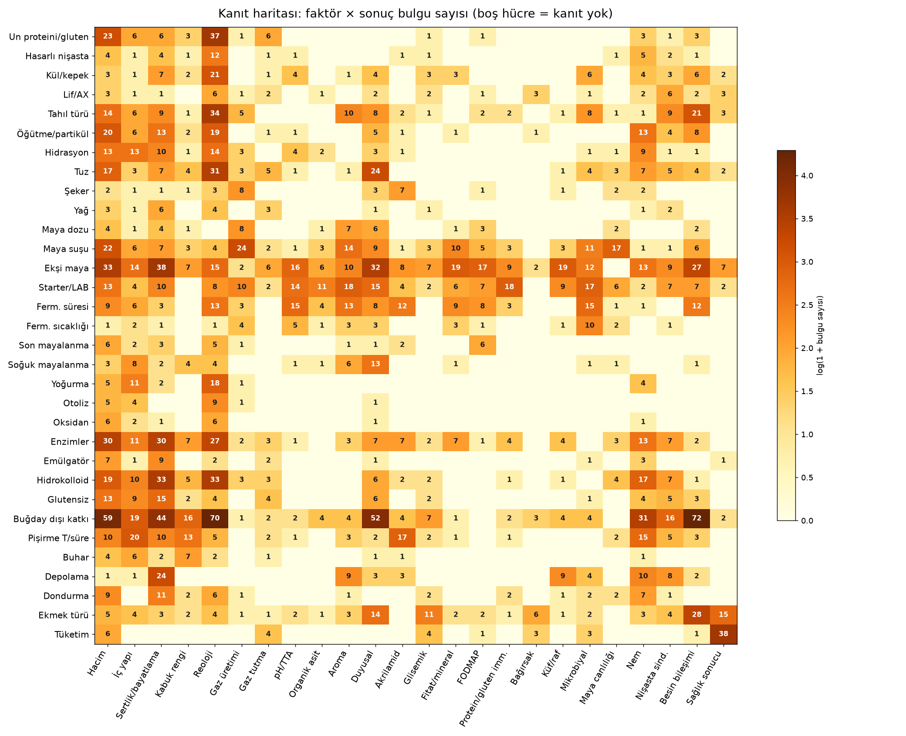

# Ekmek Bilimi Kanıt Sentezi

Makaleler, deneyler ve fırıncı deneyimlerinden simülasyona

Bu rapor **1048 kaynaktan** çıkarılan **3913 yapılandırılmış bulgunun** sistematik sentezidir. Kaynakların 728'i 2020 ve sonrasından. Her uzlaşı maddesi, sayısal değer ve simülasyon kuralı kaynağına bağlantılıdır. Ham veritabanı `veri/kanit_bulgulari.csv` ve `veri/kanit_kaynaklari.csv` dosyalarında; temaların sayısal tabloları, çelişkileri ve simülasyon kuralları `temalar/` klasöründe (tema başına bir dosya).

## Yöntem

| Adım | Ne yapıldı | Çıktı |
|---|---|---|
| 1. Akademik tarama | 15 alanda 106 sorgu | 1.255 benzersiz makale, özeti olan 922'si işlendi |
| 2. Hedefli tarama | Süreç değişkenleri ve Türk ekmekleri için 40 sorgu; açık erişimli dergi siteleri (PMC, MDPI, Frontiers, DergiPark, Springer, Wiley); sonuç bölümleri okundu | 168 makale (36'sı Türkçe) |
| 3. Fırıncı kaynakları | The Fresh Loaf, The Perfect Loaf, King Arthur, Breadtopia, Foodgeek, Reddit, Weekend Bakery vb. | 45 sayfa |
| 4. Bulgu çıkarımı | Her kaynakta faktör → sonuç, yön, sayısal büyüklük, koşul (33 faktör × 26 sonuç kategorisi) | 3.913 bulgu |
| 5. Sentez | 29 tema; uzlaşı (A/B/C), sayısal aralıklar, çelişkiler, simülasyon kuralları, boşluklar | Bu rapor ve ek |

Kanıt gücü: **A** = çok sayıda tutarlı kaynak, derleme veya meta-analiz · **B** = birkaç tutarlı kaynak · **C** = tek veya az kaynak ya da yalnız fırıncı deneyimi.

| Kaynak katmanı | Sayı | | Çalışma tipi | Sayı |
|---|---|---|---|---|
| Akademik (özet) | 835 | | experiment | 762 |
| Akademik (sonuç bölümleri) | 132 | | review | 103 |
| Fırıncı/uygulayıcı | 45 | | practitioner | 49 |
| Türkçe akademik (DergiPark) | 36 | | modelling | 40 |
|  |  | | other | 34 |
|  |  | | clinical_trial | 25 |
|  |  | | observational_epidemiology | 23 |
|  |  | | archaeology_history | 10 |
|  |  | | meta_analysis | 2 |

Haritadaki yoğunluk, araştırmacıların neyi çalıştığını gösterir; neyin önemli olduğunu göstermez. Simülasyonun çekirdeğindeki süreç değişkenleri olan fermantasyon sıcaklığı, soğuk mayalanma, otoliz, yoğurma ve oksidanlar en az kanıtlı satırlar arasında. Buna karşılık 'buğday dışı katkı', 'ekşi maya' ve 'enzim' satırları çok yoğun.

## Ana sentez: 18 ilke

**1. Doğrusal olmayan yanıt kuraldır, istisna değil** (en güçlü dayanak: A)  
Hidrasyon, yoğurma, tuz, ekşi maya oranı, askorbik asit ve katkı oranının neredeyse tüm sonuçlar üzerindeki etkisi optimumlu ya da eşikli. Simülasyonda doğrusal katsayılar yerine çan, doyum veya parçalı fonksiyonlar kullanılmalı. Temalar: T07, T08, T12, T14. Kaynaklar: [Effect of Hydration on 2020](https://pmc.ncbi.nlm.nih.gov/articles/PMC7693925/), [Pre-Saturation of Bran as 2025](https://pmc.ncbi.nlm.nih.gov/articles/PMC12192202/), [Impact of Sourdough from 2024](https://pmc.ncbi.nlm.nih.gov/articles/PMC11275368/), [The entrainment and evolution](https://onlinelibrary.wiley.com/doi/full/10.1002/cche.10699), [Effect of Mixing Time 2015](https://onlinelibrary.wiley.com/doi/10.1094/CCHEM-02-15-0021-R), [Belcar 2021](https://reference-global.com/article/10.2478/aucft-2021-0005) (+15)

**2. Fermantasyon süresi asitliği güvenilir biçimde artırır** (en güçlü dayanak: A)  
Süre uzadıkça pH düşer, TTA ve organik asitler artar. Bu, veritabanındaki en tutarlı süreç bulgularından biri. Temalar: T02. Kaynaklar: [Sourdough Bread Quality: Facts 2024](https://pmc.ncbi.nlm.nih.gov/articles/PMC11241011/), [link.springer.com](https://link.springer.com/content/pdf/10.1007/s00217-024-04560-6.pdf), [Chemical and Nutritional Characterization 2025](https://pmc.ncbi.nlm.nih.gov/articles/PMC12385715/), [Impact of Microbial Leavening 2025](https://pmc.ncbi.nlm.nih.gov/articles/PMC12027146/), [Microbial Analysis Results 2026](https://link.springer.com/article/10.1007/s00217-026-05194-6), [Ancient Wheat Varieties and 2022](https://pmc.ncbi.nlm.nih.gov/articles/PMC9777778/) (+9)

**3. Sıcaklık yanıtı organizmaya özgüdür** (en güçlü dayanak: B)  
Tek bir hamur sıcaklığı optimumu yok. Laktik asit bakterisi, ekşi maya mayası ve ticari maya farklı optimumlara sahip; sıcaklık ekşi maya topluluğunun bileşimini de kaydırır. Temalar: T01, T13. Kaynaklar: [Modeling of Growth of](https://pmc.ncbi.nlm.nih.gov/articles/PMC106434/), [Assessing the bread-leavening ability 2025](https://pmc.ncbi.nlm.nih.gov/articles/PMC12091880/), [weekendbakery.com](https://www.weekendbakery.com/posts/a-few-tips-on-dough-temperature/), [Konami 2026](https://linkinghub.elsevier.com/retrieve/pii/S0167701226003180), [Menezes 2020](https://linkinghub.elsevier.com/retrieve/pii/S0740002019303442), [Harth 2018](https://onlinelibrary.wiley.com/doi/10.1002/fsn3.690) (+2)

**4. Sıcaklık × süre etkileşimi tek katsayıyla modellenemez** (en güçlü dayanak: B)  
Erken ve geç fermantasyon evrelerinde sıcaklıklar arasındaki asitlenme sıralaması değişebilir. Temalar: T02. Kaynaklar: [Dobre 2024](https://www.mdpi.com/2076-3417/14/11/4955), [Sourdough Bread Quality: Facts 2024](https://pmc.ncbi.nlm.nih.gov/articles/PMC11241011/), [A review of sourdough 2021](https://pmc.ncbi.nlm.nih.gov/articles/PMC8117929/), [pmc.ncbi.nlm.nih.gov 2021](https://pmc.ncbi.nlm.nih.gov/articles/PMC8074121/)

**5. Uzun ve ekşi fermantasyon sağlık çıktılarını iyileştirir** (en güçlü dayanak: A)  
FODMAP/fruktan, fitat ve akrilamid düzeyleri uzun veya ekşi mayalı fermantasyonla çoğu sistemde düşüyor. Bunlar veritabanındaki en güçlü (A) sağlık-süreç bağlantıları. Temalar: T17, T21, T22. Kaynaklar: [Fermentation in breadmaking: enhancing 2026](https://www.frontiersin.org/journals/nutrition/articles/10.3389/fnut.2026.1777596/full), [Sourdough Bread Quality: Facts 2024](https://pmc.ncbi.nlm.nih.gov/articles/PMC11241011/), [Impact of Microbial Leavening 2025](https://pmc.ncbi.nlm.nih.gov/articles/PMC12027146/), [pmc.ncbi.nlm.nih.gov 2021](https://pmc.ncbi.nlm.nih.gov/articles/PMC8074121/), [link.springer.com · content ·](https://link.springer.com/content/pdf/10.1007/s00217-020-03537-5.pdf), [Technological Methods for Reducing 2019](https://pmc.ncbi.nlm.nih.gov/articles/PMC6963594/) (+37)

**6. Ekşi mayanın hacme etkisi belirsiz, küfe etkisi net** (en güçlü dayanak: A)  
Ekşi maya küf gelişimini geciktirir (21 kaynak, A). Hacim ve bayatlamaya etkisi ise una, ekşi maya türüne ve oranına göre her iki yönde de olabilir. Temalar: T12, T19. Kaynaklar: [Sourdough-Based Biotechnologies for the 2016](https://pmc.ncbi.nlm.nih.gov/articles/PMC5302394/), [Melini 2018](https://www.mdpi.com/2311-5637/4/1/9), [Impact of Storing Condition 2021](https://pmc.ncbi.nlm.nih.gov/articles/PMC7824337/), [Dan 2024](https://www.tandfonline.com/doi/full/10.1080/10408398.2024.2356256), [Moroni 2011](https://pmc.ncbi.nlm.nih.gov/articles/PMC3231922/), [López‐Malo 2023](https://www.mdpi.com/2311-5637/10/1/7/pdf?version=1703150621) (+34)

**7. Ekşi mayanın kan şekerine etkisi abartılıyor** (en güçlü dayanak: A)  
Ekşi maya bazı ekmeklerde glisemik indeksi veya erken glikoz yanıtını düşürüyor, ama bulgu tutarlı değil. Lif, tam tahıl ve dirençli nişasta çok daha tutarlı biçimde düşürüyor. Temalar: T20, T23. Kaynaklar: [Effects of sourdough and 2026](https://www.frontiersin.org/journals/nutrition/articles/10.3389/fnut.2026.1910648/full), [Effect of lactic acid-rich 2024](https://pmc.ncbi.nlm.nih.gov/articles/PMC11728969/), [Role of lactic acid 2022](https://www.frontiersin.org/journals/microbiology/articles/10.3389/fmicb.2022.969460/full), [Geleneksel Ekşi Mayanın Sağlık](https://dergipark.org.tr/en/download/article-file/1150057), [Fermentation in breadmaking: enhancing 2026](https://www.frontiersin.org/journals/nutrition/articles/10.3389/fnut.2026.1777596/full), [Sourdough Bread Quality: Facts 2024](https://pmc.ncbi.nlm.nih.gov/articles/PMC11241011/) (+7)

**8. Buzdolabı bayatlatır, dondurucu korur** (en güçlü dayanak: A)  
Buzdolabı sıcaklığında nişasta kristalleşmesi hızlanabilir; dondurma tazeliği daha iyi korur. Depolama süresiyle sertleşmenin artması veritabanının en güçlü (A) bulgularından. Temalar: T18. Kaynaklar: [Effect of Storage Conditions](https://onlinelibrary.wiley.com/doi/10.1111/j.1750-3841.2010.01920.x), [ekmek bayatlaması ve bayatlama](https://dergipark.org.tr/en/download/article-file/77876), [ekmek bayatlaması ve bayatlama](https://dergipark.org.tr/en/download/article-file/77897), [Monitoring the Dough Properties, 2024](https://pmc.ncbi.nlm.nih.gov/articles/PMC11083074/), [link.springer.com](https://link.springer.com/content/pdf/10.1007/s00217-024-04560-6.pdf), [The Effect of the 2026](https://www.mdpi.com/2304-8158/15/13/2392) (+6)

**9. Tuz hamuru güçlendirir; orta düzey azaltım fark edilmeyebilir** (en güçlü dayanak: A)  
NaCl hamurun gelişme ve stabilite süresini ve uzamaya direncini artırır, su emmeyi azaltır. Kademeli azaltım tüketici testlerinde çoğu zaman fark edilmemiş. Temalar: T05. Kaynaklar: [Sodium Chloride in Food 2025](https://pmc.ncbi.nlm.nih.gov/articles/PMC12345736/), [Sodium chloride replacement by 2022](https://pmc.ncbi.nlm.nih.gov/articles/PMC9760479/), [A Comprehensive Study on 2020](https://pmc.ncbi.nlm.nih.gov/articles/PMC7404662/), [The Effect of Sodium 2020](https://pmc.ncbi.nlm.nih.gov/articles/PMC7278690/), [Ekmek üretiminde ekşi maya](https://dergipark.org.tr/tr/download/article-file/1162315), [Wheat starch structure–function relationship 2023](https://onlinelibrary.wiley.com/doi/full/10.1111/1541-4337.13147) (+6)

**10. Lif su ister ve hacmi düşürür** (en güçlü dayanak: A)  
Kepek, arabinoksilan ve beta-glukan su gereksinimini artırır. Buğday dışı ikame arttıkça hacim düşer, sertlik artar; duyusal kabul ise orta dozda en iyi sonucu verir. Temalar: T10, T28. Kaynaklar: [Seo 2021](https://www.mdpi.com/2076-3417/11/9/4034), [Bieniek 2023](https://www.mdpi.com/2076-3417/13/4/2282), [Zhang 2012](http://www.academicjournals.org/ajb/abstracts/abs2012/21Feb/Zhang%20et%20al%201.htm), [Jin 2020](https://linkinghub.elsevier.com/retrieve/pii/S073352102030535X), [Sui 2018](https://linkinghub.elsevier.com/retrieve/pii/S0268005X17319896), [Park 2024](http://www.ekosfop.or.kr/archive/view_article?doi=10.11002/fsp.2024.31.4.527) (+29)

**11. Protein miktarı yetmez, gluten kalitesi belirler** (en güçlü dayanak: A)  
Gluten ağı gaz tutmanın temelidir, ama protein yüzdesi tek başına ekmekçilik kalitesini öngörmez. Temalar: T09, T24. Kaynaklar: [Janssen 2021](https://ift.onlinelibrary.wiley.com/doi/10.1111/1541-4337.12761), [The entrainment and evolution](https://onlinelibrary.wiley.com/doi/full/10.1002/cche.10699), [Awulachew](http://www.sciencepublishinggroup.com/journal/paperinfo?journalid=614&doi=10.11648/j.ijfsb.20210604.14), [A Review of Non-gluten 2021](https://opastonline.com/open-access/a-review-of-non-gluten-components-in-gluten-free-bread-characteristics-keep-the-doughs-baking-quality-and-viscoelastic-qualities.pdf), [Cappelli 2020](https://www.mdpi.com/2076-3417/10/18/6559), [Zhang 2018](https://bmcplantbiol.biomedcentral.com/articles/10.1186/s12870-018-1530-z) (+6)

**12. Maya suşu, maya dozu kadar önemlidir** (en güçlü dayanak: A)  
Suşlar gaz üretimini, hacmi ve aromayı belirgin biçimde değiştirir; mikroorganizma seçimi aroma profilinin ana belirleyicisi. Temalar: T04, T27. Kaynaklar: [Comparative Analysis of Bread 2024](https://pmc.ncbi.nlm.nih.gov/articles/PMC11676879/), [onlinelibrary.wiley.com · doi · 2023](https://onlinelibrary.wiley.com/doi/10.1155/2023/8873037), [Yeast Biodiversity in Fermented 2020](https://www.mdpi.com/2076-2607/9/1/47), [Frontiers / Effect of 2019](https://www.frontiersin.org/journals/microbiology/articles/10.3389/fmicb.2019.02113/full), [Assessing the bread-leavening ability 2025](https://pmc.ncbi.nlm.nih.gov/articles/PMC12091880/), [Screening of Lactic Acid 2020](https://pmc.ncbi.nlm.nih.gov/articles/PMC7353608/) (+12)

**13. Soğuk mayalanma yavaşlatır ama durdurmaz** (en güçlü dayanak: B)  
Uzun soğuk bekletmede aşırı mayalanma riski var. Lezzet kazancı süreyle düzenli artmıyor; bazı denemelerde fark yok, çok uzun bekletme kaliteyi düşürmüş. Temalar: T03, T25. Kaynaklar: [thefreshloaf.com](https://www.thefreshloaf.com/node/79362/weak-flour-re-visited), [sourdougharchive.com](https://sourdougharchive.com/sourdough-bulk-fermentation-chart/), [weekendbakery.com](https://www.weekendbakery.com/posts/the-temperature-equation-timing-your-fermentation/), [domson.co.uk](https://domson.co.uk/gb/academy/bread-technology/cold-retarded-fermentation), [scuoladimarco.com](https://scuoladimarco.com/en/sourdough-bread/cold-retard-sourdough/), [thefreshloaf.com](https://www.thefreshloaf.com/node/30978/san-joaquin-sourdough-36-hour-cold-retardation) (+3)

**14. Erken buhar fırın kabarmasını uzatır** (en güçlü dayanak: B)  
Pişirmenin başında buharı somun çevresinde tutmak (buhar ya da kapaklı kap), kuru pişirmeye göre fırın kabarmasını ve kabuk gelişimini destekliyor. Temalar: T16, T25. Kaynaklar: [thefreshloaf.com](https://www.thefreshloaf.com/node/71979/baking-stone-vs-dutch), [thefreshloaf.com](https://www.thefreshloaf.com/node/69081/60-whole-wheat-sourdough), [kingarthurbaking.com](https://www.kingarthurbaking.com/blog/2017/02/28/baking-bread-with-steam), [loafandlevain.com](https://loafandlevain.com/sourdough/dutch-oven-vs-baking-stone/), [en.wikipedia.org](https://en.wikipedia.org/wiki/No-knead_bread), [theperfectloaf.com](https://www.theperfectloaf.com/higher-hydration-sourdough-bread/)

**15. Isı ve kısa süre esmerleşmeyi ve akrilamidi yönetir** (en güçlü dayanak: A)  
Yüksek ısıl maruziyet esmerleşmeyi artırır; daha düşük sıcaklık, optimize pişirme ve asparaginaz akrilamidi azaltır. Temalar: T14, T16, T17. Kaynaklar: [Maillard Reaction in Flour 2025](https://pmc.ncbi.nlm.nih.gov/articles/PMC12345924/), [Development of Rice Cake 2025](https://onlinelibrary.wiley.com/doi/full/10.1002/fsn3.4759), [Kinetics of the crust 2012](https://pmc.ncbi.nlm.nih.gov/articles/PMC4571265/), [Chikpah 2023](https://link.springer.com/10.1007/s44187-023-00041-z), [Impact of selected baking](https://link.springer.com/article/10.1007/s13197-020-04945-x), [Mokhtari 2025](https://onlinelibrary.wiley.com/doi/10.1002/fsn3.4759) (+8)

**16. Enzimler ve askorbik asit hacmi artırır, ama doza duyarlı** (en güçlü dayanak: A)  
Ksilanaz hacmi artırır ve yumuşaklığı iyileştirir; askorbik asit optimum dozu aşınca hacim düşer. Temalar: T14, T26. Kaynaklar: [Gadallah 2025](https://esm.journals.ekb.eg/article_464185.html), [Voučko 2022](http://www.ftb.com.hr/images/InPress/7776-in_press.pdf), [Hu 2024](https://www.mdpi.com/1420-3049/29/8/1895), [Liu 2024](https://pmc.ncbi.nlm.nih.gov/articles/PMC11004072/), [Zhang 2025](https://linkinghub.elsevier.com/retrieve/pii/S0141813025034129), [Zong 2026](https://www.mdpi.com/2304-8158/15/3/486) (+9)

**17. Ekşi maya ekosistemi beslemeyle seçilir** (en güçlü dayanak: A)  
Tekrarlanan besleme, un, sıcaklık ve besleme aralığına bağlı olarak topluluğu yeniden şekillendirir. Starter bir 'parametre' değil, dinamik bir durumdur. Temalar: T13. Kaynaklar: [The role of flour 2025](https://pmc.ncbi.nlm.nih.gov/articles/PMC12772405/), [Microbial dynamics of sourdough](https://link.springer.com/article/10.1007/s00217-026-05195-5), [Tolu 2022](https://www.mdpi.com/2311-5637/8/10/571), [Leroy 2011](https://pmc.ncbi.nlm.nih.gov/articles/PMC3126363/), [Gänzle 2019](https://linkinghub.elsevier.com/retrieve/pii/S0168160518305427), [Oshiro 2019](https://linkinghub.elsevier.com/retrieve/pii/S1389172318311393) (+5)

**18. Antik buğday tek tip değil; tam tahıl uzun vadede koruyucu** (en güçlü dayanak: A)  
Siyez, gernik ve spelt genotipe göre çok farklı davranıyor. Epidemiyolojide tam tahıl tüketimi kalp-damar hastalığı ve ölüm riskinin düşüklüğüyle ilişkili (gözlemsel). Temalar: T11, T23. Kaynaklar: [Techno-Functional Performance of Emmer, 2022](https://pmc.ncbi.nlm.nih.gov/articles/PMC9741205/), [The Effect of Ancient](https://dergipark.org.tr/en/download/article-file/3245839), [Belcar 2021](https://reference-global.com/article/10.2478/aucft-2021-0005), [Valsalan 2025](https://onlinelibrary.wiley.com/doi/10.1002/cche.10865), [Belcar 2020](https://reference-global.com/article/10.2478/aucft-2020-0024), [Mefleh 2022](https://www.mdpi.com/2075-1729/12/10/1613) (+7)

## Simülasyon mimarisine etkileri

| Bulgu | ekmek_sim'de yapılacak değişiklik |
|---|---|
| Yanıtların çoğu optimumlu veya eşikli | Her faktör için `ResponseCurve` tipi: doğrusal, doyum (Monod/Hill), çan (kardinal model), eşik/parçalı. Parametreleri kanıt aralığından al. |
| Sıcaklık × süre etkileşimi | Asit üretimi ve gaz üretimi zamana göre ayrı hız denklemleriyle; sıcaklık yalnızca hız sabitini değiştirsin. Statik 'süre katsayısı' kullanma. |
| Organizmaya özgü sıcaklık optimumları | Maya, ekşi maya mayası ve LAB için ayrı kardinal parametre setleri; suş seçimi bir girdi olsun. |
| Ekşi maya topluluğu beslemeyle değişir | `Starter` nesnesi dinamik: besleme oranı, sıcaklık ve un geçmişinden mikrobiyal bileşim türet. |
| Hacim etkileri una çok bağlı | Hacmi doğrudan katsayıyla değil, gaz üretimi × gaz tutma (gluten kalitesi, lif seyreltmesi, asitlik) üzerinden hesapla. |
| Sağlık çıktıları süreçle güçlü bağlantılı | Fitat, fruktan, akrilamid için mekanistik birinci derece kinetik; GI tahmini için lif ve tane yapısı ekşi mayadan daha büyük ağırlık alsın. |
| Bayatlama depolama sıcaklığıyla çan biçimli | Avrami k(T): buzdolabında maksimum, donmuşta ~0. |
| Kanıtların çoğu koşula bağlı | Monte Carlo + Bayesçi kalibrasyon zorunlu; her çıktı güven aralığıyla raporlanmalı. |
| Az çalışılmış süreç değişkenleri | Otoliz, soğuk mayalanma, yoğurma ve hamur sıcaklığı için kendi deneylerini planla: modelin en belirsiz ama en çok kullanılan girdileri bunlar. |

## Tema bazında uzlaşı

### T01. Fermantasyon/son mayalanma sıcaklığı → gaz üretimi, hacim, mikrobiyal hız

24 kaynak, 34 bulgu. Ayrıntılar `temalar/` altındaki tema dosyasında.

| Güç | Bulgu | Kaynaklar |
|---|---|---|
| B | Sıcaklık optimumu mikroorganizmaya ve suşa özgüdür; verilen örneklerde laktobasil optimumları 32–33 °C, C. milleri optimumu 27 °C, meyve kaynaklı mayaların en iyi büyümesi ise 30 °C olarak bildirilmiştir. | [Modeling of Growth of](https://pmc.ncbi.nlm.nih.gov/articles/PMC106434/), [Assessing the bread-leavening ability 2025](https://pmc.ncbi.nlm.nih.gov/articles/PMC12091880/), [weekendbakery.com](https://www.weekendbakery.com/posts/a-few-tips-on-dough-temperature/) |
| B | Uygun aralıkta daha yüksek sıcaklık fermantasyon hızını ve hamur kabarmasını artırabilir; ancak bu eğilim her sıcaklıkta sürmez ve tek başına tüm hamurlara genellenemez. | [Assessing the bread-leavening ability 2025](https://pmc.ncbi.nlm.nih.gov/articles/PMC12091880/), [thefreshloaf.com](https://www.thefreshloaf.com/node/67943/cold-bulk-experiment-any-tips-and-thoughts-bread-ahead-method), [weekendbakery.com](https://www.weekendbakery.com/posts/the-temperature-equation-timing-your-fermentation/), [thefreshloaf.com](https://www.thefreshloaf.com/node/64462/sourdough-starter-ratios-house-temperature-and-other-stuff) |
| B | Mikrobiyal büyüme ve aktivite sıcaklığa genellikle optimumlu, doğrusal olmayan bir yanıt verir; optimumun üzerindeki sıcaklıkta büyüme veya aktivite azalabilir. | [Modeling of Growth of](https://pmc.ncbi.nlm.nih.gov/articles/PMC106434/), [Assessing the bread-leavening ability 2025](https://pmc.ncbi.nlm.nih.gov/articles/PMC12091880/), [weekendbakery.com](https://www.weekendbakery.com/posts/a-few-tips-on-dough-temperature/) |
| B | Fermantasyon sıcaklığı ekşi hamur topluluk bileşimini etkileyebilir; sıcaklık ve besleme aralığına bağlı olarak farklı bakteriler baskınlaşabilir veya bazı taksonların kalıcılığı değişebilir. | [Konami 2026](https://linkinghub.elsevier.com/retrieve/pii/S0167701226003180), [Menezes 2020](https://linkinghub.elsevier.com/retrieve/pii/S0740002019303442), [Harth 2018](https://onlinelibrary.wiley.com/doi/10.1002/fsn3.690), [Leroy 2011](https://pmc.ncbi.nlm.nih.gov/articles/PMC3126363/) (+1) |
| C | Düşük sıcaklık, özellikle soğukta, maya aktivitesini ve CO₂ üretimini yavaşlatır; aktivite tamamen durmak yerine çok düşük düzeyde sürebilir. | [weekendbakery.com](https://www.weekendbakery.com/posts/a-few-tips-on-dough-temperature/), [domson.co.uk](https://domson.co.uk/gb/academy/bread-technology/cold-retarded-fermentation), [thefreshloaf.com](https://www.thefreshloaf.com/node/67943/cold-bulk-experiment-any-tips-and-thoughts-bread-ahead-method) |
| C | Sıcaklık etkisi yalnızca büyüme hızına değil, metabolit örüntüsüne de yansıyabilir; mevcut bulgularda bu etkinin yönü ve büyüklüğü her zaman verilmemiştir. | [Bavaro 2022](https://www.mdpi.com/2304-8158/11/23/3942/pdf?version=1670394605), [Assessing the bread-leavening ability 2025](https://pmc.ncbi.nlm.nih.gov/articles/PMC12091880/) |
| C | Mayalama ortamının sıcaklık ve nemini kontrol etmek, bazı sistemlerde daha eşit kabarma veya daha fazla hacim genişlemesiyle ilişkilidir; bildirilen çalışmalar kontrollü cihaz ve belirli hamur koşullarıyla sınırlıdır. | [Yousefi-Darani 2019](https://linkinghub.elsevier.com/retrieve/pii/S0960308518305236), [Hidayati 2025](https://publikasidev.dinus.ac.id/technoc/article/view/14831), [Ullah 2018](http://ejournal.uin-suska.ac.id/index.php/IJAIDM/article/view/5664) |
| C | Yüksek hamur sıcaklığında proteaz etkinliğinin hızlanması gluten yapısını zayıflatabilir; daha sıcak son mayalama ile daha kısa somun bildiren fırıncı denemesi ise kontrollü olmadığından tek başına nedensel kanıt değildir. | [sourdougharchive.com](https://sourdougharchive.com/sourdough-bulk-fermentation-chart/), [thefreshloaf.com](https://www.thefreshloaf.com/node/79782/cold-retard-enriched-doughs) |

Kanıt boşlukları: Birçok bulguda oda sıcaklığı, başlangıç sıcaklığı veya karşılaştırma koşulu sayısal olarak verilmemiştir. · Hamur hacmi, CO₂ üretim hızı ve sıcaklık arasında aynı hamur ve starter kullanılarak yapılmış kapsamlı doz-yanıt eğrileri azdır. · Organizma bazındaki optimumlar ve sıcaklık üst sınırları sınırlı suş/ortam koşullarından gelmektedir; farklı un, hidrasyon ve ekşi hamurlara genellenebilirlik belirsizdir. · Sıcaklık etkisinin gaz üretimi ile gaz tutma, gluten zayıflaması ve proteaz etkinliği arasındaki payları nicel olarak ayrıştırılmamıştır.

### T02. Sıcaklık, süre ve ekşi maya → organik asitler, pH, TTA, laktik/asetik oranı

62 kaynak, 80 bulgu. Ayrıntılar `temalar/` altındaki tema dosyasında.

| Güç | Bulgu | Kaynaklar |
|---|---|---|
| A | Fermantasyon süresinin uzaması çoğu ekşi hamur ve hamur sisteminde pH’ın düşmesiyle; TTA veya ölçülen organik asitlerin artmasıyla ilişkilidir. | [Sourdough Bread Quality: Facts 2024](https://pmc.ncbi.nlm.nih.gov/articles/PMC11241011/), [link.springer.com](https://link.springer.com/content/pdf/10.1007/s00217-024-04560-6.pdf), [Chemical and Nutritional Characterization 2025](https://pmc.ncbi.nlm.nih.gov/articles/PMC12385715/), [Impact of Microbial Leavening 2025](https://pmc.ncbi.nlm.nih.gov/articles/PMC12027146/) (+7) |
| A | Ekşi maya oranını artırmak genellikle ekmek veya hamur pH’ını düşürür ve TTA/asitliği yükseltir; yan ürün, un ve ekşi maya formülasyonu gibi özellikler bu ilişkiyi değiştirebilir. | [link.springer.com](https://link.springer.com/content/pdf/10.1007/s00217-024-04560-6.pdf), [Effect of Sourdough Made 2025](https://onlinelibrary.wiley.com/doi/10.1155/jfpp/6662199?msockid=30cb0ba9990468483e131c4a988b6925), [Ekmek üretiminde ekşi maya](https://dergipark.org.tr/tr/download/article-file/1162315), [Ekşi Hamur Katkısının Beyaz](https://dergipark.org.tr/en/download/article-file/34173) (+2) |
| B | Daha yüksek fermantasyon sıcaklığı bazı sistemlerde asitlenmeyi hızlandırabilir; ancak sıcaklığın etkisi süreye ve sisteme bağlıdır ve her zaman daha düşük son pH anlamına gelmez. | [A review of sourdough 2021](https://pmc.ncbi.nlm.nih.gov/articles/PMC8117929/), [Sourdough Bread Quality: Facts 2024](https://pmc.ncbi.nlm.nih.gov/articles/PMC11241011/), [pmc.ncbi.nlm.nih.gov 2021](https://pmc.ncbi.nlm.nih.gov/articles/PMC8074121/), [Dobre 2024](https://www.mdpi.com/2076-3417/14/11/4955) |
| B | pH ve TTA çoğu fermantasyon bulgusunda ters yönde değişir; ancak birbirlerinin tam karşılığı değildir ve bazı formülasyonlarda biri değişirken diğeri anlamlı değişmeyebilir. | [Microbial dynamics of sourdough](https://link.springer.com/article/10.1007/s00217-026-05195-5), [3.2. Fermentation Kinetics 2025](https://pmc.ncbi.nlm.nih.gov/articles/PMC12241443/), [Impact of Sunflower (Helianthus 2025](https://www.mdpi.com/2076-3417/16/1/461), [Frontiers / The Quality 2021](https://www.frontiersin.org/journals/microbiology/articles/10.3389/fmicb.2021.652548/full) (+1) |
| B | Başlatıcı suşu veya mikrobiyal topluluk, asitlenme hızını ve üretilen asit profilini etkileyebilir; laktik ve asetik asidin aynı yönde değişmesi zorunlu değildir. | [Mixed Culture of Yeast 2024](https://pmc.ncbi.nlm.nih.gov/articles/PMC11722544/), [Review on physical properties 2023](https://www.frontiersin.org/journals/food-science-and-technology/articles/10.3389/frfst.2023.1331245/full), [Fermentation in breadmaking: enhancing 2026](https://www.frontiersin.org/journals/nutrition/articles/10.3389/fnut.2026.1777596/full), [Technological characteristics of sodium 2022](https://onlinelibrary.wiley.com/doi/full/10.1002/fsn3.2917) |
| B | Fermantasyon ve yenileme ilerledikçe pH düşebilir ve TTA artabilir; bununla birlikte olgun ekşi hamurda bazı ölçütler yenileme zamanına kadar kararlı kalabilir. | [Microbial dynamics of sourdough](https://link.springer.com/article/10.1007/s00217-026-05195-5), [Harth 2018](https://onlinelibrary.wiley.com/doi/10.1002/fsn3.690), [Carbó 2019](https://journals.sagepub.com/doi/10.1177/1082013219895357) |
| B | Fermantasyon süresi ve sıcaklığının etkisi doğrusal olmak zorunda değildir: erken ve geç fermantasyon evrelerinde sıcaklıklar arasındaki asitlenme sıralaması değişebilir ve bazı çalışmalarda optimal süre bildirilmiştir. | [Dobre 2024](https://www.mdpi.com/2076-3417/14/11/4955), [Sourdough Bread Quality: Facts 2024](https://pmc.ncbi.nlm.nih.gov/articles/PMC11241011/) |
| C | Hamur verimi/hidrasyon, asit üretimini değiştirebilen bir moderatördür; bir çalışmada DY’nin %200’den %300’e çıkarılması laktik asit ve bakteri sayısını düşürmüştür, ancak bu yön tüm sistemlere genellenemez. | [Enhancing the quality of 2025](https://pmc.ncbi.nlm.nih.gov/articles/PMC12280017/), [Wyk 2026](https://analyticalsciencejournals.onlinelibrary.wiley.com/doi/10.1002/cem.70153) |
| C | Soğuk koşullarda da asitlenme görülebilir; ancak mevcut bulgular soğuk fermantasyonun sıcak fermantasyona göre asit üretimini ne ölçüde değiştirdiğini ortak bir büyüklükle belirlemiyor. | [Impact of Sunflower (Helianthus 2025](https://www.mdpi.com/2076-3417/16/1/461), [thefreshloaf.com](https://www.thefreshloaf.com/node/66175/commercial-yeast-retardation-flavor) |

Kanıt boşlukları: Aynı un, starter, hamur verimi ve fermantasyon süresinde farklı sıcaklıkları karşılaştıran; pH, TTA, laktik asit ve asetik asidi birlikte ölçen çalışmalar sınırlı görünmektedir. · Derleme sıcaklık sınıfları (>30 °C ve 4–15 °C) için ortak sayısal etki büyüklüğü bildirmemektedir; kaynaklar arası karşılaştırma için standartlaştırılmış sonuçlar yoktur. · Fermantasyon süresi ve sıcaklığının etkileşimini tanımlayacak ortak zaman serileri ve tekrarlanabilir kinetik parametreler sağlanmamıştır. · pH ile TTA arasındaki ayrışmayı açıklamak veya simüle etmek için matris tamponlama kapasitesi ve organik asit türlerinin eşzamanlı ölçümleri çoğu satırda verilmemiştir.

### T03. Fermantasyon süresi ve soğuk mayalanma → aroma ve duyusal

69 kaynak, 103 bulgu. Ayrıntılar `temalar/` altındaki tema dosyasında.

| Güç | Bulgu | Kaynaklar |
|---|---|---|
| B | Fermantasyon süresinin uzaması bazı ekmek sistemlerinde aroma bileşiklerini ve aroma karmaşıklığını artırabilir; ancak etkinin yönü ve büyüklüğü ürün formülüne, mikroorganizmalara, sıcaklığa ve süre aralığına bağlıdır. | [Role of lactic acid 2022](https://www.frontiersin.org/journals/microbiology/articles/10.3389/fmicb.2022.969460/full), [Characterization of the key 2021](https://link.springer.com/article/10.1186/s13065-021-00743-4), [Effect of fermentation conditions](https://link.springer.com/article/10.1007/s00217-023-04325-7), [Multi-Omics and Chemometric Analysis 2026](https://pmc.ncbi.nlm.nih.gov/articles/PMC12939421/) |
| B | Uzun veya soğuk fermantasyon, uçucu bileşik profilini değiştirebilir; bu değişim her bileşik sınıfında aynı yönde gerçekleşmez. | [Investigation of in situ 2024](https://pmc.ncbi.nlm.nih.gov/articles/PMC11525620/), [Characterization of the key 2021](https://link.springer.com/article/10.1186/s13065-021-00743-4), [Volatile Compounds in Crumb 2016](https://onlinelibrary.wiley.com/doi/full/10.1094/CCHEM-09-14-0196-R), [Sanmartín 2025](https://www.mdpi.com/2304-8158/14/10/1677) |
| B | Soğuk fermantasyon bazı koşullarda aroma yoğunluğunu ve kavrulmuş, bisküvimsi, maltımsı, isli veya tereyağımsı notaları artırabilir; bildirilen duyusal sonuçlar çoğunlukla belirli ürün ve koşullara özgüdür. | [Characterization of the key 2021](https://link.springer.com/article/10.1186/s13065-021-00743-4), [Rai 2021](http://lex-localis.org/index.php/LexLocalis/article/view/802659), [thefreshloaf.com](https://www.thefreshloaf.com/node/41149/sourdough-country-loaves-long-cold-fermentation-vs-long-cold-proof) |
| B | Daha uzun fermantasyon veya soğuk bekletme her zaman daha iyi duyusal sonuç vermez: bazı karşılaştırmalarda süreyi uzatmak belirgin fark yaratmamış, bazılarında ise daha uzun süreli ürün daha az beğenilmiştir. | [thefreshloaf.com](https://www.thefreshloaf.com/node/30978/san-joaquin-sourdough-36-hour-cold-retardation), [thefreshloaf.com](https://www.thefreshloaf.com/node/68856/baguette-retard-length-testing), [thefreshloaf.com](https://www.thefreshloaf.com/node/66175/commercial-yeast-retardation-flavor), [Investigation of in situ 2024](https://pmc.ncbi.nlm.nih.gov/articles/PMC11525620/) |
| B | Fermantasyon sıcaklığı aroma profilini değiştirebilir; sıcaklık değişimi farklı uçucu bileşik gruplarını öne çıkarabildiğinden, tek bir genel 'aroma artışı' yönü varsayılmamalıdır. | [Volatile Compounds in Crumb 2016](https://onlinelibrary.wiley.com/doi/full/10.1094/CCHEM-09-14-0196-R), [Potent aromatic compounds in](https://link.springer.com/article/10.1007/BF01192996), [weekendbakery.com](https://www.weekendbakery.com/posts/the-temperature-equation-timing-your-fermentation/) |
| C | Bazı buğday ekmeği çalışmalarında uzun fermantasyon maya metabolizması kaynaklı aromaları artırırken, mayalı ekmekte kabuk Maillard aromalarının oluşumunu sınırlayabilmiştir; ekşi mayalı ekmekte ise Maillard ve LAB kaynaklı aromaların desteklendiği bildirilmiştir. | [Effect of fermentation conditions](https://link.springer.com/article/10.1007/s00217-023-04325-7) |
| C | Fermantasyon süresi ile ekşilik arasındaki ilişki tutarlı değildir: bazı fırıncı anlatılarında daha uzun soğuk bekletme daha ekşi tatla ilişkilendirilirken, başka anlatılarda 24 saatin ötesinde belirgin artış görülmemiştir. | [thefreshloaf.com](https://www.thefreshloaf.com/node/30978/san-joaquin-sourdough-36-hour-cold-retardation), [weekendbakery.com](https://www.weekendbakery.com/posts/the-temperature-equation-timing-your-fermentation/), [scuoladimarco.com](https://scuoladimarco.com/en/sourdough-bread/cold-retard-sourdough/), [pantrymama.com](https://pantrymama.com/sourdough-experiments/) |
| C | Süre etkisini değerlendirmek için sıcaklık, maya/ekşi maya miktarı ve fermantasyon aşaması sabitlenmelidir; bazı uygulama karşılaştırmalarında bu değişkenler birlikte değiştiği için süreye özgü etki ayrılamamıştır. | [reddit.com](https://www.reddit.com/r/Sourdough/comments/190ixtb/sourness_sourdough_experiment_1_temperature_and/), [kicchow.me](https://kicchow.me/news-ploetzblog-lange-fuehrung-time-flavor/) |

Kanıt boşlukları: Aynı formül ve mikroorganizma sistemi içinde, sıcaklık ve inokülasyon sabit tutularak süreyi kademeli değiştiren kontrollü çalışmalar azdır. · Aroma bileşiklerinin sayısal konsantrasyonları ile duyusal yoğunluk ve tüketici kabulünü aynı deneyde ilişkilendiren veriler eksiktir. · Uzun soğuk fermantasyon için karşılaştırılabilir sıcaklık-süre matrisleri ve tekrarlı ölçümler sağlanmamıştır. · Farklı ekmek türlerinde (buğday, çavdar, glutensiz ve buharda pişmiş ürünler) süre etkisini karşılaştırmaya yetecek ortak protokoller yoktur.

### T04. Maya dozu ve suşu → gaz üretimi, hacim, aroma

86 kaynak, 223 bulgu. Ayrıntılar `temalar/` altındaki tema dosyasında.

| Güç | Bulgu | Kaynaklar |
|---|---|---|
| B | Maya suşu, hamurda gaz üretimini ve kabartma performansını; dolayısıyla hamur veya ekmek hacmini belirgin biçimde değiştirebilir. Ancak suş sıralaması un matriksine ve ölçüm koşullarına göre değişir. | [Comparative Analysis of Bread 2024](https://pmc.ncbi.nlm.nih.gov/articles/PMC11676879/), [onlinelibrary.wiley.com · doi · 2023](https://onlinelibrary.wiley.com/doi/10.1155/2023/8873037), [Yeast Biodiversity in Fermented 2020](https://www.mdpi.com/2076-2607/9/1/47), [Frontiers / Effect of 2019](https://www.frontiersin.org/journals/microbiology/articles/10.3389/fmicb.2019.02113/full) (+5) |
| B | Daha yüksek CO₂ üretimi genellikle daha fazla hacim/kabarma ile ilişkilidir; bununla birlikte son hacim yalnızca gaz miktarına değil, gazın hamurda tutulmasına ve salım zamanlamasına da bağlıdır. | [Yeast Biodiversity in Fermented 2020](https://www.mdpi.com/2076-2607/9/1/47), [Frontiers / Effect of 2019](https://www.frontiersin.org/journals/microbiology/articles/10.3389/fmicb.2019.02113/full), [Vandenbosch 2026](https://linkinghub.elsevier.com/retrieve/pii/S266592712600273X), [Bautil 2022](https://www.mdpi.com/2304-8158/11/10/1388/pdf?version=1652841412) (+1) |
| B | Suşlar aroma ve uçucu bileşik profillerinde farklılık oluşturabilir; hangi suşun üstün olduğu bileşik türüne ve ürüne bağlıdır, genel bir aroma üstünlüğü çıkarılamaz. | [Organoleptic Analysis of Doughs 2008](https://pmc.ncbi.nlm.nih.gov/articles/PMC2593049/), [Frontiers / Effect of 2019](https://www.frontiersin.org/journals/microbiology/articles/10.3389/fmicb.2019.02113/full), [Mixed Culture of Yeast 2024](https://pmc.ncbi.nlm.nih.gov/articles/PMC11722544/), [Timmermans 2023](https://www.mdpi.com/2304-8158/12/4/830) (+4) |
| B | Alternatif veya geleneksel olmayan mayalar kimi çalışmalarda tatmin edici kabartma ve farklı/tercih edilen aroma sağlamıştır; fakat kabartma performansı ticari S. cerevisiae ile eşdeğer olmak zorunda değildir. | [Yeast Biodiversity in Fermented 2020](https://www.mdpi.com/2076-2607/9/1/47), [Vandenbosch 2026](https://linkinghub.elsevier.com/retrieve/pii/S266592712600273X), [Picozzi 2022](https://www.mdpi.com/2304-8158/11/18/2768), [Aslankoohi 2016](https://dx.plos.org/10.1371/journal.pone.0165126) (+2) |
| B | Suş ve maya dozundaki değişiklikler ekmek içi yapısı, sertlik ve duyusal özelliklerde de farklılık yaratabilir; bu sonuçların yönü tutarlı değildir ve ürün formülasyonuna bağlıdır. | [Comparative Analysis of Bread 2024](https://pmc.ncbi.nlm.nih.gov/articles/PMC11676879/), [onlinelibrary.wiley.com · doi · 2023](https://onlinelibrary.wiley.com/doi/10.1155/2023/8873037), [Vandenbosch 2026](https://linkinghub.elsevier.com/retrieve/pii/S2590157526008837), [Fukushima 2026](https://www.mdpi.com/2076-3417/16/10/4679) (+1) |
| C | Maya dozunu veya inokulum düzeyini artırmak bazı koşullarda daha hızlı kabarma ya da daha yüksek maya kaynaklı uçucu bileşik oluşumuyla ilişkilidir; doz etkisinin büyüklüğü ve duyusal sonucu ürün ve fermantasyon koşullarına bağlıdır. | [kingarthurbaking.com](https://www.kingarthurbaking.com/blog/2022/01/13/adding-yeast-to-your-sourdough-bread), [sourdougharchive.com](https://sourdougharchive.com/sourdough-bulk-fermentation-chart/), [theperfectloaf.com](https://www.theperfectloaf.com/hybrid-dough/), [Kim 2026](https://linkinghub.elsevier.com/retrieve/pii/S0963996926021460) |
| C | Fermantasyon sıcaklığı, süresi ve hamur bileşimi maya suşu veya dozunun gözlenen etkisini değiştirebilir; bazı aroma bileşenlerinde maya düzeyi ile sıcaklık arasında etkileşim bildirilmiştir. | [Volatile Compounds in Crumb 2016](https://onlinelibrary.wiley.com/doi/full/10.1094/CCHEM-09-14-0196-R), [Mixed Culture of Yeast 2024](https://pmc.ncbi.nlm.nih.gov/articles/PMC11722544/), [Timmermans 2023](https://www.mdpi.com/2304-8158/12/4/830) |
| C | Fırıncı deneyimi kaynakları, ekşi mayalı hamura ticari maya eklemenin kabarmayı hızlandırabildiğini; daha uzun fermantasyonla birlikte düşük doz kullanımının ise lezzet nüanslarını etkileyebileceğini bildiriyor. Bu gözlemler deneysel kanıtlarla aynı ağırlıkta değerlendirilmemelidir. | [kingarthurbaking.com](https://www.kingarthurbaking.com/blog/2022/01/13/adding-yeast-to-your-sourdough-bread), [theperfectloaf.com](https://www.theperfectloaf.com/hybrid-dough/), [kicchow.me](https://kicchow.me/news-ploetzblog-lange-fuehrung-time-flavor/), [sourdougharchive.com](https://sourdougharchive.com/sourdough-bulk-fermentation-chart/) |

Kanıt boşlukları: Aynı un, formülasyon, sıcaklık ve ölçüm yöntemi altında maya dozu ile suşun faktöriyel olarak birlikte karşılaştırıldığı nicel çalışmalar azdır. · Farklı deney düzeneklerindeki CO₂ hızı, toplam CO₂, hamur hacmi, fırın kabarması ve son somun hacmini ortak ölçekte karşılaştırmak mümkün değildir. · Doz-cevap eğrilerinin optimum, eşik veya plato noktalarını belirleyecek yeterli veri çoğu kaynakta verilmemiştir. · Aroma sonuçlarında bileşiklerin tepe alanları ve duyusal yoğunlukları çoğu satırda sayısal olarak bulunmamaktadır; toplam uçucu bileşik sayısı aroma üstünlüğü anlamına gelmez.

### T05. Tuz → maya aktivitesi, reoloji, hacim, duyusal

44 kaynak, 132 bulgu. Ayrıntılar `temalar/` altındaki tema dosyasında.

| Güç | Bulgu | Kaynaklar |
|---|---|---|
| A | NaCl genellikle buğday hamurunu güçlendirir: gelişme ve stabilite süreleri, uzamaya karşı direnç ve/veya elastik modüller artabilir; yumuşama azalabilir. Etkinin büyüklüğü un çeşidine, tuz düzeyine ve işleme koşullarına bağlıdır. | [Sodium Chloride in Food 2025](https://pmc.ncbi.nlm.nih.gov/articles/PMC12345736/), [Sodium chloride replacement by 2022](https://pmc.ncbi.nlm.nih.gov/articles/PMC9760479/), [A Comprehensive Study on 2020](https://pmc.ncbi.nlm.nih.gov/articles/PMC7404662/), [The Effect of Sodium 2020](https://pmc.ncbi.nlm.nih.gov/articles/PMC7278690/) (+3) |
| A | Kademeli veya orta düzey tuz azaltımı bazı tüketici çalışmalarında duyusal olarak fark edilmemiş ya da kabul edilebilir bulunmuştur; daha büyük azaltımlarda algı ve kabul sonucu ürün ve test koşullarına göre değişebilir. | [Strategies to Reduce Salt 2022](https://pmc.ncbi.nlm.nih.gov/articles/PMC9564303/), [Ati 2021](https://www.mdpi.com/1660-4601/18/4/1590), [Jessen 2022](https://www.mdpi.com/2304-8158/11/3/454), [Bernabé-Ortiz 2015](https://pmc.ncbi.nlm.nih.gov/articles/PMC10271060/) (+2) |
| B | NaCl azaltımı veya tamamen kaldırılması çoğu hamur sisteminde hamur gücünü ve karıştırma stabilitesini düşürebilir; yapışkanlığı ve su absorbsiyonunu artırabilir. Ancak yanıt un çeşidine ve formülasyona göre değişebilir. | [Wheat starch structure–function relationship 2023](https://onlinelibrary.wiley.com/doi/full/10.1111/1541-4337.13147), [Sodium chloride replacement by 2022](https://pmc.ncbi.nlm.nih.gov/articles/PMC9760479/), [Effect of Salt Reduction 2017](https://onlinelibrary.wiley.com/doi/10.1094/CCHEM-02-17-0026-R), [Sodium Chloride in Food 2025](https://pmc.ncbi.nlm.nih.gov/articles/PMC12345736/) (+1) |
| B | Tuz düzeyi maya fermantasyonunu ve hamurun kabarmasını etkiler; daha yüksek tuz bazı çalışmalarda gaz üretimini veya maksimum hamur yüksekliğini azaltırken, tuz azaltımı bazı hamurlarda fermantasyon hacmini artırmıştır. Etki ürüne ve ölçüm koşuluna bağlıdır. | [The entrainment and evolution](https://onlinelibrary.wiley.com/doi/full/10.1002/cche.10699), [A Comprehensive Study on 2020](https://pmc.ncbi.nlm.nih.gov/articles/PMC7404662/), [Effects of Sodium Reduction 2026](https://pmc.ncbi.nlm.nih.gov/articles/PMC13147307/), [Modeling of Growth of](https://pmc.ncbi.nlm.nih.gov/articles/PMC106434/) (+1) |
| B | Tuz azaltımının somun veya ürün hacmine etkisi tek yönlü ve genellenebilir değildir: bazı ekmeklerde hacim azalırken, bazı formülasyonlarda tuz miktarıyla hacim arasında negatif ilişki veya belirli bir tuz düzeyinde optimum bildirilmiştir. | [Sodium chloride replacement by 2022](https://pmc.ncbi.nlm.nih.gov/articles/PMC9760479/), [Effect of Salt Reduction 2017](https://onlinelibrary.wiley.com/doi/10.1094/CCHEM-02-17-0026-R), [Impact of NaCl reduction](https://www.frontiersin.org/journals/nutrition/articles/10.3389/fnut.2025.1657034/pdf), [pmc.ncbi.nlm.nih.gov 2025](https://pmc.ncbi.nlm.nih.gov/articles/PMC12497575/) (+2) |
| B | NaCl'nin KCl ile kısmen veya tamamen değiştirilmesi bazı ekmeklerde hacim, tekstür veya duyusal kabulü koruyabilir; başka sistemlerde yüksek ikame düzeyleri reolojik ya da hacimsel farklılıklarla ilişkilidir. | [Sodium chloride replacement by 2022](https://pmc.ncbi.nlm.nih.gov/articles/PMC9760479/), [Impact of NaCl reduction](https://www.frontiersin.org/journals/nutrition/articles/10.3389/fnut.2025.1657034/pdf), [pmc.ncbi.nlm.nih.gov 2025](https://pmc.ncbi.nlm.nih.gov/articles/PMC12497575/), [Technological characteristics of sodium 2022](https://onlinelibrary.wiley.com/doi/full/10.1002/fsn3.2917) |
| B | NaCl düzeyi farinograf su absorbsiyonunu çoğunlukla düşürür; tuzun azaltılması veya kaldırılması bazı deneylerde absorbsiyonu artırmıştır. Bu sonuç, tuz düzeyi ve ölçüm sistemine bağlı bir reoloji etkisi olarak ele alınmalıdır. | [Sodium Chloride in Food 2025](https://pmc.ncbi.nlm.nih.gov/articles/PMC12345736/), [Sodium chloride replacement by 2022](https://pmc.ncbi.nlm.nih.gov/articles/PMC9760479/), [A Comprehensive Study on 2020](https://pmc.ncbi.nlm.nih.gov/articles/PMC7404662/), [The Effect of Sodium 2020](https://pmc.ncbi.nlm.nih.gov/articles/PMC7278690/) |
| C | Tuz partikül boyutu veya kapsüllenmiş tuzun hamur içindeki dağılımı, tuz düzeyi azaltılırken algılanan tuzluluğun korunmasına yardımcı olabilir. | [Strategies to Reduce Salt 2022](https://pmc.ncbi.nlm.nih.gov/articles/PMC9564303/) |

Kanıt boşlukları: Birçok satır etki yönü veriyor ancak varyans, örneklem büyüklüğü veya karşılaştırmalar arası standartlaştırılabilir etki büyüklüğü vermiyor. · Tuz yüzdesinin bazı çalışmalarda un ağırlığına, bazılarında ürün veya formülasyon ağırlığına göre verildiği açık değil; bu durum sayısal birleştirmeyi sınırlar. · Aynı un ve aynı proses içinde birden fazla tuz düzeyini karşılaştırıp reoloji, fermantasyon, hacim ve duyusal sonuçları birlikte ölçen çalışma sayısı sınırlı. · Tuz azaltımının maya aktivitesine doğrudan etkisi ile hamur reolojisi ve gaz tutma üzerinden dolaylı etkisini ayıran nicel veriler yetersiz.

### T06. Şeker ve yağ → fermantasyon, hacim, bayatlama

28 kaynak, 64 bulgu. Ayrıntılar `temalar/` altındaki tema dosyasında.

| Güç | Bulgu | Kaynaklar |
|---|---|---|
| B | Şeker ilavesinin fermantasyon ve gaz üretimine etkisi doz ve hamur sistemine bağlıdır: bazı koşullarda ilave şeker CO₂ üretimini veya somun hacmini artırırken, yüksek sakkaroz düzeylerinde fermantasyon ve ürün yüksekliği azalabilir. | [Sugar Levels Determine Fermentation 2022](https://pmc.ncbi.nlm.nih.gov/articles/PMC9140867/), [Laurent 2020](https://linkinghub.elsevier.com/retrieve/pii/S0168160520301422), [Rahman 2023](https://linkinghub.elsevier.com/retrieve/pii/S0141813023000521), [Technological and Nutritional Aspects 2024](https://pmc.ncbi.nlm.nih.gov/articles/PMC11241233/) |
| B | Yüksek sakkaroz/şeker koşulları ozmotik stresle ilişkili olabilir ve maya fermantasyonunu baskılayabilir; etkinin büyüklüğü maya suşu ve hamur koşullarına bağlıdır. | [Technological and Nutritional Aspects 2024](https://pmc.ncbi.nlm.nih.gov/articles/PMC11241233/), [Sugar Levels Determine Fermentation 2022](https://pmc.ncbi.nlm.nih.gov/articles/PMC9140867/), [Glycerol Production by Fermenting 2015](https://pmc.ncbi.nlm.nih.gov/articles/PMC4357469/) |
| B | Sakkaroz, uygun starter ve fermantasyon koşullarında LAB kaynaklı glukan/EPS üretimini destekleyebilir; bildirilen sonuçlar sakkaroz varlığı, pH ve hamur matrisiyle koşulludur. | [Role of lactic acid 2022](https://www.frontiersin.org/journals/microbiology/articles/10.3389/fmicb.2022.969460/full), [Metabolism Characteristics of Lactic 2021](https://www.frontiersin.org/journals/bioengineering-and-biotechnology/articles/10.3389/fbioe.2021.612285/full) |
| B | Lipitler ekmek kalitesini gaz tutma kapasitesi ve gaz hücrelerinin stabilitesi üzerinden etkileyebilir; etki lipit kaynağına ve fiziksel/kimyasal özelliklerine bağlıdır. | [Melis 2020](https://ift.onlinelibrary.wiley.com/doi/10.1111/1541-4337.12616), [Cauvain](https://linkinghub.elsevier.com/retrieve/pii/B9780081025192000062), [Ma 2025](https://www.mdpi.com/2304-8158/14/9/1505), [Zhao 2025](https://linkinghub.elsevier.com/retrieve/pii/S0141813025062440) |
| B | Bazı yağ veya yağ benzeri katkılar ekmek yumuşaklığını artırabilir ya da depolama sonrası sertliği azaltabilir; bildirilen etkiler katkı türüne ve ürüne özgüdür. | [ekmek bayatlaması ve bayatlama](https://dergipark.org.tr/en/download/article-file/77876), [Ma 2025](https://www.mdpi.com/2304-8158/14/9/1505), [Kasai 2016](http://maxwellsci.com/jp/mspabstract.php?jid=AJFST&doi=ajfst.12.3060), [Zhao 2025](https://linkinghub.elsevier.com/retrieve/pii/S0141813025062440) |
| C | Mayalı pastry hamurunda sakkarozun fermantasyona etkisi doğrusal değildir; incelenen düzeyler arasında CO₂ üretimi %7’de en yüksek, %21’de ise en düşüktür. | [Sugar Levels Determine Fermentation 2022](https://pmc.ncbi.nlm.nih.gov/articles/PMC9140867/) |
| C | Sakkaroz düzeyini artırmak her ekşi hamur sisteminde EPS verimini artırmaz: bazı yalancı tahıl sistemlerinde yüksek düzeyler EPS verimini ve molekül ağırlığını düşürürken dallanma bağlarını artırmıştır. | [Woo 2025](https://linkinghub.elsevier.com/retrieve/pii/S0963996925018617) |
| C | Şeker türü, ekmek kabuğundaki akrilamid düzeyini değiştirebilir; indirgen ve indirgen olmayan şekerlerin etkileri aynı değildir. | [Effect of added sugars](https://onlinelibrary.wiley.com/doi/am-pdf/10.1002/cche.10154), [Seyedzadeh-Hashemi 2025](https://linkinghub.elsevier.com/retrieve/pii/S0308814625044164) |

Kanıt boşlukları: Tatlı ekmekte sakkaroz düzeyine karşı maya gaz üretimini ölçen, özellikle yüksek düzeyleri kapsayan sayısal doz-cevap verisi sınırlıdır. · Farklı maya suşları için sakkaroz/şeker düzeyi, su aktivitesi ve fermantasyon kapasitesini birlikte ölçen karşılaştırmalı veriler eksiktir. · EPS sonuçlarında starter türü, pH, substrat matrisi ve şeker düzeyinin bağımsız ve etkileşimli etkilerini ayıran nicel veriler yetersizdir. · Birçok lipit ve yağ katkısı için somun hacmi, gaz tutma kapasitesi, sertlik ve bayatlama etkilerinin sayısal büyüklükleri verilmemiştir.

### T07. Hidrasyon → reoloji, hacim, iç yapı

45 kaynak, 90 bulgu. Ayrıntılar `temalar/` altındaki tema dosyasında.

| Güç | Bulgu | Kaynaklar |
|---|---|---|
| A | Hidrasyonun özgül hacme etkisi çoğu formülasyonda doğrusal değildir: su artışı belirli bir düzeye kadar hacmi artırabilir, ancak optimumun aşılması hacmi düşürebilir veya hamur biçimini/ölçülebilirliğini bozabilir. | [Effect of Hydration on 2020](https://pmc.ncbi.nlm.nih.gov/articles/PMC7693925/), [Pre-Saturation of Bran as 2025](https://pmc.ncbi.nlm.nih.gov/articles/PMC12192202/), [Impact of Sourdough from 2024](https://pmc.ncbi.nlm.nih.gov/articles/PMC11275368/) |
| A | Daha yüksek su düzeyi çoğu bildirilen sistemde hamur veya iç doku sertliğini/kıvamını azaltır; bu eğilim özellikle glutensiz hamurlarda geri ekstrüzyon ölçümlerinde belirgindir. | [Fermentation Kinetics of Gluten-Free 2023](https://pmc.ncbi.nlm.nih.gov/articles/PMC10177808/), [Pre-Saturation of Bran as 2025](https://pmc.ncbi.nlm.nih.gov/articles/PMC12192202/), [Impact of Sourdough from 2024](https://pmc.ncbi.nlm.nih.gov/articles/PMC11275368/), [Wu 2025](https://www.mdpi.com/2304-8158/14/12/2071) |
| A | Optimum su düzeyi un/nişasta türüne, katkıya ve su absorpsiyon kapasitesine bağlıdır; farklı sistemlerde bildirilen optimumlar belirgin biçimde farklıdır. | [Effect of Hydration on 2020](https://pmc.ncbi.nlm.nih.gov/articles/PMC7693925/), [Impact of Sourdough from 2024](https://pmc.ncbi.nlm.nih.gov/articles/PMC11275368/), [Fermentation Kinetics of Gluten-Free 2023](https://pmc.ncbi.nlm.nih.gov/articles/PMC10177808/) |
| B | Hidrasyon artışı birçok ekmek sisteminde daha açık ve gözenekli iç yapıyla ilişkilidir; ancak bu, somun yüksekliği veya fırın yayı artışı anlamına gelmeyebilir. | [Santos 2021](https://linkinghub.elsevier.com/retrieve/pii/S1878450X21001335), [breadtopia.com](https://breadtopia.com/no-knead-whole-wheat-sourdough-hydration-comparison/), [breadtopia.com](https://breadtopia.com/sourdough-technique-experiment-no-knead-vs-the-works/) |
| B | Su düzeyi arttıkça ekmek içi neminin artabildiği bildirilmiştir; kanıt hem deneysel kontrol ekmeği hem de fırıncı karşılaştırmasını içerir. | [Chestnut peels and wheat](https://link.springer.com/article/10.1007/s00217-022-03959-3), [breadtopia.com](https://breadtopia.com/no-knead-whole-wheat-sourdough-hydration-comparison/) |
| B | Hidrasyonun reolojiye etkisi ölçülen özelliğe ve sisteme bağlıdır: kepek ön hidrasyonu hamur kıvamını düşürürken gelişme süresini uzatmış; glutensiz hamurlarda su düzeyi geri ekstrüzyon reolojisini belirgin biçimde değiştirmiştir. | [Pre-Saturation of Bran as 2025](https://pmc.ncbi.nlm.nih.gov/articles/PMC12192202/), [Impact of Sourdough from 2024](https://pmc.ncbi.nlm.nih.gov/articles/PMC11275368/) |
| B | Belirli bir optimum hidrasyonda ekmek içi yaylanırlığı, kohezyon veya genel doku iyileşebilir; bu bulgular bütün su aralığı boyunca sürekli iyileşme olarak yorumlanmamalıdır. | [Wheat starch structure–function relationship 2023](https://onlinelibrary.wiley.com/doi/full/10.1111/1541-4337.13147), [Pre-Saturation of Bran as 2025](https://pmc.ncbi.nlm.nih.gov/articles/PMC12192202/), [Wu 2025](https://www.mdpi.com/2304-8158/14/12/2071) |
| C | Fırıncı gözlemlerinde daha yüksek hidrasyon daha açık iç yapı ile birlikte daha düşük somun yüksekliği/fırın yayıyla ilişkilendirilmiştir; bu, yüksekliğin hidrasyona tepkisinin iç gözeneklilikten farklı olabileceğini gösterir. | [breadtopia.com](https://breadtopia.com/no-knead-whole-wheat-sourdough-hydration-comparison/), [breadtopia.com](https://breadtopia.com/sourdough-technique-experiment-no-knead-vs-the-works/) |
| C | Yüksek hidrasyon gluten hareketliliğini ve mekanik kuvvete duyarlılığı artırabilir; bu gözlemler belirli yoğurmasız hamurlar veya yoğurma koşullarıyla sınırlıdır. | [en.wikipedia.org](https://en.wikipedia.org/wiki/No-knead_bread), [Li 2022](https://pmc.ncbi.nlm.nih.gov/articles/PMC9532874/) |

Kanıt boşlukları: Birçok çalışmada hidrasyon düzeyleri arasında sonuçların sayısal büyüklüğü, belirsizliği veya istatistiksel karşılaştırması verilmemiştir. · Su yüzdesinin hesabında kullanılan baz çalışmalara göre değiştiği için farklı sistemlerdeki optimumlar doğrudan karşılaştırılamaz. · Hidrasyon ile gözeneklilik, kabarcık büyümesi ve somun yüksekliği arasındaki mekanistik bağlantıyı aynı deneyde ölçen veri sınırlıdır. · Un protein kalitesi, gluten özellikleri ve su absorpsiyon kapasitesine göre hidrasyon-yanıt eğrilerinin parametreleri yeterince raporlanmamıştır.

### T08. Yoğurma ve otoliz → gluten gelişimi, hacim

29 kaynak, 69 bulgu. Ayrıntılar `temalar/` altındaki tema dosyasında.

| Güç | Bulgu | Kaynaklar |
|---|---|---|
| B | Karıştırma süresi ile hamur veya ürün performansı arasında her koşulda doğrusal bir ilişki yoktur; yetersiz karıştırmadan optimuma geçiş yarar sağlayabilirken, optimumun ötesinde karıştırma somun hacmini ve hamur yapısını olumsuz etkileyebilir. | [The entrainment and evolution](https://onlinelibrary.wiley.com/doi/full/10.1002/cche.10699), [Effect of Mixing Time 2015](https://onlinelibrary.wiley.com/doi/10.1094/CCHEM-02-15-0021-R), [Belcar 2021](https://reference-global.com/article/10.2478/aucft-2021-0005), [Chen 2021](https://www.mdpi.com/1420-3049/26/3/541/pdf) (+1) |
| B | Aşırı karıştırma bazı buğday hamuru koşullarında gaz tutulumunu ve somun hacmini zayıflatabilir; karıştırmayı tepe noktasından sonra sürdürmek test edilen unlarda hacmi düşürmüştür. | [The entrainment and evolution](https://onlinelibrary.wiley.com/doi/full/10.1002/cche.10699), [Effect of Mixing Time 2015](https://onlinelibrary.wiley.com/doi/10.1094/CCHEM-02-15-0021-R), [Chen 2021](https://www.mdpi.com/1420-3049/26/3/541/pdf), [theperfectloaf.com](https://www.theperfectloaf.com/higher-hydration-sourdough-bread/) |
| B | Otoliz, hamurun uzayabilirliğini artırabilir ve olgunlaşma için gereken mekanik karıştırma veya yoğurma süresini azaltabilir. | [theperfectloaf.com](https://www.theperfectloaf.com/guides/how-to-autolyse/comment-page-1/), [kingarthurbaking.com](https://www.kingarthurbaking.com/blog/2017/09/29/autolyse-sourdough) |
| B | Otolizin gereğinden uzun sürmesi, özellikle enzim etkinliğinin yüksek olabileceği unlarda, hamurun aşırı gevşemesine veya zayıflamasına yol açabilir. | [theperfectloaf.com](https://www.theperfectloaf.com/guides/how-to-autolyse/comment-page-1/), [fermentician.com](https://fermentician.com/2024/08/a-computational-approach-to-perfecting-your-baguette-recipe/) |
| B | Fermantasyon sırasındaki germe-katlama hamur kuvvetini ve gluten ağının gelişimini destekleyebilir; yoğurmasız yöntemde yeterli katlama, bazı koşullarda yoğurmaya alternatif olabilir. | [sourdougharchive.com](https://sourdougharchive.com/sourdough-bulk-fermentation-chart/), [kingarthurbaking.com](https://www.kingarthurbaking.com/blog/2019/07/22/bulk-fermentation), [chainbaker.com](https://www.chainbaker.com/folding-vs-kneading/), [bakewithjack.co.uk](https://www.bakewithjack.co.uk/blog-1/2018/1/28/the-theory-of-no-knead-bread) (+1) |
| B | Karıştırma hızı, süresi, iş girdisi ve mikser basıncı gibi işlem koşulları hamur boşluk oranı veya gluten içermeyen ekmeğin hacim ve dokusunu etkileyebilir; yön ve büyüklük ürün türüne ve koşullara bağlıdır. | [The entrainment and evolution](https://onlinelibrary.wiley.com/doi/full/10.1002/cche.10699), [link.springer.com 2022](https://link.springer.com/article/10.1007/s44187-022-00012-w) |
| B | Karıştırma ve otoliz sonuçları unun protein özellikleri, un türü, hidrasyon, ekipman ve değerlendirilen sonuca bağlıdır; farklı ürün ve yöntemlerden gelen bulgular tek bir evrensel optimuma indirgenemez. | [Kim 2022](https://pmc.ncbi.nlm.nih.gov/articles/PMC9653986/), [Effect of Mixing Time 2015](https://onlinelibrary.wiley.com/doi/10.1094/CCHEM-02-15-0021-R), [breadtopia.com](https://breadtopia.com/sourdough-technique-experiment-no-knead-vs-the-works/), [foodgeek.io](https://foodgeek.io/en/showdown-which-sourdough-kneading-method-will-make-you-proud/) |
| C | Katlamanın veya hamuru çalıştırmanın gereğinden fazla sürdürülmesi bazı uygulamalarda daha yoğun ve daha az açık iç doku ile ilişkilendirilmiştir; hamur yeterli kuvvete ulaştığında ek işlemin yararı sınırlı olabilir. | [theperfectloaf.com](https://www.theperfectloaf.com/higher-hydration-sourdough-bread/), [thefreshloaf.com](https://www.thefreshloaf.com/node/79362/weak-flour-re-visited) |
| C | Uzun fermantasyon, yoğurma yapılmayan yöntemde hamurun gluten ağının gelişmesi için kullanılabilir; ancak bu bulgu genel bir fermantasyon süresi kuralı olarak değerlendirilmemelidir. | [en.wikipedia.org](https://en.wikipedia.org/wiki/No-knead_bread) |

Kanıt boşlukları: Birçok kaynakta un türü, hidrasyon ve mikser koşulları arasında karşılaştırılabilir standart ölçümler yoktur; evrensel karıştırma süresi çıkarılamaz. · Derlemedeki 1, 2,5 ve 7 dakika karşılaştırmasının ayrıntılı un, hidrasyon ve ekipman bilgileri sağlanan satırda yoktur. · Karıştırma hızı, iş girdisi ve hazne basıncının boşluk oranına etkileri için sayısal katsayı veya belirsizlik aralığı verilmemiştir. · Otolizin süreye bağlı yarar ve zarar eğrisini, farklı unlar için sayısal eşiklerle tanımlayacak karşılaştırmalı veri eksiktir.

### T09. Un proteini ve gluten kalitesi → reoloji ve hacim

53 kaynak, 116 bulgu. Ayrıntılar `temalar/` altındaki tema dosyasında.

| Güç | Bulgu | Kaynaklar |
|---|---|---|
| A | Gluten ağı, buğday hamurunda fermantasyon gazının tutulmasına ve gaz hücrelerinin stabilize edilmesine katkı sağlar; glutenin yokluğu gaz tutmayı ve hamur reolojisini zayıflatır. | [Janssen 2021](https://ift.onlinelibrary.wiley.com/doi/10.1111/1541-4337.12761), [The entrainment and evolution](https://onlinelibrary.wiley.com/doi/full/10.1002/cche.10699), [Awulachew](http://www.sciencepublishinggroup.com/journal/paperinfo?journalid=614&doi=10.11648/j.ijfsb.20210604.14), [A Review of Non-gluten 2021](https://opastonline.com/open-access/a-review-of-non-gluten-components-in-gluten-free-bread-characteristics-keep-the-doughs-baking-quality-and-viscoelastic-qualities.pdf) (+1) |
| B | Buğday unu örnekleri içinde protein içeriği, somun hacmiyle genellikle pozitif ilişkilidir; ancak bildirilen ilişkiler korelasyondur ve un türüne göre değişebilir. | [Prediction models to evaluate](https://onlinelibrary.wiley.com/doi/full/10.1002/cche.10772), [Prediction models to evaluate 2024](https://onlinelibrary.wiley.com/doi/10.1002/cche.10772), [Hermans 2024](https://pubs.acs.org/doi/10.1021/acs.jafc.4c06550) |
| B | Vital buğday gluteni eklenmesi çoğu buğday ekmeği bağlamında hacmi artırabilir; etki un matrisi, ürün türü ve gluten dozuna bağlıdır ve her tahıl sisteminde görülmez. | [pmc.ncbi.nlm.nih.gov 2016](https://pmc.ncbi.nlm.nih.gov/articles/PMC5224582/), [Combined Effects of Particle 2023](https://pmc.ncbi.nlm.nih.gov/articles/PMC10340551/), [GIDA THE JOURNAL OF](https://dergipark.org.tr/tr/download/article-file/1386140) |
| B | Vital gluten, incelenen formülasyonlarda çoğunlukla hamur reolojisini güçlendirmiş; su absorpsiyonu, gelişme süresi veya stabiliteyi artırıp yumuşamayı azaltabilmiştir. | [pmc.ncbi.nlm.nih.gov 2016](https://pmc.ncbi.nlm.nih.gov/articles/PMC5224582/), [Abd-El-Khalek 2020](https://svuijas.journals.ekb.eg/article_118559.html), [Li 2023](https://www.mdpi.com/2304-8158/12/19/3607) |
| B | Un kuvveti ile hacim arasındaki ilişki evrensel değildir: bazı buğday unu çalışmalarında daha kuvvetli un daha yüksek hacimle ilişkilendirilirken, bazı kışlık buğday sonuçlarında düşük gluten gücü en yüksek hacimlerle ilişkilendirilmiştir. | [The entrainment and evolution](https://onlinelibrary.wiley.com/doi/full/10.1002/cche.10699), [onlinelibrary.wiley.com · doi · 2001](https://onlinelibrary.wiley.com/doi/abs/10.1094/CCHEM.2001.78.1.1), [Prediction models to evaluate](https://onlinelibrary.wiley.com/doi/full/10.1002/cche.10772), [Prediction models to evaluate 2024](https://onlinelibrary.wiley.com/doi/10.1002/cche.10772) |
| B | Gluten ilavesinin etkisi dozla doğrusal olmak zorunda değildir; optimum veya eşik dozlar ürün ve un türüne göre değişebilir, ayrıca bazı sistemlerde doz artışı hacmi anlamlı biçimde artırmayabilir. | [pmc.ncbi.nlm.nih.gov 2016](https://pmc.ncbi.nlm.nih.gov/articles/PMC5224582/), [Jiang 2023](https://linkinghub.elsevier.com/retrieve/pii/S0308814623019362) |
| B | Daha yüksek protein veya gluten içeriği bazı çalışmalarda su absorpsiyonu ve su ihtiyacının artmasıyla birlikte bildirilmiştir; bu nedenle hidrasyon, hacim ve reoloji etkilerinin yorumlanmasında önemli bir koşuldur. | [Al-Saleh 2012](https://www.mdpi.com/2304-8158/1/1/3/pdf), [Chakraborty 2025](https://onlinelibrary.wiley.com/doi/10.1111/jfpe.70154) |
| B | Protein miktarı tek başına gluten işlevselliğini veya ekmekçilik kalitesini belirlemez; gluten alt birimleri ve gluten gücüyle ilgili farklılıklar hamur özelliklerini ve uygun kullanım amacını değiştirebilir. | [Zhang 2018](https://bmcplantbiol.biomedcentral.com/articles/10.1186/s12870-018-1530-z), [Ma 2020](https://scijournals.onlinelibrary.wiley.com/doi/10.1002/jsfa.10423), [Ma 2026](https://scijournals.onlinelibrary.wiley.com/doi/10.1002/jsfa.70860), [Orlovskaya 2024](https://elpub.vir.nw.ru/jour/article/view/1874) (+1) |
| B | Gluten ilavesi bazı sistemlerde somun hacmi dışında ekmek içi yapısını, sertliği veya pişirme kaybını da etkileyebilir; bu ikincil kalite etkilerinin yönü ve büyüklüğü her çalışmada aynı değildir. | [pmc.ncbi.nlm.nih.gov 2016](https://pmc.ncbi.nlm.nih.gov/articles/PMC5224582/), [Combined Effects of Particle 2023](https://pmc.ncbi.nlm.nih.gov/articles/PMC10340551/), [onlinelibrary.wiley.com · doi · 2001](https://onlinelibrary.wiley.com/doi/abs/10.1094/CCHEM.2001.78.1.1), [GIDA THE JOURNAL OF](https://dergipark.org.tr/tr/download/article-file/1386140) (+1) |

Kanıt boşlukları: Protein ve gluten için birim miktar başına somun hacmi değişimini veren ortak, karşılaştırılabilir doz-yanıt verileri yetersizdir; korelasyon katsayıları nedensel eğim değildir. · Un kuvveti, protein miktarı, gluten miktarı ve gluten kalitesinin bağımsız katkılarını aynı deney tasarımında ayıran çalışmalar sınırlıdır. · Gluten ilavesinin gaz hücresi oluşumu ve stabilizasyonuna etkisi çoğunlukla nitel bildirilmiştir; gaz hücresi dinamiğiyle hacmi bağlayan nicel parametreler eksiktir. · Farklı un sınıfları, tahıl türleri, öğütme fraksiyonları ve proseslerin aynı standart koşullarda karşılaştırıldığı veri azdır.

### T10. Hasarlı nişasta, kül/randıman, kepek, lif, partikül boyutu

112 kaynak, 281 bulgu. Ayrıntılar `temalar/` altındaki tema dosyasında.

| Güç | Bulgu | Kaynaklar |
|---|---|---|
| A | Kepek, arabinoksilan ve beta-glukan gibi lif/NSP bileşenlerinin eklenmesi çoğunlukla su tutma veya hamur su kaldırma gereksinimini artırır; lif türü ve parçacık özellikleri sonucu değiştirebilir. | [Seo 2021](https://www.mdpi.com/2076-3417/11/9/4034), [Bieniek 2023](https://www.mdpi.com/2076-3417/13/4/2282), [Zhang 2012](http://www.academicjournals.org/ajb/abstracts/abs2012/21Feb/Zhang%20et%20al%201.htm), [Jin 2020](https://linkinghub.elsevier.com/retrieve/pii/S073352102030535X) (+3) |
| A | Partikül boyutunun ekmek hacmi ve dokusu üzerindeki etkisi evrensel olarak tek yönlü değildir: bazı tam buğday ve kepek sistemlerinde daha ince parçacıklar hacmi artırıp ekmeği yumuşatırken, başka sistemlerde hacmi düşürüp sertliği artırabilir. | [link.springer.com 2022](https://link.springer.com/article/10.1007/s44187-022-00012-w), [Combined Effects of Particle 2023](https://pmc.ncbi.nlm.nih.gov/articles/PMC10340551/), [Navrotskyi 2019](https://linkinghub.elsevier.com/retrieve/pii/S0733521019301985), [Pang 2021](https://onlinelibrary.wiley.com/doi/10.1002/fsn3.2008) (+3) |
| B | Hasarlı nişasta arttıkça un/hamur su absorbsiyonu genellikle artar. | [Jukič 2019](http://nuft.edu.ua/doi/doc/ufj/2019/3/8.pdf), [Meleshkina 2023](https://www.vestnik-vsuet.ru/vguit/article/view/3303), [Raj 2023](https://www.mdpi.com/2304-8158/12/10/2078) |
| B | Hasarlı nişastanın artması, yüksek düzeylerde ekmek kalitesini olumsuz etkileyebilir: hacim düşebilir, iç sertliği ve kabuk koyuluğu artabilir. Etki un ve ürün koşullarına bağlıdır. | [Jukič 2019](http://nuft.edu.ua/doi/doc/ufj/2019/3/8.pdf), [León 2016](https://pmc.ncbi.nlm.nih.gov/articles/PMC5147690/), [Sourdough Bread Quality: Facts 2024](https://pmc.ncbi.nlm.nih.gov/articles/PMC11241011/), [Wheat starch structure–function relationship 2023](https://onlinelibrary.wiley.com/doi/full/10.1111/1541-4337.13147) |
| B | Daha ince öğütme veya fraksiyonlama, bazı buğday unlarında hasarlı nişastayı artırır; bunun büyüklüğü ve ekmek performansına yansıması öğütme yöntemi ile ürüne bağlıdır. | [Pang 2021](https://onlinelibrary.wiley.com/doi/10.1002/fsn3.2008), [Inamdar 2014](https://pmc.ncbi.nlm.nih.gov/articles/PMC4252461/) |
| B | Kepek veya lif ilavesi besinsel bileşenleri artırabilir; ancak yüksek ikame ya da belirli glutensiz formülasyonlarda hacim ve bazı hamur/ekmek kalite ölçütleri düşebilir. | [Park 2024](http://www.ekosfop.or.kr/archive/view_article?doi=10.11002/fsp.2024.31.4.527), [Föste 2020](https://linkinghub.elsevier.com/retrieve/pii/S0308814619315663), [Seo 2021](https://www.mdpi.com/2076-3417/11/9/4034), [Jin 2020](https://linkinghub.elsevier.com/retrieve/pii/S073352102030535X) (+1) |
| B | Partikül boyutu veya parçacık fraksiyonu için ürün ve hammaddeye özgü optimum bulunabilir; orta boyutlu buğday unu buharda pişmiş ekmekte en iyi kaliteyi verirken farklı tam buğday sistemlerinde daha ince veya daha iri kepek avantaj sağlayabilmiştir. | [Pang 2021](https://onlinelibrary.wiley.com/doi/10.1002/fsn3.2008), [Combined Effects of Particle 2023](https://pmc.ncbi.nlm.nih.gov/articles/PMC10340551/), [Huang 2021](https://www.mdpi.com/2304-8158/10/10/2413), [Steel 2019](https://pmc.ncbi.nlm.nih.gov/articles/PMC7016051/) |
| B | Kepek/lifin işlevsel etkileri yalnız parçacık boyutuna bağlı değildir: tür, çözünürlük, ön işlem, ikame oranı ve ürünün gluten/hamur yapısı sonucu değiştirebilir. | [Atzler 2021](https://link.springer.com/10.1007/s00217-021-03762-6), [Jin 2020](https://linkinghub.elsevier.com/retrieve/pii/S073352102030535X), [Sui 2018](https://linkinghub.elsevier.com/retrieve/pii/S0268005X17319896), [Pietiäinen 2024](https://www.mdpi.com/2304-8158/13/15/2309) (+2) |
| B | Tam tahıl veya kepek içeriğinin artması besinsel bileşenleri artırabilir; buna karşılık bazı ekmeklerde hacim azalması ve daha sert doku görülür. | [Park 2024](http://www.ekosfop.or.kr/archive/view_article?doi=10.11002/fsp.2024.31.4.527), [Francisco 2014](https://www.scielo.br/j/bjps/a/t5mP3cqDJRXFRSbgJsw6fqS/?format=pdf&lang=en), [Technological Methods for Reducing 2019](https://pmc.ncbi.nlm.nih.gov/articles/PMC6963594/), [Technological methods for reducing](https://link.springer.com/article/10.1007/s00217-020-03537-5) (+1) |

Kanıt boşlukları: Hasarlı nişasta ölçüm birimleri ve yöntemleri çalışmalar arasında uyumlaştırılmamıştır; yüzde, UCD ve diğer ölçümler için dönüşüm verisi yoktur. · Hasarlı nişasta ile hacim, sertlik ve su absorbsiyonu arasındaki doz-yanıtı belirleyecek aynı un ve aynı proses içinde yapılmış geniş aralıklı karşılaştırmalar sınırlıdır. · Yaklaşık %8 ve >%12 değerlerinin farklı un türleri, ekmek prosesleri ve kalite hedeflerinde ne ölçüde genellenebileceği belirsizdir. · Partikül boyutu çalışmalarında un/kepek bileşimi, dağılım genişliği, öğütme kaynaklı hasar ve hidrasyon çoğu zaman birlikte değişmektedir; nedensel ayrıştırma yetersizdir.

### T11. Tahıl türü ve çeşidi (antik buğdaylar, çavdar, durum)

73 kaynak, 173 bulgu. Ayrıntılar `temalar/` altındaki tema dosyasında.

| Güç | Bulgu | Kaynaklar |
|---|---|---|
| A | Antik buğday türleri ve çeşitleri ekmekçilik bakımından tek tip değildir; hamur işleme toleransı, somun hacmi, sertlik ve iç yapı tür ve genotipe göre değişir. Bu nedenle antik buğdaylar için yaygın buğdaya göre tek yönlü bir kalite etkisi genellenemez. | [Techno-Functional Performance of Emmer, 2022](https://pmc.ncbi.nlm.nih.gov/articles/PMC9741205/), [The Effect of Ancient](https://dergipark.org.tr/en/download/article-file/3245839), [Belcar 2021](https://reference-global.com/article/10.2478/aucft-2021-0005), [Valsalan 2025](https://onlinelibrary.wiley.com/doi/10.1002/cche.10865) (+4) |
| A | Tahıl türü ve çeşidi somun hacmini ve ekmek sertliğini etkileyebilir, ancak etkinin yönü genotipe bağlıdır: bazı einkorn araştırmalarında hacim düşerken belirli kavılca ve buğday genotiplerinde yüksek hacim veya düşük sertlik bildirilmiştir. | [Techno-Functional Performance of Emmer, 2022](https://pmc.ncbi.nlm.nih.gov/articles/PMC9741205/), [The Effect of Ancient](https://dergipark.org.tr/en/download/article-file/3245839), [Quality, Nutritional Properties, and 2023](https://pmc.ncbi.nlm.nih.gov/articles/PMC10529405/), [Valsalan 2025](https://onlinelibrary.wiley.com/doi/10.1002/cche.10865) (+2) |
| A | Buğday çeşidi ve yetiştirme çevresi protein, gluten, sedimentasyon, tane sertliği ve hamur karıştırma özelliklerinde farklılık yaratır; genotip × çevre etkileşimi de kalite ve verim sonuçlarını değiştirebilir. | [biga koşullarında yetiştirilen farklı](https://dergipark.org.tr/tr/download/article-file/18185), [Microsoft Word - 01](https://dergipark.org.tr/tr/download/article-file/19879), [Bazı Ekmeklik Buğday (Triticum](https://dergipark.org.tr/en/download/article-file/262804), [Ekmeklik Buğday (Triticum aestivum 2023](https://dergipark.org.tr/tr/pub/jist/article/1358515) (+4) |
| B | Einkorn ve emmer hamurları bazı çalışmalarda yaygın buğdaya kıyasla mekanik işlemeye veya uzun fermantasyona daha az tolerans göstermiş; bazı einkorn çeşitlerinde zayıf fermantasyon ve düşük ekmek kalitesi bildirilmiştir. Bununla birlikte çeşit ve formülasyon sonuçları değişebilir. | [Belcar 2021](https://reference-global.com/article/10.2478/aucft-2021-0005), [Belcar 2020](https://reference-global.com/article/10.2478/aucft-2020-0024), [Mefleh 2022](https://www.mdpi.com/2075-1729/12/10/1613), [Techno-Functional Performance of Emmer, 2022](https://pmc.ncbi.nlm.nih.gov/articles/PMC9741205/) |
| B | Spelt, yaygın buğdaydan daha yüksek ortalama protein içerebilse de gluten kuvveti daha düşük olabilir; buna rağmen bir genotip karşılaştırmasında pişirme testi sonuçları benzer bulunmuştur. Protein düzeyi tek başına ekmekçilik performansını belirlemez. | [Huertas-García 2023](https://www.mdpi.com/2304-8158/12/16/2996) |
| B | Islah ve çeşit yenilenmesi kaliteyi her ölçütte aynı yönde değiştirmeyebilir: bazı kaynaklar yeni çeşitlerin verim ve kaliteye katkısını bildirirken, tarihsel eğilimlerde somun hacmi veya protein düşüşleri de raporlanmıştır. | [Ekmeklik buğdayda kalite Quality](https://dergipark.org.tr/tr/download/article-file/236141), [Laidig 2016](http://link.springer.com/10.1007/s00122-016-2810-3), [Bentley 2023](https://onlinelibrary.wiley.com/doi/pdfdirect/10.1002/tpg2.20326), [Ekmeklik Buğday (Triticum aestivum 2023](https://dergipark.org.tr/tr/pub/jist/article/1358515) |
| B | Çimlendirilmiş tam buğday unu ekmek içi yumuşaklığını veya kabuk esmerleşmesini artırabilir; sonuçlar çimlendirme koşullarına ve formülasyona bağlıdır. Derleme, olumsuz etkileri sınırlamak için daha kısa çimlendirme, düşük ikame veya vital buğday gluteni seçeneklerini belirtmiştir. | [link.springer.com 2022](https://link.springer.com/article/10.1007/s44187-022-00012-w), [Table 4. 2025](https://pmc.ncbi.nlm.nih.gov/articles/PMC12385715/table/foods-14-02805-t004/) |
| B | Yüksek amilozlu buğday unu dirençli nişastayı artırabilir; ancak ekmek hacmi düşüşü, daha yoğun iç yapı ve daha yüksek sertlik gibi kalite ödünleşmeleri de bildirilmiştir. | [Li](https://linkinghub.elsevier.com/retrieve/pii/S0268005X2100597X) |
| C | Durum unu eklenmesi hamur direncini artırabilir; Tırnaklı ekmeği çalışmasında duyusal görünüş puanı %20 durum unu düzeyinde en yüksek bulunmuştur. Bu sonuçlar belirli ürün ve işlem koşullarına bağlıdır. | [GIDA THE JOURNAL OF](https://dergipark.org.tr/en/download/article-file/1094856) |

Kanıt boşlukları: Antik tür ve çeşitlerin aynı un ekstraksiyonu, hidrasyon, fermantasyon ve pişirme koşullarında doğrudan karşılaştırıldığı çalışma sayısı sınırlıdır. · Birçok kaynakta yön bildirilmiş, ancak ekmek hacmi, sertlik ve tüketici kabulü için etki büyüklükleri veya belirsizlik ölçüleri verilmemiştir. · Einkorn için bildirilen %65,12 optimum oranının hangi formülasyon ve işlem koşullarında geçerli olduğu açık değildir. · Çimlendirme süresi ve sıcaklığının ikame oranıyla etkileşimini ve depolama boyunca yumuşaklık değişimini birlikte değerlendiren nicel veriler yetersizdir.

### T12. Ekşi maya kullanımı → hacim, sertlik, raf ömrü, duyusal

83 kaynak, 164 bulgu. Ayrıntılar `temalar/` altındaki tema dosyasında.

| Güç | Bulgu | Kaynaklar |
|---|---|---|
| A | Ekşi maya özgül hacmi artırabilir veya azaltabilir; yön ve büyüklük un türüne, ekşi maya türü ve oranına ve üretim yöntemine bağlıdır. Bu nedenle tek bir genel hacim etkisi desteklenmiyor. | [Sourdough Bread Quality: Facts 2024](https://pmc.ncbi.nlm.nih.gov/articles/PMC11241011/), [Techno-Functional Performance of Emmer, 2022](https://pmc.ncbi.nlm.nih.gov/articles/PMC9741205/), [Impact of Microbial Leavening 2025](https://pmc.ncbi.nlm.nih.gov/articles/PMC12027146/), [3.3. Colorimetric Parameters 2022](https://pmc.ncbi.nlm.nih.gov/articles/PMC9455473/) (+11) |
| A | Ekşi maya bazı formülasyonlarda ekmek sertliğini ve depolama sırasında bayatlama hızını düşürür; ancak artan ekşi maya oranı veya belirli ekşi maya türleri sertliği yükseltebilir. | [Techno-Functional Performance of Emmer, 2022](https://pmc.ncbi.nlm.nih.gov/articles/PMC9741205/), [link.springer.com](https://link.springer.com/content/pdf/10.1007/s00217-024-04560-6.pdf), [Chemical and Nutritional Characterization 2025](https://pmc.ncbi.nlm.nih.gov/articles/PMC12385715/), [Enhancing the quality of 2025](https://pmc.ncbi.nlm.nih.gov/articles/PMC12280017/) (+10) |
| A | Ekşi maya ve bazı fermente ön hamurlar raf ömrünü uzatabilir; raporlanan mekanizmalar küf/maya gelişiminin baskılanması ve bayatlama ya da doku kaybının yavaşlamasıdır. Etki her formülasyonda garanti değildir. | [Melini 2018](https://www.mdpi.com/2311-5637/4/1/9), [Leveraging Natural Fermentation: A 2026](https://onlinelibrary.wiley.com/doi/10.1155/jfpp/6012531), [Enhancing the quality of 2025](https://pmc.ncbi.nlm.nih.gov/articles/PMC12280017/), [Geleneksel Ekşi Mayanın Sağlık](https://dergipark.org.tr/en/download/article-file/1150057) (+11) |
| B | Duyusal kabul ekşi maya kullanımıyla iyileşebilir, fakat yanıt doğrusal değildir: bazı çalışmalarda orta veya düşük oranlar daha iyi sonuç verirken yüksek oranlar kabulü düşürmüştür. | [Sourdough Biotechnology Applied to 2021](https://pmc.ncbi.nlm.nih.gov/articles/PMC8304676/), [Ekmek üretiminde ekşi maya](https://dergipark.org.tr/tr/download/article-file/1162315), [Enhancing the quality of 2025](https://www.nature.com/articles/s41598-025-11872-4), [Effect of Sourdough Made 2025](https://onlinelibrary.wiley.com/doi/10.1155/jfpp/6662199?msockid=30cb0ba9990468483e131c4a988b6925) (+3) |
| B | Glutensiz ekmeklerde ekşi maya bazı pirinç, mısır, kinoa ve karabuğday formülasyonlarında hacim, doku veya kabulü iyileştirebilir; sonuçlar kullanılan un ve starter kombinasyonuna özgüdür. | [Enhancing the quality of 2025](https://pmc.ncbi.nlm.nih.gov/articles/PMC12280017/), [Effect of Sourdough Made 2025](https://onlinelibrary.wiley.com/doi/10.1155/jfpp/6662199?msockid=30cb0ba9990468483e131c4a988b6925), [Impact of Sourdough from 2024](https://pmc.ncbi.nlm.nih.gov/articles/PMC11275368/), [Choi 2023](https://www.mdpi.com/2304-8158/12/23/4367/pdf?version=1701677690) (+4) |
| B | Ekşi maya oranı arttıkça hacim ve tekstür yanıtı her zaman doğrusal ilerlemez; bazı bulgularda orta düzeyler daha iyi, daha yüksek düzeyler daha olumsuz sonuç vermiştir. | [Enhancing the quality of 2025](https://pmc.ncbi.nlm.nih.gov/articles/PMC12280017/), [Sourdough Biotechnology Applied to 2021](https://pmc.ncbi.nlm.nih.gov/articles/PMC8304676/), [Ekmek üretiminde ekşi maya](https://dergipark.org.tr/tr/download/article-file/1162315), [Enhancing the quality of 2025](https://www.nature.com/articles/s41598-025-11872-4) (+2) |
| B | Ekşi maya ile duyusal veya fiziksel iyileşme bildiren bulgulara karşın, bazı karşılaştırmalarda anlamlı fark bulunmamıştır; etki ölçüt ve formülasyona göre değişmektedir. | [3.3. Colorimetric Parameters 2022](https://pmc.ncbi.nlm.nih.gov/articles/PMC9455473/), [Saraç 2022](http://dergipark.org.tr/en/doi/10.55147/efse.1117033), [López‐Malo 2024](https://www.mdpi.com/2304-8158/13/15/2318), [Deebom 2026](https://iiardjournals.org/abstract?j=RJFSQC&pn=Effect%20of%20sourdough%20fermentation%20on%20the%20physical%20properties%20and%0D%0Asensory%20characteristics%20of%20bread%20made%20from%20Wheat%20(Triticum%0D%0Aaestivum)%2C%20Orange-Fleshed%20Sweet%20Potato%20(Ipomoea%20batata%20L.)%20and%0D%0ASoybean%20(Glycine%20max%20L.)%20Composite%20Flour&id=59101) (+1) |
| B | Ön hamur/ekşi hamur tipi hacmi ve hamur reolojisini değiştirebilir; ancak tipler arasındaki yön, kullanılan tahıl ve yönteme bağlıdır. | [Sourdough Bread Quality: Facts 2024](https://pmc.ncbi.nlm.nih.gov/articles/PMC11241011/), [Evaluation of the Effects](https://onlinelibrary.wiley.com/doi/abs/10.1111/jtxs.12124), [Evaluation of the Effects 2015](https://onlinelibrary.wiley.com/doi/full/10.1111/jtxs.12124), [link.springer.com · content ·](https://link.springer.com/content/pdf/10.1007/s00217-020-03537-5.pdf) (+1) |

Kanıt boşlukları: Birçok derleme bulgusunda özgül hacim, sertlik, duyusal kabul ve raf ömrü için sayısal etki büyüklüğü verilmemiştir. · Ekşi maya oranı, un ikame oranı, hamur hidrasyonu ve starter miktarı her kaynakta aynı tanımla raporlanmamıştır. · Aynı formülasyonda hacim, sertlik, duyusal kabul ve raf ömrünü birlikte ölçen karşılaştırmalı çalışmalar sınırlıdır. · Çalışmalar arası sonuçları birleştirmek için ortak depolama koşulları, ölçüm zamanları ve duyusal ölçekler yetersizdir.

### T13. Ekşi maya ekolojisi ve besleme (backslopping, sıcaklık, un)

59 kaynak, 82 bulgu. Ayrıntılar `temalar/` altındaki tema dosyasında.

| Güç | Bulgu | Kaynaklar |
|---|---|---|
| A | Tekrarlanan geri besleme ve propagasyon, topluluk bileşimini zaman içinde değiştirir; seçilen taksonlar un, sıcaklık, besleme aralığı ve başlangıç kültürüne bağlıdır. | [The role of flour 2025](https://pmc.ncbi.nlm.nih.gov/articles/PMC12772405/), [Microbial dynamics of sourdough](https://link.springer.com/article/10.1007/s00217-026-05195-5), [Tolu 2022](https://www.mdpi.com/2311-5637/8/10/571), [Leroy 2011](https://pmc.ncbi.nlm.nih.gov/articles/PMC3126363/) (+4) |
| B | Sıcaklık, ekşi mayadaki büyüme hızını ve topluluk bileşimini etkiler; sıcaklık yanıtı organizma ve suşa özgüdür ve tek bir genel optimumla açıklanamaz. | [Modeling of Growth of](https://pmc.ncbi.nlm.nih.gov/articles/PMC106434/), [Konami 2026](https://linkinghub.elsevier.com/retrieve/pii/S0167701226003180), [Menezes 2020](https://linkinghub.elsevier.com/retrieve/pii/S0740002019303442), [Harth 2018](https://onlinelibrary.wiley.com/doi/10.1002/fsn3.690) (+3) |
| B | Uzun süreli Tip I propagasyonu hızlı büyüyen ve ekşi maya koşullarına uyumlu laktobasilleri seçebilir; ancak hangi türün baskınlaşacağı koşula göre değişir. | [Gänzle 2019](https://linkinghub.elsevier.com/retrieve/pii/S0168160518305427), [Tolu 2022](https://www.mdpi.com/2311-5637/8/10/571), [Leroy 2011](https://pmc.ncbi.nlm.nih.gov/articles/PMC3126363/), [Rogalski 2021](https://link.springer.com/10.1007/s00217-021-03722-0) (+1) |
| B | Sıcaklık değişimi yalnızca toplam büyümeyi değil, LAB ile diğer bakterilerin göreli başarısını da değiştirebilir; farklı sıcaklıklar farklı toplulukları destekleyebilir. | [Konami 2026](https://linkinghub.elsevier.com/retrieve/pii/S0167701226003180), [Menezes 2020](https://linkinghub.elsevier.com/retrieve/pii/S0740002019303442), [Harth 2018](https://onlinelibrary.wiley.com/doi/10.1002/fsn3.690), [Leroy 2011](https://pmc.ncbi.nlm.nih.gov/articles/PMC3126363/) |
| B | Fermantasyon süresince mikrobiyal sayılar ve topluluk bileşimi tek yönlü değişmek zorunda değildir: bazı gruplar artarken diğerleri azalabilir veya geç evrede düşebilir. | [3.2. Fermentation Kinetics 2025](https://pmc.ncbi.nlm.nih.gov/articles/PMC12241443/), [The role of flour 2025](https://pmc.ncbi.nlm.nih.gov/articles/PMC12772405/), [Tolu 2022](https://www.mdpi.com/2311-5637/8/10/571), [Oshiro 2019](https://linkinghub.elsevier.com/retrieve/pii/S1389172318311393) (+1) |
| B | Un ve starter kaynağı, ekşi maya mikrobiyotasının bileşimini ve popülasyon yoğunluğunu etkileyen bağlamsal etmenlerdir; kaynaklar arası farklılıklar belirgindir. | [Impact of Leavening Agent 2022](https://www.mdpi.com/2076-2607/10/7/1416), [Umiraliyeva 2026](https://scifood.eu/journal/index.php/1/article/view/166), [Sanmartín 2025](https://www.mdpi.com/2304-8158/14/10/1677), [Izak 2020](https://pmc.ncbi.nlm.nih.gov/articles/PMC7142371/) |
| B | Besleme/geri besleme aralığı, mikrobiyal seçilimi ve fermantasyonun ilerleyişini değiştirebilir; mevcut kanıtlar farklı aralıkların etkisini tek bir genel kurala indirgemek için yetersizdir. | [Leroy 2011](https://pmc.ncbi.nlm.nih.gov/articles/PMC3126363/), [Galli 2019](https://linkinghub.elsevier.com/retrieve/pii/S0023643819300866), [pantrymama.com](https://pantrymama.com/sourdough-experiments/), [practicalsourdough.com](https://practicalsourdough.com/system/) |
| B | Karışık starterlarda türler arası etkileşimler gaz üretimini veya topluluk bileşimini değiştirebilir; ortak kültürün her durumda pozitif ya da sinerjik sonuç vereceği gösterilmemiştir. | [Mixed Culture of Yeast 2024](https://pmc.ncbi.nlm.nih.gov/articles/PMC11722544/), [Viola 2024](https://www.mdpi.com/2076-3417/14/24/11581), [Umiraliyeva 2026](https://scifood.eu/journal/index.php/1/article/view/166), [Carbonetto 2020](https://pmc.ncbi.nlm.nih.gov/articles/PMC7074792/) (+1) |

Kanıt boşlukları: Sıcaklık yanıtları birçok kaynakta kontrollü, çok noktalı deneyler olarak verilmemiştir; tür başına T_min, optimum ve T_max eğrileri eksiktir. · Q4 dışındaki kaynaklarda sıcaklık etkileri çoğu zaman topluluk değişimiyle raporlanmış, aynı koşullarda mutlak büyüme hızı ve canlı sayısı birlikte ölçülmemiştir. · Sıcaklık, un türü, hidrasyon, başlangıç inokulumu ve geri besleme aralığını faktöriyel olarak ayıran karşılaştırmalar sınırlıdır. · Besleme aralığı ve besleme oranının mikrobiyal topluluk, asitlik ve gaz üretimine ayrı ayrı etkilerini nicel olarak karşılaştıran veri azdır.

### T14. Enzimler, oksidanlar, emülgatörler

89 kaynak, 246 bulgu. Ayrıntılar `temalar/` altındaki tema dosyasında.

| Güç | Bulgu | Kaynaklar |
|---|---|---|
| A | L-asparaginaz, uygun gıda uygulamalarında akrilamid oluşumunu azaltabilir; derlemeler ve ekmek deneyleri bu yönde tutarlıdır. Asparajin azalması ve akrilamid azalması ayrı sonuçlardır. | [Chen 2021](https://pmc.ncbi.nlm.nih.gov/articles/PMC8400838/), [Seyedzadeh-Hashemi 2025](https://linkinghub.elsevier.com/retrieve/pii/S0308814625044164), [Yuan 2022](https://www.mdpi.com/2311-5637/8/5/218), [Cai 2025](https://linkinghub.elsevier.com/retrieve/pii/S0141813025058532) (+1) |
| A | Ksilanaz uygulaması birçok ekmek sisteminde hacmi artırma ve sertlik/yumuşaklık özelliklerini iyileştirme eğilimindedir; etki doz, enzim ve un/ürün sistemine bağlıdır. | [Gadallah 2025](https://esm.journals.ekb.eg/article_464185.html), [Voučko 2022](http://www.ftb.com.hr/images/InPress/7776-in_press.pdf), [Hu 2024](https://www.mdpi.com/1420-3049/29/8/1895), [Liu 2024](https://pmc.ncbi.nlm.nih.gov/articles/PMC11004072/) (+4) |
| A | Askorbik asit çoğu buğday ekmeği uygulamasında hamur kuvvetini veya somun hacmini artırabilir; doz ve hamur/öğütme koşulları sonucu değiştirebilir ve optimum doz aşılınca hacim düşebilir. | [The effect of redox 2020](https://pmc.ncbi.nlm.nih.gov/articles/PMC7723219/), [Makale » L-Askorbik Asit 2007](https://dergipark.org.tr/tr/pub/sduzfd/article/317613), [Combined Effects of Particle 2023](https://pmc.ncbi.nlm.nih.gov/articles/PMC10340551/), [Farklı Düzeylerde Kullanılan L-Askorbik](https://dergipark.org.tr/tr/download/article-file/308832) (+3) |
| A | Enzim uygulamalarında doz, un kuvveti, kepek/tam tahıl içeriği, su dağılımı ve işlem koşulları önemli etki değiştiricileridir; tek bir genel etki büyüklüğü çıkarılamaz. | [Dai 2021](https://ift.onlinelibrary.wiley.com/doi/10.1111/1750-3841.15713), [Boukid 2018](https://linkinghub.elsevier.com/retrieve/pii/S0023643818301981), [Meeus 2021](https://linkinghub.elsevier.com/retrieve/pii/S0268005X21004069), [Askari 2025](https://www.nature.com/articles/s41598-025-27026-5) (+3) |
| A | Enzimlerle bayatlamanın veya depolama sırasında sertleşmenin azaltılabildiği bildirilmiştir; etki ölçütü, depolama süresi ve formülasyona bağlıdır. | [Ekmekte Bayatlama ve Geciktirilmesi 2011](https://dergipark.org.tr/en/pub/ataunizfd/article/41772), [Dai 2021](https://ift.onlinelibrary.wiley.com/doi/10.1111/1750-3841.15713), [Hmad 2024](https://linkinghub.elsevier.com/retrieve/pii/S0141813024051961), [Gomes-Ruffi 2012](https://linkinghub.elsevier.com/retrieve/pii/S0023643812001843) (+3) |
| B | Amilazlar nişasta hidrolizini ve bazı formülasyonlarda bayatlamanın gecikmesini destekleyebilir; sonuçlar enzim türüne, dozuna ve ürün sistemine göre değişebilir. | [Effects of the Interactions 2025](https://www.mdpi.com/2304-8158/14/22/3963), [Holubchyk 2024](https://journals.ontu.edu.ua/index.php/foodtech/article/view/2848), [Gomes-Ruffi 2012](https://linkinghub.elsevier.com/retrieve/pii/S0023643812001843), [Sakr](http://www.curresweb.com/mejas/mejas/2021/mejas.2021.11.1.21.pdf) (+3) |
| B | SSL, DATEM ve başka emülgatörler hacim veya yumuşaklıkta iyileşme sağlayabilir; etki emülgatör türüne, doza ve un/formülasyona özgüdür. | [Combined Effects of Particle 2023](https://pmc.ncbi.nlm.nih.gov/articles/PMC10340551/), [Gomes-Ruffi 2012](https://linkinghub.elsevier.com/retrieve/pii/S0023643812001843), [Liszkowska 2024](https://www.mdpi.com/1420-3049/30/1/112), [Ahrné 2016](https://pmc.ncbi.nlm.nih.gov/articles/PMC4930506/) (+2) |
| B | Enzim veya katkı kombinasyonlarının etkisi tekil bileşenlerden farklı olabilir; sinerji ve en iyi düzey un kuvvetine, ürün tipine ve birlikte kullanılan bileşenlere bağlıdır. | [Dai 2021](https://ift.onlinelibrary.wiley.com/doi/10.1111/1750-3841.15713), [Boukid 2018](https://linkinghub.elsevier.com/retrieve/pii/S0023643818301981), [Jardak 2016](https://pmc.ncbi.nlm.nih.gov/articles/PMC6049287/), [Sheikholeslami 2021](https://linkinghub.elsevier.com/retrieve/pii/S0023643820317837) (+2) |
| B | Lipaz ekmek kalitesini, hamur gücünü veya somun hacmini iyileştirebilir; ancak lipitlerin ileri hidrolizi ve kullanılan un hattı sonucu tersine çevirebilir. | [Melis 2019](https://linkinghub.elsevier.com/retrieve/pii/S0308814619311045), [Huang 2020](https://linkinghub.elsevier.com/retrieve/pii/S0023643820304448), [Mabrouk 2024](https://linkinghub.elsevier.com/retrieve/pii/S014181302408958X), [Melis 2019](https://linkinghub.elsevier.com/retrieve/pii/S0308814619313834) |
| B | Fitaz, hamur veya ekmekte fitat düzeyini düşürebilir; insanlardaki demir emilimi ve ferritin sonuçları müdahale ve değerlendirme koşullarına göre farklılaşabilir. | [Sorour 2018](https://jsasj.journals.ekb.eg/article_229197.html), [Sheikholeslami 2021](https://linkinghub.elsevier.com/retrieve/pii/S0023643820317837), [Effects of sourdough- or](https://www.frontiersin.org/journals/nutrition/articles/10.3389/fnut.2026.1778997/pdf), [Haros](http://iufost.edpsciences.org/10.1051/IUFoST:20060681) |

Kanıt boşlukları: Birçok derleme bulgusunda enzim dozu, aktivite birimi, ekleme zamanı ve işlem koşulları verilmediğinden doz-tepki eğrileri güvenilir biçimde birleştirilemiyor. · Aynı enzim ve doz için farklı un kuvveti, genotip, öğütme ve ürün türlerinde karşılaştırılabilir kontrollü çalışmalar sınırlı. · Hacim, sertlik, bayatlama, raf ömrü ve duyusal kabul ölçütleri farklı yöntem ve zamanlarda ölçülmüş; ortak standart sonlanımlar yok. · Enzim kombinasyonlarında sinerji bildiriliyor, ancak tekil bileşen kontrolleri ve etkileşim büyüklükleri çoğu kayıtta eksik.

### T15. Hidrokolloidler ve glutensiz ekmek

62 kaynak, 227 bulgu. Ayrıntılar `temalar/` altındaki tema dosyasında.

| Güç | Bulgu | Kaynaklar |
|---|---|---|
| A | Hidrokolloid ilavesi, incelenen glutensiz un ve hamur sistemlerinde çoğunlukla su absorpsiyonunu ve hamur viskoelastik özelliklerini artırır; bazı çalışmalarda hava/gaz tutma kapasitesi de yükselmiştir. | [Influence of Hydrocolloids on 2016](https://onlinelibrary.wiley.com/doi/10.1155/2016/8750258), [Culețu 2021](https://www.mdpi.com/2304-8158/10/12/3121/pdf), [Awulachew](http://www.sciencepublishinggroup.com/journal/paperinfo?journalid=614&doi=10.11648/j.ijfsb.20210604.14), [A Review of Non-gluten 2021](https://opastonline.com/open-access/a-review-of-non-gluten-components-in-gluten-free-bread-characteristics-keep-the-doughs-baking-quality-and-viscoelastic-qualities.pdf) (+3) |
| A | Hidrokolloidler glutensiz ekmekte özgül hacmi artırabilir; ancak etkinin büyüklüğü ve yönü hidrokolloid türüne, un bazına ve formülasyona bağlıdır. | [Sourdough Biotechnology Applied to 2021](https://pmc.ncbi.nlm.nih.gov/articles/PMC8304676/), [Effect of Hydration on 2020](https://pmc.ncbi.nlm.nih.gov/articles/PMC7693925/), [Gao 2024](https://www.mdpi.com/2304-8158/13/5/767), [Maphaha 2026](https://www.nature.com/articles/s41598-026-48571-7) (+5) |
| A | Bazı hidrokolloid uygulamaları ekmek içi sertliğini azaltır, nemi korur veya bayatlamayı geciktirir; bu sonuç bütün hidrokolloid ve un kombinasyonları için geçerli değildir. | [Influence of Hydrocolloids on 2016](https://onlinelibrary.wiley.com/doi/10.1155/2016/8750258), [Culețu 2021](https://www.mdpi.com/2304-8158/10/12/3121/pdf), [Awulachew](http://www.sciencepublishinggroup.com/journal/paperinfo?journalid=614&doi=10.11648/j.ijfsb.20210604.14), [A Review of Non-gluten 2021](https://opastonline.com/open-access/a-review-of-non-gluten-components-in-gluten-free-bread-characteristics-keep-the-doughs-baking-quality-and-viscoelastic-qualities.pdf) (+6) |
| A | Psylliumun etkisi özellikle formülasyona bağlıdır: bazı karabuğday ve pirinç bazlı sistemlerde gaz tutma, hacim veya yumuşaklık artarken, başka sistemlerde hacim düşmesi ya da gummy özellikte artış bildirilmiştir. | [Gao 2024](https://www.mdpi.com/2304-8158/13/5/767), [Fratelli 2021](https://www.mdpi.com/2304-8158/10/5/954), [Hastaoğlu 2024](https://academic.oup.com/ijfst/article/59/11/8551/7933016), [Keman 2024](http://dergipark.org.tr/en/doi/10.31015/jaefs.2024.3.11) (+5) |
| B | Hidrokolloid türü aynı kalite ölçütünde farklı sonuçlar verebilir: örneğin pirinç unu bazında HPMC, psyllium ve ksantan özgül hacim veya sertlik bakımından birbirinin yerine geçebilir kabul edilemez. | [Effect of Hydration on 2020](https://pmc.ncbi.nlm.nih.gov/articles/PMC7693925/), [Torres-Pérez 2023](https://www.mdpi.com/2673-9976/26/1/48), [Torres-Pérez 2024](https://www.mdpi.com/2304-8158/13/11/1691), [Morreale 2017](https://linkinghub.elsevier.com/retrieve/pii/S0268005X1731202X) (+2) |
| B | Doz ve bileşim önemlidir; bazı sistemlerde doz artırımı hacmi veya tekstürü iyileştirirken, başka sistemlerde daha fazla ikame daha düşük hacim, yoğun yapı ya da daha gummy/sert doku ile ilişkilidir. | [Application of inulin in 2023](https://onlinelibrary.wiley.com/doi/full/10.1002/fsn3.3141), [Maphaha 2026](https://www.nature.com/articles/s41598-026-48571-7), [Jang 2026](https://onlinelibrary.wiley.com/doi/10.1111/jtxs.70099), [Torres-Pérez 2023](https://www.mdpi.com/2673-9976/26/1/48) (+3) |
| B | Dondurulmuş hamur sistemlerinde bazı hidrokolloidler ve polisakkaritler donma kaynaklı yapısal veya fermantatif bozulmayı sınırlayabilir; etkiler bileşen ve uygulama koşuluna göre değişir. | [Guo 2026](https://linkinghub.elsevier.com/retrieve/pii/S0963996926000281), [Isache 2026](https://journal-of-agroalimentary.ro/admin/articole/57793L19_ISACHE_DOI-2.19.pp.295-305.pdf), [Chen 2026](https://linkinghub.elsevier.com/retrieve/pii/S0141813026042236), [Ren 2023](https://scijournals.onlinelibrary.wiley.com/doi/10.1002/jsfa.12752) (+4) |
| B | Hidrokolloid veya hidrokolloid içeren formülasyonlar duyusal kabulü iyileştirebilir, fakat iyileşme her formülasyonda garanti değildir. | [Plessas 2025](https://academic.oup.com/tfs/article/doi/10.1093/trfood/vxaf020/8384208), [Influence of Hydrocolloids on 2016](https://onlinelibrary.wiley.com/doi/10.1155/2016/8750258), [Cozmuta 2021](https://linkinghub.elsevier.com/retrieve/pii/S2212429221002686), [Isache 2026](https://journal-of-agroalimentary.ro/admin/articole/57793L19_ISACHE_DOI-2.19.pp.295-305.pdf) (+3) |

Kanıt boşlukları: Birçok bulguda hidrokolloid dozu, un ağırlığına göre ikame oranı veya hamurun toplam hidrasyonu açıkça verilmemiştir. · Derleme kaynaklarındaki genel yön bildirimleri çoğu zaman etki büyüklüğü, varyans ve istatistiksel anlamlılık bilgisi içermez. · Aynı hidrokolloid için farklı un bazlarını ve dozları doğrudan karşılaştıran standartlaştırılmış deneyler sınırlıdır. · Özgül hacim, sertlik, gummy özellik, gaz tutma ve duyusal kabul ölçümleri arasında ortak ölçüm protokolü ve zaman noktası yoktur.

### T16. Pişirme sıcaklığı, süresi ve buhar → kabuk rengi, hacim, nem

48 kaynak, 136 bulgu. Ayrıntılar `temalar/` altındaki tema dosyasında.

| Güç | Bulgu | Kaynaklar |
|---|---|---|
| B | Daha yüksek sıcaklık veya daha yoğun ısıl maruziyet, birçok incelenen üründe esmerleşmeyi artırır; etki fırınlama yöntemi ve ürün türüne göre değişir. | [Maillard Reaction in Flour 2025](https://pmc.ncbi.nlm.nih.gov/articles/PMC12345924/), [Development of Rice Cake 2025](https://onlinelibrary.wiley.com/doi/full/10.1002/fsn3.4759), [Kinetics of the crust 2012](https://pmc.ncbi.nlm.nih.gov/articles/PMC4571265/), [Chikpah 2023](https://link.springer.com/10.1007/s44187-023-00041-z) (+2) |
| B | Pişirme ilerledikçe nem ve kütle kaybı oluşabilir; kaybın miktarı süreye, sıcaklığa ve pişirme düzenine bağlıdır. | [A 2D axisymmetric finite 2026](https://link.springer.com/article/10.1007/s44522-026-00012-5), [mdpi.com 2025](https://www.mdpi.com/2304-8158/14/9/1649), [Impact of selected baking](https://link.springer.com/article/10.1007/s13197-020-04945-x), [Influence of blend proportion 2023](https://pmc.ncbi.nlm.nih.gov/articles/PMC9933821/) (+1) |
| B | Turuncu etli tatlı patates unu içeren buğday ekmeğinde özgül hacim sıcaklıkla doğrusal artmamış; 180 °C’ye kadar artıp daha yüksek sıcaklıklarda azalmıştır. | [Chikpah 2023](https://link.springer.com/10.1007/s44187-023-00041-z), [Influence of blend proportion 2023](https://pmc.ncbi.nlm.nih.gov/articles/PMC9933821/) |
| B | Pişirme süresi ve sıcaklığının kabuk kalınlığı, renk ve doku üzerinde etkileri olabilir; bu etkiler kullanılan sıcaklık-süre bileşimine bağlıdır. | [Kinetics of the crust 2012](https://pmc.ncbi.nlm.nih.gov/articles/PMC4571265/), [Gundu 2026](https://www.akjournals.com/view/journals/066/55/2/article-p340.xml) |
| B | Pişirmenin erken aşamasında buharı somun çevresinde tutmak, uygulayıcı kaynaklarında genişleme ve kabuk kalitesiyle ilişkilendirilmiştir; deneysel bulgular da buhar düzeyinin gözeneklilik ve ısı aktarımını etkileyebildiğini gösterir. | [kingarthurbaking.com](https://www.kingarthurbaking.com/blog/2017/02/28/baking-bread-with-steam), [thefreshloaf.com](https://www.thefreshloaf.com/node/71979/baking-stone-vs-dutch), [loafandlevain.com](https://loafandlevain.com/sourdough/dutch-oven-vs-baking-stone/) |
| B | Pişirme yönteminin türü (ör. zorlanmış konveksiyon, kızgın buhar destekli veya mikrodalga destekli pişirme) hacim, sertlik, nem, kabuk rengi ve gözenek yapısında farklı sonuçlar oluşturabilir; tek bir genel yön her ürüne uygulanamaz. | [link.springer.com 2022](https://link.springer.com/article/10.1007/s44187-022-00012-w), [Development of Rice Cake 2025](https://onlinelibrary.wiley.com/doi/full/10.1002/fsn3.4759), [Mokhtari 2025](https://onlinelibrary.wiley.com/doi/10.1002/fsn3.4759), [Gundu 2026](https://www.akjournals.com/view/journals/066/55/2/article-p340.xml) |
| B | Merkez sıcaklığı pişirme sonu için yararlı bir gösterge olsa da, tamamlanma veya somun şeklinin korunması için gereken eşik ürüne ve kalite ölçütüne bağlıdır. | [Wheat starch structure–function relationship 2023](https://onlinelibrary.wiley.com/doi/full/10.1111/1541-4337.13147), [A 2D axisymmetric finite 2026](https://link.springer.com/article/10.1007/s44522-026-00012-5), [Impact of selected baking](https://link.springer.com/article/10.1007/s13197-020-04945-x), [kicchow.me](https://kicchow.me/news-foodgeek-sourdough-control-experiment/) |
| C | Daha yüksek ısıl maruziyet bazı ekmeklerde sertliği artırabilir; ancak sonuç ürün bileşimi ve pişirme yöntemiyle değişebilir. | [Gundu 2026](https://www.akjournals.com/view/journals/066/55/2/article-p340.xml), [Mokhtari 2025](https://onlinelibrary.wiley.com/doi/10.1002/fsn3.4759) |

Kanıt boşlukları: Ekmek formülasyonu, somun geometrisi ve fırın koşullarını eşleştirerek sıcaklık-süre-buhar etkilerini aynı deney tasarımında karşılaştıran veri sınırlıdır. · Ekmek için sıcaklık başına esmerleşme kinetiği ve aktarılabilir parametreler azdır; Q73 ve P646’daki ayrıntılı hız sabitleri kek sistemlerine aittir. · Buhar miktarı, zamanlaması ve yüzey nemi ölçümlerinin ekmek hacmi, kabuk rengi ve nem kaybıyla nicel ilişkisi yeterince belirlenmemiştir. · Merkez sıcaklığına dayalı pişme sonu eşikleri ürün türü ve kalite ölçütleri arasında değişmektedir; eşikleri doğrudan karşılaştıran çalışmalar gereklidir.

### T17. Akrilamid ve proses kontaminantları

39 kaynak, 99 bulgu. Ayrıntılar `temalar/` altındaki tema dosyasında.

| Güç | Bulgu | Kaynaklar |
|---|---|---|
| A | Fermantasyonun uzatılması veya uygun ekşi hamur/LAB uygulaması, birçok ekmek sisteminde akrilamidi azaltmıştır; ancak etki ekmek matrisi, fermantasyon koşulu ve startera bağlıdır ve her koşulda azalma beklenemez. | [Review on physical properties 2023](https://www.frontiersin.org/journals/food-science-and-technology/articles/10.3389/frfst.2023.1331245/full), [Formulation and Processing Strategies 2023](https://www.mdpi.com/1660-4601/20/13/6272), [Acrylamide Formation during Baking 2023](https://onlinelibrary.wiley.com/doi/10.1155/2023/9952725), [Fhoula 2024](https://www.mdpi.com/2311-5637/10/12/647) (+10) |
| A | L-asparajinaz, ekmek ve diğer fırın ürünlerinde akrilamidi azaltmaya yönelik tekrarlanan bir müdahaledir; bildirilen azalma büyüklükleri ürün ve uygulama koşullarına göre değişir. | [Maillard Reaction in Flour 2025](https://pmc.ncbi.nlm.nih.gov/articles/PMC12345924/), [Chen 2021](https://pmc.ncbi.nlm.nih.gov/articles/PMC8400838/), [Seyedzadeh-Hashemi 2025](https://linkinghub.elsevier.com/retrieve/pii/S0308814625044164), [Yuan 2022](https://www.mdpi.com/2311-5637/8/5/218) (+2) |
| B | Pişirme sıcaklığı, süresi ve kabukta oluşan ısıl işlem şiddeti akrilamid düzeyini etkiler; daha düşük sıcaklık veya optimize edilmiş pişirme bazı ekmek çalışmalarında azalmayla ilişkilidir. Bununla birlikte sıcaklık etkisi ürün ve diğer proses koşullarından bağımsız tek bir doğrusal ilişki olarak genellenemez. | [Maillard Reaction in Flour 2025](https://pmc.ncbi.nlm.nih.gov/articles/PMC12345924/), [Formulation and Processing Strategies 2023](https://www.mdpi.com/1660-4601/20/13/6272), [Nikolov 2025](https://brain.edusoft.ro/index.php/brain/article/view/1825), [Ghorbani 2019](https://akjournals.com/view/journals/066/48/2/article-p160.xml) (+1) |
| B | Ekşi hamur asitlenmesi ve pH değişimi akrilamid oluşumunu etkileyebilir; bazı bulgular daha düşük pH ile daha düşük akrilamidi destekler, ancak kaynaklar etki büyüklüğü veya bütün ürünlere uygulanabilecek ortak bir pH yanıtı belirlememektedir. | [Yıltırak 2021](https://pubs.acs.org/doi/10.1021/acs.jafc.1c03316), [Dastmalchi 2016](https://pmc.ncbi.nlm.nih.gov/articles/PMC4984696/), [Duan 2022](https://pmc.ncbi.nlm.nih.gov/articles/PMC9249569/), [Formulation and Processing Strategies 2023](https://www.mdpi.com/1660-4601/20/13/6272) |
| B | Bitkisel ekstraktlar ve yan ürünler bazı ekmeklerde akrilamidi azaltabilir; etkinin katkının türüne ve gıda matrisine bağlı olduğu, bazı bitkisel tozların ise artırıcı sonuç verebildiği bildirilmiştir. | [Abedini 2025](https://linkinghub.elsevier.com/retrieve/pii/S2590157525012258), [Jing 2019](https://scijournals.onlinelibrary.wiley.com/doi/10.1002/jsfa.9927), [Acrylamide Formation during Baking 2023](https://onlinelibrary.wiley.com/doi/10.1155/2023/9952725), [Frontiers / The Quality 2021](https://www.frontiersin.org/journals/microbiology/articles/10.3389/fmicb.2021.652548/full) (+1) |
| B | Şeker ve amino asit formülasyonu akrilamidi, özellikle ekmek kabuğunda, değiştirebilir; yön ve büyüklük bileşiğin türüne ve ekleme düzeyine bağlıdır. Bu nedenle bütün şekerler veya amino asitler için ortak bir azaltma katsayısı çıkarılamaz. | [Effect of added sugars](https://onlinelibrary.wiley.com/doi/am-pdf/10.1002/cche.10154), [Maillard Reaction in Flour 2025](https://pmc.ncbi.nlm.nih.gov/articles/PMC12345924/), [Seyedzadeh-Hashemi 2025](https://linkinghub.elsevier.com/retrieve/pii/S0308814625044164) |
| B | Pişirme ve fermantasyon mikotoksinleri etkileyebilir, ancak yön ve büyüklük mikotoksine ve prosese bağlıdır: bazı koşullarda azalma bildirilirken DON için artış, OTA için ise sınırlı veya anlamsız değişim de raporlanmıştır. | [Frontiers / Commercial Organic 2021](https://www.frontiersin.org/journals/microbiology/articles/10.3389/fmicb.2021.674413/full), [Vicens-Sans 2025](https://linkinghub.elsevier.com/retrieve/pii/S0168160525000376), [Kotsiou 2025](https://www.mdpi.com/2304-8158/14/6/910), [Özdemir 2024](https://onlinelibrary.wiley.com/doi/10.1002/fsn3.4357) |
| C | Ekmek kabuğundaki akrilamid, ölçümlerin çoğunda ekmek içindekinden daha yüksek bulunmuştur; iç fraksiyon sonuçları kabuk eğilimlerini her zaman izlememiştir. | [Effect of added sugars](https://onlinelibrary.wiley.com/doi/am-pdf/10.1002/cche.10154) |

Kanıt boşlukları: Birçok derleme bulgusunda özgün çalışma koşulları, kontrol tanımı, örneklem büyüklüğü ve belirsizlik aralıkları verilmediğinden ortak etki büyüklüğü hesaplanamıyor. · Fermantasyon süresi, sıcaklığı, pH, bağıl nem, starter suşu ve pişirme süresinin birbirinden bağımsız etkilerini ayıran karşılaştırmalı veriler sınırlıdır. · Akrilamid sonuçları için farklı ekmek matrisi ve laboratuvarlar arasında ölçüm yöntemleri ile ürün bazındaki başlangıç düzeyleri verilmemiştir. · Şeker ve amino asit doz-yanıtları belirli bir beyaz tava ekmeği çalışmasına dayanıyor; diğer ekmek türlerine genellenebilirlik belirsizdir.

### T18. Bayatlama, depolama ve dondurma

162 kaynak, 266 bulgu. Ayrıntılar `temalar/` altındaki tema dosyasında.

| Güç | Bulgu | Kaynaklar |
|---|---|---|
| A | Depolama süresi uzadıkça ekmek sertliği genellikle artar; artışın büyüklüğü ekmek türüne ve depolama koşullarına göre değişir. | [ekmek bayatlaması ve bayatlama](https://dergipark.org.tr/en/download/article-file/77876), [ekmek bayatlaması ve bayatlama](https://dergipark.org.tr/en/download/article-file/77897), [Monitoring the Dough Properties, 2024](https://pmc.ncbi.nlm.nih.gov/articles/PMC11083074/), [link.springer.com](https://link.springer.com/content/pdf/10.1007/s00217-024-04560-6.pdf) (+8) |
| A | Depolama sırasında ekmek nemi çoğu çalışmada azalır; ambalaj, ekmek formülasyonu ve sıcaklık bu kaybın derecesini değiştirebilir. | [ekmek bayatlaması ve bayatlama](https://dergipark.org.tr/en/download/article-file/77876), [The Effect of the 2026](https://www.mdpi.com/2304-8158/15/13/2392), [Impact of Storing Condition 2021](https://pmc.ncbi.nlm.nih.gov/articles/PMC7824337/), [pmc.ncbi.nlm.nih.gov 2018](https://pmc.ncbi.nlm.nih.gov/articles/PMC6145253/) (+2) |
| B | Ekşi hamur, bazı ekmek sistemlerinde nem kaybını ve sertleşme hızını azaltabilir; ancak ekşi hamur oranı, türü ve formülasyon sonucu değiştirebilir ve her sistemde yumuşama sağlamaz. | [Techno-Functional Performance of Emmer, 2022](https://pmc.ncbi.nlm.nih.gov/articles/PMC9741205/), [Chemical and Nutritional Characterization 2025](https://pmc.ncbi.nlm.nih.gov/articles/PMC12385715/), [Impact of Sourdough from 2024](https://pmc.ncbi.nlm.nih.gov/articles/PMC11275368/), [link.springer.com](https://link.springer.com/content/pdf/10.1007/s00217-024-04560-6.pdf) (+1) |
| B | Enzim preparatları ve bazı enzim karışımları ekmek sertliğini veya bayatlama hızını azaltabilir; etki enzim türüne, dozuna ve ekmek sistemine bağlıdır. | [Ekmekte Bayatlama ve Geciktirilmesi 2011](https://dergipark.org.tr/en/pub/ataunizfd/article/41772), [Hmad 2024](https://linkinghub.elsevier.com/retrieve/pii/S0141813024051961), [Liu 2026](https://pubs.acs.org/doi/10.1021/acs.jafc.6c03496), [Askari 2025](https://www.nature.com/articles/s41598-025-27026-5) (+4) |
| B | Bazı hidrokolloidler ve lif kaynaklı bileşenler su tutumunu artırabilir veya depolama sırasında sertleşmeyi azaltabilir; sonuç bileşen türüne ve düzeyine bağlıdır. | [Influence of Hydrocolloids on 2016](https://onlinelibrary.wiley.com/doi/10.1155/2016/8750258), [Sourdough Biotechnology Applied to 2021](https://pmc.ncbi.nlm.nih.gov/articles/PMC8304676/), [Effect of Hydration on 2020](https://pmc.ncbi.nlm.nih.gov/articles/PMC7693925/), [Impact of Sourdough from 2024](https://pmc.ncbi.nlm.nih.gov/articles/PMC11275368/) (+4) |
| B | Ambalajlama ve kabuk kaplama/modifikasyonları nem ve ağırlık kaybını azaltabilir; ambalaj türü depolama boyunca sertleşme ve nem kaybı sonuçlarını değiştirebilir. | [Ekmekte Bayatlama ve Geciktirilmesi 2011](https://dergipark.org.tr/en/pub/ataunizfd/article/41772), [Impact of Storing Condition 2021](https://pmc.ncbi.nlm.nih.gov/articles/PMC7824337/), [Städeli 2021](https://pmc.ncbi.nlm.nih.gov/articles/PMC8050008/), [Hernández-Figueroa 2025](https://www.mdpi.com/2036-7481/16/8/179) (+1) |
| B | Düşük sıcaklık her zaman bayatlamayı yavaşlatmaz: buzdolabı sıcaklığında nişasta kristalleşmesi ve bayatlama oda sıcaklığına göre hızlanabilirken, dondurulmuş depolama bazı ekmeklerde tazelik veya tekstürü daha iyi koruyabilir. | [Effect of Storage Conditions](https://onlinelibrary.wiley.com/doi/10.1111/j.1750-3841.2010.01920.x), [ekmek bayatlaması ve bayatlama](https://dergipark.org.tr/en/download/article-file/77876) |
| B | Dondurulmuş hamur veya kısmen pişmiş ekmekte depolama süresi ve donma-çözünme işlemleri sertliği, nemi ya da maya canlılığını olumsuz etkileyebilir; sonuç ürün ve uygulamaya göre değişir. | [Bread quality of frozen 2007](https://link.springer.com/article/10.1007/s00217-007-0747-0), [Monitoring the Dough Properties, 2024](https://pmc.ncbi.nlm.nih.gov/articles/PMC11083074/), [The Effect of the 2026](https://www.mdpi.com/2304-8158/15/13/2392), [domson.co.uk](https://domson.co.uk/gb/academy/bread-technology/cold-retarded-fermentation) (+1) |
| B | Nişasta retrogradasyonu bayatlamanın önemli mekanizmalarındandır; ancak tek başına bayatlamanın bütün tekstürel ve su dağılımı değişimlerini açıklamaz. | [Ekmek Bayatlaması ve Bayatlama 2008](https://dergipark.org.tr/en/pub/gida/article/91609), [ekmek bayatlaması ve bayatlama](https://dergipark.org.tr/en/download/article-file/77897), [Influence of Hydrocolloids on 2016](https://onlinelibrary.wiley.com/doi/10.1155/2016/8750258) |
| C | Kabuk ve iç kısım arasındaki nem alışverişi çevresel bağıl nemden etkilenir; yüksek bağıl nem kabuğun nem almasına, düşük bağıl nem ise kurumasına yol açabilir. | [Wheat starch structure–function relationship 2023](https://onlinelibrary.wiley.com/doi/full/10.1111/1541-4337.13147) |

Kanıt boşlukları: Çalışmalar arasında ortak depolama sıcaklığı, süre, ambalaj ve sertlik ölçüm protokolü bulunmadığından birleşik etki büyüklüğü hesaplamak mümkün değildir. · Çoğu bulguda örneklem büyüklüğü, varyans, anlamlılık testi veya tam ölçüm zaman serisi verilmemiştir. · Bağıl nemin ekmek kabuğu ve iç nemi üzerindeki nicel sorpsiyon/alışveriş katsayıları yoktur. · Ekşi hamur etkilerinde starter türü, asitlik, doz ve hamur veriminin birbirinden bağımsız katkıları yeterince ayrıştırılmamıştır.

### T19. Küf ve raf ömrü

53 kaynak, 69 bulgu. Ayrıntılar `temalar/` altındaki tema dosyasında.

| Güç | Bulgu | Kaynaklar |
|---|---|---|
| A | Ekşi maya veya antifungal LAB içeren fermantasyonlar, birçok ekmek çalışmasında küf gelişimini geciktirmiş ya da küfsüz raf ömrünü uzatmıştır; etkinin büyüklüğü suş, formülasyon ve test koşullarına bağlıdır. | [Sourdough-Based Biotechnologies for the 2016](https://pmc.ncbi.nlm.nih.gov/articles/PMC5302394/), [Melini 2018](https://www.mdpi.com/2311-5637/4/1/9), [Impact of Storing Condition 2021](https://pmc.ncbi.nlm.nih.gov/articles/PMC7824337/), [Dan 2024](https://www.tandfonline.com/doi/full/10.1080/10408398.2024.2356256) (+16) |
| B | Ekşi mayanın küf kontrolü, tek başına ekşi maya kullanımıyla sınırlı değildir: seçilmiş LAB suşları, mikrobiyal konsorsiyumlar ve ekşi maya ile antimikrobiyal kaplamanın birlikte kullanılması da olumlu sonuçlarla ilişkilendirilmiştir. | [Umiraliyeva 2026](https://scifood.eu/journal/index.php/1/article/view/166), [Saraç 2022](http://dergipark.org.tr/en/doi/10.55147/efse.1117033), [Bartkienė 2018](https://linkinghub.elsevier.com/retrieve/pii/S0956713518301804), [Mou 2025](https://www.mdpi.com/2304-8158/14/7/1253) (+4) |
| B | Ekşi maya etkisi her üründe veya her bileşikte garanti değildir; doğal PLA düzeyinin yetersiz bulunduğu ve bazı bitkisel yan ürünlerin küfü engellemediği örnekler vardır. | [Debonne 2020](https://linkinghub.elsevier.com/retrieve/pii/S0740002019310172), [Lazaridou 2023](https://www.mdpi.com/2304-8158/12/21/4007/pdf?version=1698922433) |
| B | Fermentat veya ekşi maya oranı artırıldığında bazı çalışmalarda küf/maya sayıları azalmış ya da küfün görünür hale gelmesi gecikmiştir; bu bulgu bütün ürünlere genellenemez. | [Hernández-Figueroa 2025](https://www.mdpi.com/2036-7481/16/8/179), [Enhancing the quality of 2025](https://pmc.ncbi.nlm.nih.gov/articles/PMC12280017/), [Enhancing the quality of 2025](https://www.nature.com/articles/s41598-025-11872-4) |
| B | Depolama koşulları küf başlangıcını güçlü biçimde değiştirebilir: soğukta veya dondurulmuş saklamada bildirilen raf ömrü daha uzun, oda sıcaklığında saklanan bazı buğday ekmeklerinde küf başlangıcı daha erkendir. | [Impact of Storing Condition 2021](https://pmc.ncbi.nlm.nih.gov/articles/PMC7824337/), [Avrasya Turizm Araştırmaları Dergisi](https://dergipark.org.tr/tr/download/article-file/1469292) |
| B | Formülasyona eklenen bazı koruyucular, enzimler, hamur düzenleyiciler ve diğer bileşenler bozulmayı azaltma veya raf ömrünü uzatma amacıyla kullanılır; ancak kaynakların bir kısmında etki büyüklüğü verilmemiştir ve tüm katkılar etkili değildir. | [Un ve Katkı Maddelerinin 2025](https://dergipark.org.tr/tr/pub/gida/issue/6976/92980), [Gadallah 2025](https://esm.journals.ekb.eg/article_464185.html), [Vargas 2021](https://www.mdpi.com/2304-8158/10/9/2054/pdf), [Jardak 2016](https://pmc.ncbi.nlm.nih.gov/articles/PMC6049287/) (+4) |
| B | Asit türü ve miktarı antifungal etkinliği etkileyebilir; ayrışmamış asetik asit/laktik asit düzeyleriyle küf inhibisyonu bildirilmiş, buna karşılık laktik asidin doğrudan etkisinin anlamlı olmadığı ve doğal PLA düzeyinin yetersiz kalabildiği belirtilmiştir. | [Debonne 2020](https://linkinghub.elsevier.com/retrieve/pii/S0168160520300453), [Debonne 2020](https://linkinghub.elsevier.com/retrieve/pii/S0740002019310172), [Quattrini 2019](https://linkinghub.elsevier.com/retrieve/pii/S0168160518306421) |
| B | Teknolojik işlem ve paketleme koşulları da raf ömrünü değiştirebilir: UVC uygulaması ve uygun sıcaklıkta paketleme bazı çalışmalarda küfsüz süreyi artırırken, yüksek paketleme sıcaklığı yoğuşma/nem artışıyla küfü artırabilir. | [Debonne 2023](https://journals.sagepub.com/doi/10.1177/10820132231162170), [Zhanbolat 2025](https://www.mdpi.com/2311-5637/11/12/686) |

Kanıt boşlukları: Birçok derleme ve deneyde raf ömrü artışı sayısal olarak verilmemiş; farklı çalışmaların ortak etki büyüklüğünü çıkarmak mümkün değil. · Ekşi maya suşu, ekşi hamur oranı ve fermantasyon koşulları için standartlaştırılmış doz-yanıt verisi sınırlı. · Görünür küf başlangıcı, mikrobiyal sayım ve küfsüz raf ömrü sonlanımları çalışmalar arasında aynı biçimde tanımlanmamış. · Depolama sıcaklığı, bağıl nem, ambalaj, başlangıç kontaminasyonu ve çapraz bulaşmanın birlikte etkisini ayıran karşılaştırmalı veriler az.

### T20. Glisemik yanıt ve nişasta sindirilebilirliği

111 kaynak, 173 bulgu. Ayrıntılar `temalar/` altındaki tema dosyasında.

| Güç | Bulgu | Kaynaklar |
|---|---|---|
| A | Lif, tam tahıl ve bazı alternatif un veya bileşenlerin eklenmesi çoğu bildirilen durumda nişasta sindirimini, GI'yi ya da glikoz salımını azaltır; etkinin büyüklüğü formülasyona ve ürüne bağlıdır. | [Sourdough Bread Quality: Facts 2024](https://pmc.ncbi.nlm.nih.gov/articles/PMC11241011/), [Sourdough Biotechnology Applied to 2021](https://pmc.ncbi.nlm.nih.gov/articles/PMC8304676/), [Application of inulin in 2023](https://onlinelibrary.wiley.com/doi/full/10.1002/fsn3.3141), [link.springer.com 2022](https://link.springer.com/article/10.1007/s44187-022-00012-w) (+3) |
| B | Ekşi maya fermantasyonu bazı ekmeklerde GI'yi veya erken dönem yemek sonrası glikoz yanıtını düşürebilir; ancak etki tüm ekmeklerde ve çalışmalarda tutarlı değildir. Klinik yanıt, GI ve glikoz AUC'si ayrı sonuçlar olarak değerlendirilmelidir. | [Effects of sourdough and 2026](https://www.frontiersin.org/journals/nutrition/articles/10.3389/fnut.2026.1910648/full), [Effect of lactic acid-rich 2024](https://pmc.ncbi.nlm.nih.gov/articles/PMC11728969/), [Role of lactic acid 2022](https://www.frontiersin.org/journals/microbiology/articles/10.3389/fmicb.2022.969460/full), [Geleneksel Ekşi Mayanın Sağlık](https://dergipark.org.tr/en/download/article-file/1150057) (+1) |
| B | Yüksek amilozlu veya dirençli nişasta içeren bileşenler ve bazı fermantasyon/işleme uygulamaları dirençli nişastayı artırabilir ya da nişasta hidrolizini yavaşlatabilir; sonuç kullanılan malzeme ve prosese bağlıdır. | [Li](https://linkinghub.elsevier.com/retrieve/pii/S0268005X2100597X), [Li 2024](https://www.mdpi.com/2304-8158/13/8/1251), [Ismail 2026](https://linkinghub.elsevier.com/retrieve/pii/S0308814626013439), [Liang 2026](https://www.mdpi.com/2304-8158/15/10/1745) (+3) |
| B | Depolama ekmek nişastasının fiziksel düzenini ve sindirilebilir fraksiyonlarını değiştirebilir. Bazı ekşi mayalı ekmeklerde depolamayla RDS azalırken SDS artmıştır; kristalleşme ölçümleri ve ekmek sertliğiyle ilişkisi her zaman doğrudan yorumlanamaz. | [Wheat starch structure–function relationship 2023](https://onlinelibrary.wiley.com/doi/full/10.1111/1541-4337.13147), [ekmek bayatlaması ve bayatlama](https://dergipark.org.tr/en/download/article-file/77897), [ekmek bayatlaması ve bayatlama](https://dergipark.org.tr/en/download/article-file/77876), [Terrazas-Avila 2024](https://onlinelibrary.wiley.com/doi/10.1111/jtxs.12831) (+1) |
| B | Pişirme ve ısıl işlem nişasta jelatinleşmesini, yapısal düzenliliği ve sindirilebilirliği etkileyebilir; etkilerin yönü işlem türü ve koşullarına göre değiştiğinden tek bir evrensel pişirme etkisi çıkarılamaz. | [link.springer.com 2022](https://link.springer.com/article/10.1007/s44187-022-00012-w), [Bredariol 2019](https://linkinghub.elsevier.com/retrieve/pii/S0023643819305195), [Wheat starch structure–function relationship 2023](https://onlinelibrary.wiley.com/doi/full/10.1111/1541-4337.13147), [Feng 2025](https://ift.onlinelibrary.wiley.com/doi/10.1111/1750-3841.70438) (+1) |
| B | İnsan çalışmalarında ekmek türü ve formülasyonu glikoz yanıtını değiştirebilir; bazı sonuçlar yalnızca belirli zaman noktalarında görülürken AUC'de fark olmayabilir. Bu nedenle tek zaman noktası, toplam glisemik yanıtın yerine kullanılmamalıdır. | [Effect of lactic acid-rich 2024](https://pmc.ncbi.nlm.nih.gov/articles/PMC11728969/), [Takemura 2024](https://www.mdpi.com/2304-8158/13/18/2878), [Duncan 2012](https://pmc.ncbi.nlm.nih.gov/articles/PMC3317179/), [Effects of sourdough and 2026](https://www.frontiersin.org/journals/nutrition/articles/10.3389/fnut.2026.1910648/full) |
| C | Tuz düzeyi nişastanın jelatinleşme/pasting özelliklerini etkileyebilir; ancak bu reolojik veya termal değişikliklerden tek başına insanlardaki glisemik yanıtın yönü çıkarılamaz. | [Sodium Chloride in Food 2025](https://pmc.ncbi.nlm.nih.gov/articles/PMC12345736/), [The Effect of Sodium 2020](https://pmc.ncbi.nlm.nih.gov/articles/PMC7278690/), [Substitution of Salt with 2026](https://pmc.ncbi.nlm.nih.gov/articles/PMC12835044/) |
| C | Aynı bileşen değişikliği farklı ekmek matrislerinde farklı nişasta-fraksiyonu sonuçları verebilir. Örneğin tuz azaltımıyla birlikte kolin klorür kullanımı glutensiz ve glutenli yassı ekmeklerde aynı yönde sonuç vermemiştir. | [Substitution of Salt with 2026](https://pmc.ncbi.nlm.nih.gov/articles/PMC12835044/), [Guo 2026](https://linkinghub.elsevier.com/retrieve/pii/S0963996926000281) |

Kanıt boşlukları: Ekşi maya çalışmalarında starter suşu, fermantasyon süresi, asitlik ve ekmek formülasyonu yeterince standartlaştırılmamıştır; sonuçların karşılaştırılabilirliği sınırlıdır. · Birçok bulguda GI, RDS/SDS/RS veya hidroliz için sayısal etki büyüklüğü, değişkenlik ölçüsü ve istatistiksel anlamlılık verilmemiştir. · İn vitro sindirilebilirlik, tahmini GI ve insanlarda ölçülen glikoz yanıtı arasında doğrudan dönüşüm sağlayacak ortak veriler eksiktir. · Depolama sıcaklığı ve süresinin nişasta fraksiyonları, kristallilik ve insan glisemik yanıtı üzerindeki ortak etkisini nicel olarak tanımlayan veriler azdır.

### T21. Fitat ve mineral biyoyararlanımı

36 kaynak, 78 bulgu. Ayrıntılar `temalar/` altındaki tema dosyasında.

| Güç | Bulgu | Kaynaklar |
|---|---|---|
| A | Fermantasyon, özellikle ekşi maya uygulamaları, ekmek ve hamurda fitat/fitik asit düzeyini çoğunlukla azaltır; azalma büyüklüğü ürün ve süreçler arasında geniş değişkenlik gösterir. | [Effects of sourdough- or](https://www.frontiersin.org/journals/nutrition/articles/10.3389/fnut.2026.1778997/pdf), [Sourdough Bread Quality: Facts 2024](https://pmc.ncbi.nlm.nih.gov/articles/PMC11241011/), [Reffai 2025](https://www.mdpi.com/2673-8007/5/3/74), [Chemical and Nutritional Characterization 2025](https://pmc.ncbi.nlm.nih.gov/articles/PMC12385715/) (+15) |
| A | Fitat parçalanması fermantasyon süresi, pH, sıcaklık, un/tarif bileşimi ve kullanılan starter veya fitaz üreten mikroorganizmaya bağlıdır; tek bir evrensel azalma oranı çıkarılamaz. | [3.2. Fermentation Kinetics 2025](https://pmc.ncbi.nlm.nih.gov/articles/PMC12241443/), [Impact of Sunflower (Helianthus 2025](https://www.mdpi.com/2076-3417/16/1/461), [Fermentation in breadmaking: enhancing 2026](https://www.frontiersin.org/journals/nutrition/articles/10.3389/fnut.2026.1777596/full), [Phytate degradation in composite 2023](https://pmc.ncbi.nlm.nih.gov/articles/PMC10804092/) (+6) |
| A | Fitaz ilavesi veya fitaz üreten mikroorganizmaların kullanılması, uygun koşullarda fitat yıkımını artırıp çok düşük fitat düzeylerine ulaşabilir. | [Effects of sourdough- or](https://www.frontiersin.org/journals/nutrition/articles/10.3389/fnut.2026.1778997/pdf), [Phytate degradation in composite 2023](https://pmc.ncbi.nlm.nih.gov/articles/PMC10804092/), [Vilanculos 2022](https://academicjournals.org/journal/AJFS/article-abstract/F20421169986), [Yıldırım 2019](https://linkinghub.elsevier.com/retrieve/pii/S0023643819305535) (+3) |
| B | Fitat azalması mineral biyoyararlanımını artırma potansiyeli taşır; ancak fitatın azalması tek başına insanlarda demir emiliminin veya her mineralin biyoyararlanımının artacağını garanti etmez. | [Effects of sourdough- or](https://www.frontiersin.org/journals/nutrition/articles/10.3389/fnut.2026.1778997/pdf), [Sourdough Bread Quality: Facts 2024](https://pmc.ncbi.nlm.nih.gov/articles/PMC11241011/), [Geleneksel Ekşi Mayanın Sağlık](https://dergipark.org.tr/en/download/article-file/1150057), [Reffai 2025](https://www.mdpi.com/2673-8007/5/3/74) (+4) |
| B | İnsan demir emilimi bulguları müdahaleye ve demir bileşiğine göre değişebilir: fitazla artış bildirilirken, çok düşük fitatlı ekşi mayalı ekmekte kontrol ekmeğine göre anlamlı fark görülmeyen bir sonuç da vardır. | [Effects of sourdough- or](https://www.frontiersin.org/journals/nutrition/articles/10.3389/fnut.2026.1778997/pdf) |
| B | Unun/tarifin başlangıç fitat düzeyi ve bileşimi son ürünün fitat düzeyini etkiler; farklı tahıl ve karışım tariflerinde başlangıç düzeyleri ve fermantasyon sonundaki parçalanma oranları farklıdır. | [3.2. Fermentation Kinetics 2025](https://pmc.ncbi.nlm.nih.gov/articles/PMC12241443/), [Impact of Sunflower (Helianthus 2025](https://www.mdpi.com/2076-3417/16/1/461), [Ghaffar 2025](https://www.ijbr.com.pk/IJBR/article/view/1269), [Carcea 2022](https://www.mdpi.com/2304-8158/11/3/339) |
| B | Fermantasyon ve ekmek üretimi sırasında fitat azalabilir; pişirme sonrasında doğal buğday fitazı aktivitesi kaybolabilir. | [Nasser](https://ijs.uobaghdad.edu.iq/index.php/eijs/article/view/1070), [Požrl 2018](http://cjfs.agriculturejournals.cz/doi/10.17221/130/2008-CJFS.html), [Sorour 2018](https://jsasj.journals.ekb.eg/article_229197.html) |
| B | Mineral biyoyararlanımına ilişkin sonuçlar mineral türüne, biyofortifikasyon uygulamasına ve ekmek sistemine göre değişebilir; iyot, selenyum ve çinko sonuçları aynı yönde değildir. | [Food–gut continuum of biofortified 2026](https://pmc.ncbi.nlm.nih.gov/articles/PMC13157193/) |

Kanıt boşlukları: Fitat azalması ile gerçek insan mineral emilimi arasındaki ilişki için daha fazla karşılaştırılabilir kontrollü insan çalışması gerekir; mevcut insan demir bulguları sınırlı ve farklı müdahalelere aittir. · Çalışmaların önemli bir bölümünde fitat azalması bildirilse de biyoyararlanım doğrudan ölçülmemiştir; in vitro erişilebilirlik, emilim ve uzun dönem mineral durumu birbirinden ayrılmalıdır. · Farklı starter, un, tarif, pH, süre ve sıcaklıkların etkilerini ortak bir nicel modele aktaracak standartlaştırılmış koşul ve ölçüm raporlaması sınırlıdır. · Birçok deneyde başlangıç ve son fitat düzeyleri, analiz yöntemi veya kuru madde temeli aynı ayrıntıda verilmemiştir; sonuçların doğrudan karşılaştırılması kısıtlıdır.

### T22. FODMAP, protein sindirilebilirliği, gluten immünojenitesi

57 kaynak, 116 bulgu. Ayrıntılar `temalar/` altındaki tema dosyasında.

| Güç | Bulgu | Kaynaklar |
|---|---|---|
| A | Hamur fermantasyonu çoğu durumda fruktanları ve/veya toplam FODMAP’ları azaltır; ancak azalma tahıl, ürün, mikroorganizma suşu ve proses koşullarına göre büyük ölçüde değişir. | [Fermentation in breadmaking: enhancing 2026](https://www.frontiersin.org/journals/nutrition/articles/10.3389/fnut.2026.1777596/full), [Sourdough Bread Quality: Facts 2024](https://pmc.ncbi.nlm.nih.gov/articles/PMC11241011/), [Impact of Microbial Leavening 2025](https://pmc.ncbi.nlm.nih.gov/articles/PMC12027146/), [pmc.ncbi.nlm.nih.gov 2021](https://pmc.ncbi.nlm.nih.gov/articles/PMC8074121/) (+8) |
| A | FODMAP azaltımının büyüklüğü suşa ve fermantasyon rejimine bağlıdır; seçilmiş LAB veya mayalar yüksek azaltım sağlayabilirken bazı suşlar matriksteki FODMAP’ları fermente edemeyebilir. | [Fermentation in breadmaking: enhancing 2026](https://www.frontiersin.org/journals/nutrition/articles/10.3389/fnut.2026.1777596/full), [Sourdough Bread Quality: Facts 2024](https://pmc.ncbi.nlm.nih.gov/articles/PMC11241011/), [EKŞİ MAYA VE EKŞİ 2023](https://dergipark.org.tr/tr/pub/gida/article/1300176), [Shewry 2021](https://linkinghub.elsevier.com/retrieve/pii/S0308814621027163) (+3) |
| B | Rafine buğday ürünlerinde prova süresinin uzatılması çoğunlukla fruktan veya toplam FODMAP azalmasıyla ilişkilidir; bu ilişki tüm ekmek türleri ve fermantasyon koşulları için genellenemez. | [link.springer.com](https://link.springer.com/content/pdf/10.1007/s00217-020-03633-6.pdf), [Determination of FODMAP contents](https://link.springer.com/article/10.1007/s00217-020-03633-6), [Technological Methods for Reducing 2019](https://pmc.ncbi.nlm.nih.gov/articles/PMC6963594/), [Technological methods for reducing](https://link.springer.com/article/10.1007/s00217-020-03537-5) |
| B | Ekşi hamur fruktanları azaltırken mannitolü artırabilir; bu nedenle fruktan azalması her zaman toplam FODMAP azalması anlamına gelmez. | [Determination of FODMAP contents](https://link.springer.com/article/10.1007/s00217-020-03633-6), [Fermentation in breadmaking: enhancing 2026](https://www.frontiersin.org/journals/nutrition/articles/10.3389/fnut.2026.1777596/full), [link.springer.com](https://link.springer.com/content/pdf/10.1007/s00217-020-03633-6.pdf) |
| B | Ekşi hamur veya LAB fermantasyonu bazı sistemlerde in vitro protein sindirilebilirliğini artırır; etki kullanılan hammaddeye, startera ve yardımcı işlemlere bağlıdır. | [Metabolism Characteristics of Lactic 2021](https://www.frontiersin.org/journals/bioengineering-and-biotechnology/articles/10.3389/fbioe.2021.612285/full), [Sourdough Bread Quality: Facts 2024](https://pmc.ncbi.nlm.nih.gov/articles/PMC11241011/), [Influence of different leavening 2021](https://link.springer.com/article/10.1007/s00217-021-03740-y), [Reffai 2025](https://www.mdpi.com/2673-8007/5/3/74) |
| B | LAB proteolizi ve uygun peptidaz veya fungal proteaz kombinasyonları gluten proteinlerini ve bazı immünojenik peptitleri parçalayabilir; çok düşük artık gluten düzeyleri için özel işlem koşulları bildirilmiştir. | [Fermentation in breadmaking: enhancing 2026](https://www.frontiersin.org/journals/nutrition/articles/10.3389/fnut.2026.1777596/full), [Sourdough-Based Biotechnologies for the 2016](https://pmc.ncbi.nlm.nih.gov/articles/PMC5302394/) |
| B | Protein veya gluten parçalanması tek başına immünojenitenin ortadan kalktığını göstermez: ölçülen sonuçlar protein fraksiyonuna ve kullanılan immünojenite ölçümüne bağlıdır; bir çalışmada sindirim sırasında toplam immünojenik peptit konsantrasyonu azalmamıştır. | [Screening of Lactic Acid 2020](https://pmc.ncbi.nlm.nih.gov/articles/PMC7353608/), [Fermentation in breadmaking: enhancing 2026](https://www.frontiersin.org/journals/nutrition/articles/10.3389/fnut.2026.1777596/full) |
| C | Düşük FODMAP ekşi hamur ekmeğinin IBS belirtilerini azaltabileceğine dair bulgu aktarılmıştır; ancak verilen satırlarda klinik etki büyüklüğü ve FODMAP miktarı sayısal olarak belirtilmemiştir. | [Role of lactic acid 2022](https://www.frontiersin.org/journals/microbiology/articles/10.3389/fmicb.2022.969460/full) |
| C | Pişirme, hamurla karşılaştırıldığında bildirilen protein verimlilik oranını düşürmüştür; bu bulgu tek bir karşılaştırmaya dayandığından genel ekmek protein kalitesine doğrudan genellenmemelidir. | [Maillard Reaction in Flour 2025](https://pmc.ncbi.nlm.nih.gov/articles/PMC12345924/) |

Kanıt boşlukları: Farklı un, suş ve ürünler arasında doğrudan karşılaştırmaya izin verecek standartlaştırılmış FODMAP ve fruktan ölçümleri sınırlıdır. · Birçok sonuç yalnızca yüzde azalma veya eşik altında olma biçiminde verilmiş; başlangıç ve son konsantrasyonlar birlikte raporlanmamıştır. · Fermantasyon süresi, sıcaklık, inokulum, hamur hidrasyonu ve pişirme koşullarını ortak bir doz-tepki modeli kurmaya yetecek yoğunlukta bildiren veri yoktur. · Toplam FODMAP ile fruktan, fazla fruktoz, rafinoz ve mannitolün birlikte ölçüldüğü çalışma sayısı sınırlıdır.

### T23. Ekmek tüketimi ve sağlık sonuçları (epidemiyoloji, klinik)

44 kaynak, 106 bulgu. Ayrıntılar `temalar/` altındaki tema dosyasında.

| Güç | Bulgu | Kaynaklar |
|---|---|---|
| A | Daha yüksek tam tahıl tüketimi, prospektif kohort ve meta-analizlerde koroner kalp hastalığı, kardiyovasküler hastalık ve tüm nedenlere bağlı ölüm riskinin daha düşük olmasıyla genel olarak ilişkilidir; bu sonuçlar gözlemsel ilişkilerdir ve ekmeğe özgü nedensel etki olarak yorumlanmamalıdır. | [Aune 2016](https://www.bmj.com/lookup/doi/10.1136/bmj.i2716), [Kwok 2019](https://academic.oup.com/eurjpc/article/26/13/1415-1429/5925961), [Flint 2015](https://pmc.ncbi.nlm.nih.gov/articles/PMC4429593/), [Liu 2024](https://pmc.ncbi.nlm.nih.gov/articles/PMC11092208/) (+1) |
| B | Tam tahıl tüketiminin tip 2 diyabet riskiyle ters ilişkisi çeşitli kaynaklarda bildirilmiştir; ancak etki büyüklüğü ve tüketim ölçüsü kaynaklar arasında aynı değildir. | [Liu 2024](https://pmc.ncbi.nlm.nih.gov/articles/PMC11092208/), [Rosner 2020](https://pmc.ncbi.nlm.nih.gov/articles/PMC7341349/), [Dicken 2024](https://pmc.ncbi.nlm.nih.gov/articles/PMC11530753/) |
| B | Tam tahıllı veya ekşi mayalı ekmeklerin akut glukoz yanıtını her durumda düşürdüğü söylenemez. Bazı karşılaştırmalarda erken glukoz ölçümleri veya belirli ekmek formülasyonları daha düşük yanıt verirken, AUC farkı bulunmayan ya da ekşi mayalı ekmeğin diğer ekmeklerden daha yüksek glukoz/insülin AUC'si verdiği sonuçlar da vardır. | [Effect of lactic acid-rich 2024](https://pmc.ncbi.nlm.nih.gov/articles/PMC11728969/), [Role of lactic acid 2022](https://www.frontiersin.org/journals/microbiology/articles/10.3389/fmicb.2022.969460/full), [Geleneksel Ekşi Mayanın Sağlık](https://dergipark.org.tr/en/download/article-file/1150057), [Duncan 2012](https://pmc.ncbi.nlm.nih.gov/articles/PMC3317179/) (+1) |
| B | Bir öğünlük çapraz çalışmada laktik asitten zengin ekşi mayalı ekmek, mayalı ekmeğe kıyasla erken glukoz ve C-peptit yanıtlarını düşürmüş; glukoz ve C-peptit AUC'leri ile sonraki ad libitum enerji alımı farklı bulunmamıştır. | [Effect of lactic acid-rich 2024](https://pmc.ncbi.nlm.nih.gov/articles/PMC11728969/) |
| B | Mikrobiyota ve kısa zincirli yağ asitleriyle ilgili olumlu ekmek bulgularının önemli bölümü in vitro veya hayvan çalışmalarına dayanır; bunlar insanlarda klinik sağlık yararı kanıtı olarak doğrudan genellenemez. | [Koc 2024](https://www.frontiersin.org/articles/10.3389/fmicb.2024.1496022/full), [Huang 2024](https://www.mdpi.com/2304-8158/13/17/2856), [Tuppia 2024](https://www.mdpi.com/2304-8158/13/18/3014), [In vitro Prebiotic Effect 2021](https://pmc.ncbi.nlm.nih.gov/articles/PMC8543021/) |
| C | Ekmeğin tahıl türü, formülasyonu, fermantasyonu ve tüketim süresi metabolik sonuçları değiştirebilir: darı ekmeğiyle 12 haftalık çalışmada bazı glukoz göstergeleri düşmüş; uzun süreli çavdar ekmeği müdahalesinde geç insülin yanıtı ve dispozisyon indeksi değişmiştir. | [Effects of sourdough and 2026](https://www.frontiersin.org/journals/nutrition/articles/10.3389/fnut.2026.1910648/full) |
| C | Tam tahıllı ekmeğe veya tahıla geçişin besin profiline etkisi ikame edilen ürüne bağlıdır. Bir modellemede lif ve bazı mineraller artarken bazı vitaminler, demir ve karbonhidrat alımı azalmıştır; bu sonuçlar gerçek tüketim müdahalesinden değil senaryodan elde edilmiştir. | [Fontanelli 2021](https://www.cambridge.org/core/product/identifier/S1368980021001531/type/journal_article) |
| C | Ekmek türüne özgü uzun dönem sağlık sonuçları, toplam tahıl tüketimine ilişkin kanıttan daha belirsizdir; bazı ekmek kohort analizlerinde ilişki bulunmazken, koyu ekmek tüketimi ile tip 2 diyabet riskinde azalma bildirilmiştir. | [Rosner 2020](https://pmc.ncbi.nlm.nih.gov/articles/PMC7341349/), [Thelin 2009](https://www.mdpi.com/1660-4601/6/10/2626), [Wada 2022](https://www.mdpi.com/2072-6643/14/11/2291) |

Kanıt boşlukları: Ekşi maya ve diğer ekmek türlerini aynı tarif, porsiyon, kontrol ekmeği ve katılımcı profiliyle karşılaştıran yeterli sayıda klinik çalışma verilmemiştir. · Akut çalışmaların çoğunda glukoz, insülin ve C-peptit farklarının mutlak etki büyüklükleri veya güven aralıkları yoktur; p değerleri tek başına simülasyon parametresi sağlamaz. · Tam tahıl ve ekmek tüketimi için uzun dönem randomize çalışma kanıtı sınırlıdır; epidemiyolojik ilişkiler gözlemsel karıştırıcılara açık olabilir. · Ekmek türüne özgü kalp-damar hastalığı, diyabet ve mortalite sonuçlarında maruziyet tanımları ve porsiyon birimleri standart değildir.

### T24. Matematiksel ve hesaplamalı modeller

40 kaynak, 99 bulgu. Ayrıntılar `temalar/` altındaki tema dosyasında.

| Güç | Bulgu | Kaynaklar |
|---|---|---|
| B | Pişirme süresince ısı ve nem aktarımı birlikte modellenmelidir: ekmek ısınırken nem kaybı gerçekleşebilir; kayıp çevresel bölgelerde daha hızlı, merkezde ise zamanla ilerleyen biçimde görülür. | [A 2D axisymmetric finite 2026](https://link.springer.com/article/10.1007/s44522-026-00012-5), [mdpi.com 2025](https://www.mdpi.com/2304-8158/14/9/1649) |
| B | Ekmek pişirme modellerinde faz değişimleri ve gözenek açılması belirli sıcaklık aralıklarında temsil edilir; bu geçişler yerel su dağılımı ve gözenek yapısıyla bağlantılıdır. | [mdpi.com 2025](https://www.mdpi.com/2304-8158/14/9/1649), [Ye 2025](https://pmc.ncbi.nlm.nih.gov/articles/PMC12071401/) |
| B | Un bileşimi veya kalite ölçümleriyle somun hacmi arasında ilişki modellenebilir; proteinle bulunan ilişkiler un türüne göre değişebilir ve çok değişkenli kalite ölçümleri tek başına proteinden daha düşük tahmin hatası sağlayabilir. | [Prediction models to evaluate](https://onlinelibrary.wiley.com/doi/full/10.1002/cche.10772), [Prediction models to evaluate 2024](https://onlinelibrary.wiley.com/doi/10.1002/cche.10772) |
| B | NIR, fizikokimyasal ölçüm veya görüntü verilerine dayalı makine öğrenmesi modelleri, somun hacmi ve un/hamur reolojisi gibi hedefleri tahmin etmek için kullanılmıştır; bildirilen performanslar veri türü ve hedef değişkene özgüdür. | [Li 2025](https://linkinghub.elsevier.com/retrieve/pii/S0308814625040701), [L. 2025](https://www.ijisrt.com/aienabled-predictive-modeling-of-flour-rheological-properties-using-machine-learning-techniques), [Barbon 2020](https://linkinghub.elsevier.com/retrieve/pii/S2214317318304554), [Nwatu 2021](https://www.ajol.info/index.php/njt/article/view/205013) |
| B | Fırınlama ve fermantasyonda her girdiye doğrusal ve tek yönlü bir yanıt varsaymak uygun değildir: bazı koşullar için optimumlar veya eşikler bildirilmiş, bazı etkenlerin sonucu ise birden fazla değişkene bağlı bulunmuştur. | [Modeling of Growth of](https://pmc.ncbi.nlm.nih.gov/articles/PMC106434/), [Singh 2015](https://pmc.ncbi.nlm.nih.gov/articles/PMC4397342/), [Hatou 2021](https://linkinghub.elsevier.com/retrieve/pii/S2405844021002899), [Bavaro 2022](https://www.mdpi.com/2304-8158/11/23/3942/pdf?version=1670394605) |
| B | Fırınlama modeli sonuçları fırın sıcaklığı, fırın yükü ve raf konumu gibi sınır ve işletim koşullarına bağlıdır; bu koşullar ısı ve hız profillerini veya pişme hızını değiştirebilir. | [Tank 2014](https://pmc.ncbi.nlm.nih.gov/articles/PMC4152543/), [A 2D axisymmetric finite 2026](https://link.springer.com/article/10.1007/s44522-026-00012-5) |
| B | Sınıflandırma ve tahmin performansı, kullanılan model ailesine, hedef göreve ve veri temsiline göre değişir; tek bir performans değerini tüm ekmek kalite uygulamalarına genellemek desteklenmemektedir. | [Askerzade 2021](https://pmc.ncbi.nlm.nih.gov/articles/PMC7935609/), [Li 2025](https://linkinghub.elsevier.com/retrieve/pii/S0308814625040701), [Sahu 2026](https://www.degruyterbrill.com/document/doi/10.1515/rams-2025-0303/html), [Kavitha 2022](https://ieeexplore.ieee.org/document/10007243/) |
| C | Model indirgeme, ekmek pişirme benzetimlerinde hesaplama maliyetini azaltmak amacıyla kullanılabilir; bildirilen kanıt hesaplama maliyetinin düştüğünü gösterse de nicel bir azalma değeri vermez. | [Hlavatý](https://tpfm.it.cas.cz/im/im/proceeding/2026/13) |

Kanıt boşlukları: Pişirme süresi boyunca merkez ve çevre nemi için Q146 dışında karşılaştırılabilir, çok noktalı zaman serileri sınırlıdır; farklı ürün geometrilerine aktarım belirsizdir. · Gözenek açılması, hamur katılaşması ve nem faz değişimleri için modeller bildirilmiş olsa da parametrelerin farklı tarif ve fırın koşullarında nasıl değiştiğine ilişkin ortak kalibrasyon verisi verilmemiştir. · Fırın yükü ve raf konumu etkileri nitel olarak bildirilmiş; simülasyona aktarılabilecek sayısal düzeltme katsayıları mevcut değildir. · Somun hacmi tahminlerinde farklı un türleri ve çalışmaların veri kümeleri aynı protokolle karşılaştırılmamıştır; dış veri kümelerinde genellenebilirlik sınırlı biçimde raporlanmıştır.

### T25. Fırıncı deneyimleri ve uygulamalı testler

44 kaynak, 269 bulgu. Ayrıntılar `temalar/` altındaki tema dosyasında.

| Güç | Bulgu | Kaynaklar |
|---|---|---|
| B | Hamur sıcaklığı yükseldikçe fermantasyon genellikle hızlanır ve bulk/son prova süresi kısalır; bu ilişki starter oranı, un türü ve hamurun başlangıçtaki fermantasyon durumuna bağlıdır. | [sourdougharchive.com](https://sourdougharchive.com/sourdough-bulk-fermentation-chart/), [weekendbakery.com](https://www.weekendbakery.com/posts/the-temperature-equation-timing-your-fermentation/), [weekendbakery.com](https://www.weekendbakery.com/posts/a-few-tips-on-dough-temperature/), [practicalsourdough.com](https://practicalsourdough.com/system/) (+1) |
| B | Katlama ve germe-katlama hamur kuvvetini ve işlenebilirliği artırabilir; ancak katlama sayısı arttıkça hamur sıkılaşabilir ve açık iç yapı üzerindeki sonuç yönteme ve hamura göre değişebilir. | [kingarthurbaking.com](https://www.kingarthurbaking.com/blog/2019/07/22/bulk-fermentation), [breadtopia.com](https://breadtopia.com/sourdough-technique-experiment-no-knead-vs-the-works/), [foodgeek.io](https://foodgeek.io/en/showdown-which-sourdough-kneading-method-will-make-you-proud/), [sourdougharchive.com](https://sourdougharchive.com/sourdough-bulk-fermentation-chart/) (+2) |
| B | Hidrasyonu artırmak kırıntıyı daha açık ve nemli yapabilir; buna karşılık somun yüksekliği, fırın yayı veya skor açılması azalabilir. Sonuç unun özelliklerine ve hamurun yapısal dayanımına bağlıdır. | [breadtopia.com](https://breadtopia.com/no-knead-whole-wheat-sourdough-hydration-comparison/), [breadtopia.com](https://breadtopia.com/sourdough-technique-experiment-no-knead-vs-the-works/), [kicchow.me](https://kicchow.me/news-ploetzblog-lange-fuehrung-time-flavor/), [domson.co.uk](https://domson.co.uk/gb/academy/bread-technology/cold-retarded-fermentation) |
| B | Pişirmenin başlangıcında buharı somun çevresinde tutmak veya kapaklı kap kullanmak, kuru/açık pişirmeye kıyasla fırın yayılmasını ve kabuk gelişimini destekleyebilir; kırıntı farkı her karşılaştırmada görülmez. | [thefreshloaf.com](https://www.thefreshloaf.com/node/71979/baking-stone-vs-dutch), [thefreshloaf.com](https://www.thefreshloaf.com/node/69081/60-whole-wheat-sourdough), [kingarthurbaking.com](https://www.kingarthurbaking.com/blog/2017/02/28/baking-bread-with-steam), [loafandlevain.com](https://loafandlevain.com/sourdough/dutch-oven-vs-baking-stone/) (+2) |
| B | Soğuk fermantasyon mayayı yavaşlatır fakat fermantasyon tamamen durmayabilir; süre uzadıkça aşırı mayalanma ve gluten/gaz tutma kaybı riski artabilir. | [thefreshloaf.com](https://www.thefreshloaf.com/node/79362/weak-flour-re-visited), [sourdougharchive.com](https://sourdougharchive.com/sourdough-bulk-fermentation-chart/), [weekendbakery.com](https://www.weekendbakery.com/posts/the-temperature-equation-timing-your-fermentation/), [domson.co.uk](https://domson.co.uk/gb/academy/bread-technology/cold-retarded-fermentation) (+2) |
| B | Soğuk bekletmenin lezzet üzerindeki etkisi süreyle düzenli biçimde artmayabilir: bazı denemelerde daha derin veya ekşi tat bildirilirken, bazılarında fark az ya da yoktur; çok uzun bekletme bazı hamurlarda kaliteyi düşürmüştür. | [thefreshloaf.com](https://www.thefreshloaf.com/node/68856/baguette-retard-length-testing), [thefreshloaf.com](https://www.thefreshloaf.com/node/66175/commercial-yeast-retardation-flavor), [thefreshloaf.com](https://www.thefreshloaf.com/node/30978/san-joaquin-sourdough-36-hour-cold-retardation), [weekendbakery.com](https://www.weekendbakery.com/posts/the-temperature-equation-timing-your-fermentation/) (+1) |
| B | Daha yüksek starter besleme oranı, starterin tepeye ulaşmasını uzatabilir; starter miktarını ve besleme oranını değiştirmenin sonucu sıcaklık ve kültür özellikleriyle birlikte değerlendirilmelidir. | [thefreshloaf.com](https://www.thefreshloaf.com/node/64462/sourdough-starter-ratios-house-temperature-and-other-stuff), [kingarthurbaking.com](https://www.kingarthurbaking.com/blog/2025/03/13/sourdough-feeding-ratios), [practicalsourdough.com](https://practicalsourdough.com/system/) |
| B | Ticari maya eklemek fermantasyonu hızlandırabilir ve zamanlamayı öngörülebilir kılabilir; yüksek doz veya soğukta uzun bekletme aşırı mayalanma riskini artırabilir. | [theperfectloaf.com](https://www.theperfectloaf.com/hybrid-dough/), [kingarthurbaking.com](https://www.kingarthurbaking.com/blog/2022/01/13/adding-yeast-to-your-sourdough-bread), [thefreshloaf.com](https://www.thefreshloaf.com/node/79782/cold-retard-enriched-doughs) |
| C | Yoğurmama yöntemi uygun fermantasyon ve formül koşullarında başarılı ekmek verebilir; bazı karşılaştırmalarda kırıntı katlamalı veya mikserle işlenmiş hamurdan biraz daha sıkı bulunurken, başka karşılaştırmalarda belirgin fark görülmemiştir. | [breadtopia.com](https://breadtopia.com/sourdough-technique-experiment-no-knead-vs-the-works/), [foodgeek.io](https://foodgeek.io/en/showdown-which-sourdough-kneading-method-will-make-you-proud/), [kicchow.me](https://kicchow.me/news-foodgeek-sourdough-control-experiment/), [bakewithjack.co.uk](https://www.bakewithjack.co.uk/blog-1/2018/1/28/the-theory-of-no-knead-bread) |
| C | Otoliz hamurun uzayabilirliğini artırabilir ve gereken karıştırma süresini azaltabilir; çok uzun otoliz, özellikle taze öğütülmüş veya yüksek enzim etkinlikli unlarda, hamuru zayıflatabilir. | [theperfectloaf.com](https://www.theperfectloaf.com/guides/how-to-autolyse/comment-page-1/), [kingarthurbaking.com](https://www.kingarthurbaking.com/blog/2017/09/29/autolyse-sourdough) |

Kanıt boşlukları: Çoğu bulgu kontrollü, tekrarlı ve körlenmiş deneylerden değil; tek fırıncı veya az sayıda somun gözleminden geliyor. · Lezzet, ekşilik, kırıntı açıklığı, somun yüksekliği, gluten gücü ve gaz tutma için ortak ve nicel ölçüm protokolleri yok. · Soğuk fermantasyon süresi karşılaştırmalarında hamur sıcaklığı, buzdolabı sıcaklığı, inokülasyon ve soğutma hızı çoğu zaman raporlanmamış. · Hidrasyon etkisi un protein düzeyi, unun öğütülme/tazelik durumu ve tam tahıl oranına göre yeterince ayrıştırılmamış.

### T26. Türk ekmekleri (somun, Vakfıkebir, yufka, bazlama, pide, simit, tandır)

44 kaynak, 198 bulgu. Ayrıntılar `temalar/` altındaki tema dosyasında.

| Güç | Bulgu | Kaynaklar |
|---|---|---|
| A | Depolama uzadıkça ekmekte sertleşme veya duyusal kalite kaybı sık görülür; bazı çalışmalarda nem kaybı da eşlik eder. Etkinin büyüklüğü ve nem değişimi ekmek türü ile depolama koşullarına bağlıdır. | [ekmek bayatlaması ve bayatlama](https://dergipark.org.tr/en/download/article-file/77876), [ekmek bayatlaması ve bayatlama](https://dergipark.org.tr/en/download/article-file/77897), [The Effect of the 2026](https://www.mdpi.com/2304-8158/15/13/2392), [Farklı Düzeylerde Kullanılan L-Askorbik](https://dergipark.org.tr/tr/download/article-file/308832) (+3) |
| B | Ekşi hamur fermantasyonu veya ekşi hamur oranındaki artış, incelenen formülasyonlarda pH’ı düşürüp asitliği artırabilir; sonuç fermantasyon süresi ve ekşi hamur oranına göre değişir. | [Ekmek üretiminde ekşi maya](https://dergipark.org.tr/tr/download/article-file/1162315), [Ekşi Hamur Katkısının Beyaz](https://dergipark.org.tr/en/download/article-file/34173), [Trabzon Ekmeği Ekşi Hamurlarının](https://dergipark.org.tr/tr/download/article-file/3366763) |
| B | Ekşi hamurun hacim, yumuşaklık ve duyusal kabul üzerindeki etkisi tek yönlü değildir: bazı sistemlerde olumlu sonuç bildirilirken belirli tam buğday ekmeklerinde oran artışı özgül hacmi düşürüp sertliği artırmıştır. | [The Effect of Ancient](https://dergipark.org.tr/en/download/article-file/3245839), [Geleneksel Ekşi Mayanın Sağlık](https://dergipark.org.tr/en/download/article-file/1150057), [Ekmek üretiminde ekşi maya](https://dergipark.org.tr/tr/download/article-file/1162315), [Ekşi Hamur Katkısının Beyaz](https://dergipark.org.tr/en/download/article-file/34173) |
| B | Un tipi ve formülasyona yapılan ikameler ekmek özelliklerini değiştirir; zenginleştirme besin bileşenlerini artırabilir, ancak sertlik, hacim ve duyusal kabul üzerindeki yön ve optimum düzey ürüne özgüdür. | [Farklı Düzeylerde Kullanılan L-Askorbik](https://dergipark.org.tr/tr/download/article-file/308832), [GIDA THE JOURNAL OF](https://dergipark.org.tr/tr/download/article-file/1386140), [The Effect of Ancient](https://dergipark.org.tr/en/download/article-file/3245839), [Evaluation Of Production And 2025](https://dergipark.org.tr/tr/pub/sufbd/article/1787353) |
| B | L-askorbik asit, belirli mekanik hamur geliştirme koşullarında somun hacmini artırabilir; incelenen doz aralığında en yüksek hacim 100 mg/kg’da bildirilmiş, daha yüksek dozlarda hacim gerilemiştir. | [Farklı Düzeylerde Kullanılan L-Askorbik](https://dergipark.org.tr/tr/download/article-file/308832), [Makale » L-Askorbik Asit 2007](https://dergipark.org.tr/tr/pub/sduzfd/article/317613) |
| B | Geleneksel ve bölgesel ekmek örnekleri arasında bileşim ve özellik farkları bildirilmiştir; bu farklar doğrudan ekmek türüne atfedilebilse de örnekleme ve üretim koşulları genellenebilirliği sınırlar. | [Zonguldak İli Çaycuma İlçesinin](https://dergipark.org.tr/en/download/article-file/2378772), [Trabzon Ekmeği Ekşi Hamurlarının](https://dergipark.org.tr/tr/download/article-file/3366763) |
| C | Mayalama/fermantasyon, bazı yassı buğday ekmeklerinde fitik asit yıkımıyla ilişkilendirilmiştir; yıkım yüzdesi un türü ve ekmek türüne göre değişmiştir. | – |
| C | Yufkada ekstraksiyon oranı ve depolama süresi kaliteyi etkileyebilir; incelenen oranlarda düşük ekstraksiyonlu un daha olumlu tazelik, incelik ve beyazlık sonuçlarıyla ilişkilendirilmiştir. | [Bazı Özel Amaçlı Unların](https://dergipark.org.tr/tr/download/article-file/1186580) |
| C | Depolama biçimi raf ömrünü değiştirebilir; dondurma veya buzdolabında saklama için bazı geleneksel ekmeklerde daha uzun bildirilen raf ömrü vardır, ancak bu değerler uygulayıcı kaynağına dayalıdır. | [Avrasya Turizm Araştırmaları Dergisi](https://dergipark.org.tr/tr/download/article-file/1469292) |

Kanıt boşlukları: Geleneksel somun, Vakfıkebir, tandır, bazlama ve pide için kontrollü ve karşılaştırılabilir depolama çalışmaları sınırlıdır. · Yufka depolama etkisinin nicel büyüklüğü, süreye bağlı değişim ve farklı ambalajların karşılaştırması verilmemiştir. · Birçok geleneksel ürün için gerçek depolama sıcaklığı, bağıl nem, ambalaj ve ölçüm zamanları raporlanmamıştır. · Ekşi hamurun ekmek hacmi, sertliği ve raf ömrüne etkisini ayırmak için kültür, oran, fermantasyon süresi ve un türünü eşleştiren çalışmalar gereklidir.

### T27. Ekmek aroması: uçucu bileşikler

63 kaynak, 111 bulgu. Ayrıntılar `temalar/` altındaki tema dosyasında.

| Güç | Bulgu | Kaynaklar |
|---|---|---|
| A | Fermantasyon ve kullanılan mikrobiyal kültür, ekmekteki uçucu bileşiklerin miktarını ve profilini belirgin biçimde değiştirebilir; farklı kaynaklarda uçucu bileşik çeşitliliği veya toplam düzeylerde artış bildirilmiştir. | [Investigation of in situ 2024](https://pmc.ncbi.nlm.nih.gov/articles/PMC11525620/), [Frontiers / Effect of 2019](https://www.frontiersin.org/journals/microbiology/articles/10.3389/fmicb.2019.02113/full), [Mixed Culture of Yeast 2024](https://pmc.ncbi.nlm.nih.gov/articles/PMC11722544/), [Effect of Low-Temperature Fermentation](https://link.springer.com/content/pdf/10.1007/s11947-026-04318-w.pdf) (+2) |
| A | Maya ve LAB türü/suşu ile bunların birlikte kullanımı aroma profilini bileşik türüne göre değiştirir; belirli mikroorganizmalar bazı esterler, alkoller veya diğer uçucularla ilişkilendirilmiştir. | [Frontiers / Effect of 2019](https://www.frontiersin.org/journals/microbiology/articles/10.3389/fmicb.2019.02113/full), [Mixed Culture of Yeast 2024](https://pmc.ncbi.nlm.nih.gov/articles/PMC11722544/), [Multi-Omics and Chemometric Analysis 2026](https://pmc.ncbi.nlm.nih.gov/articles/PMC12939421/), [Viola 2024](https://www.mdpi.com/2076-3417/14/24/11581) (+3) |
| A | Ekşi maya veya LAB-maya karma kültürleri birçok çalışmada aroma bileşiklerinin miktarını ya da çeşitliliğini artırmıştır; ancak toplam aroma bileşikleri her durumda artmaz ve profilin bileşimi değişebilir. | [Geleneksel Ekşi Mayanın Sağlık](https://dergipark.org.tr/en/download/article-file/1150057), [GIDA THE JOURNAL OF](https://dergipark.org.tr/tr/download/article-file/1386140), [Mou 2025](https://www.mdpi.com/2304-8158/14/7/1253), [Huang 2023](https://www.mdpi.com/2304-8158/12/3/605) (+1) |
| A | Fermantasyon sıcaklığı, süresi ve maya düzeyi uçucu bileşikleri seçici biçimde etkiler; aynı koşul bazı aroma bileşiklerini artırırken diğerlerini azaltabilir. | [Volatile Compounds in Crumb 2016](https://onlinelibrary.wiley.com/doi/full/10.1094/CCHEM-09-14-0196-R), [Characterization of the key 2021](https://link.springer.com/article/10.1186/s13065-021-00743-4), [Potent aromatic compounds in](https://link.springer.com/article/10.1007/BF01192996), [Xi 2021](https://linkinghub.elsevier.com/retrieve/pii/S0023643821000141) (+2) |
| A | Depolama sırasında uçucu profil değişebilir: bazı bileşikler azalırken bazı esterler artabilir; değişimin yönü bileşiğe, ekmek türüne ve depolama koşullarına bağlıdır. | [ekmek bayatlaması ve bayatlama](https://dergipark.org.tr/en/download/article-file/77897), [Investigation of in situ 2024](https://pmc.ncbi.nlm.nih.gov/articles/PMC11525620/), [Multi-Omics and Chemometric Analysis 2026](https://pmc.ncbi.nlm.nih.gov/articles/PMC12939421/), [onlinelibrary.wiley.com 2024](https://onlinelibrary.wiley.com/doi/full/10.1155/jfpp/3575144) (+2) |
| B | Un türü, ekmek matrisi ve formülasyon aroma bileşimi ile koku aktivitesini değiştirir; farklı unlardan yapılan ekmekler aynı aroma bileşiklerini aynı düzeyde taşımaz. | [Frontiers / Commercial Organic 2021](https://www.frontiersin.org/journals/microbiology/articles/10.3389/fmicb.2021.674413/full), [Boeswetter 2019](https://pubs.acs.org/doi/10.1021/acs.jafc.9b00074), [Boeswetter 2019](https://pubs.acs.org/doi/10.1021/acs.jafc.9b04800), [Peterson 2019](https://europepmc.org/articles/pmc6651719?pdf=render) (+2) |
| B | Öncül maddeler ve fermentasyon koşulları belirli aroma bileşiklerinin oluşumunu yönlendirebilir; örneğin maya, lösin ve fenilalanin öncüllerini sırasıyla 3-metilbutanal ve fenilasetaldehit gibi ürünlere dönüştürebilir. | [Potent aromatic compounds in](https://link.springer.com/article/10.1007/BF01192996), [Characterization of the key 2021](https://link.springer.com/article/10.1186/s13065-021-00743-4), [Wu 2025](https://ift.onlinelibrary.wiley.com/doi/10.1111/1750-3841.70141) |
| B | Depolama veya işlem koşullarının aroma üzerindeki etkisi, duyusal kabul edilebilirlikle her zaman doğrudan eşdeğer değildir; bazı kaynaklar belirli bileşik değişimlerini aroma bozulmasıyla ilişkilendirirken bazıları yalnızca kimyasal profil değişimini raporlamıştır. | [ekmek bayatlaması ve bayatlama](https://dergipark.org.tr/en/download/article-file/77897), [onlinelibrary.wiley.com 2024](https://onlinelibrary.wiley.com/doi/full/10.1155/jfpp/3575144), [Amangeldi 2026](https://www.mdpi.com/2673-8007/6/8/85), [Monitoring the Dough Properties, 2024](https://pmc.ncbi.nlm.nih.gov/articles/PMC11083074/) |

Kanıt boşlukları: Çok sayıda bulguda nicel konsantrasyon veya varyans verilmemiştir; bu nedenle etki büyüklüklerini çalışmalar arasında birleştirmek sınırlıdır. · VOC konsantrasyonu, göreli bolluk, tepe alanı, FD faktörü ve koku aktivitesi farklı ölçütlerdir; ortak bir nicel ölçeğe dönüştürme bilgisi çoğu satırda yoktur. · Depolama çalışmalarında ekmek türü, paketleme, sıcaklık, nem ve örnekleme zamanı her zaman birlikte raporlanmamıştır. · Aroma kimyası değişikliklerinin duyusal kabul, koku yoğunluğu veya tüketici tercihiyle ilişkisi sınırlı sayıda bulguda belirtilmiştir.

### T28. Buğday dışı katkılar (baklagil, sözde tahıl, sebze/meyve tozu)

104 kaynak, 297 bulgu. Ayrıntılar `temalar/` altındaki tema dosyasında.

| Güç | Bulgu | Kaynaklar |
|---|---|---|
| A | Buğday dışı un, kepek veya toz ikamesi birçok formülasyonda somun hacmini ya da özgül hacmi düşürür; düşüş çoğunlukla ikame oranı arttıkça belirginleşir. Bu eğilim genel olmakla birlikte bileşene ve matrise özgü istisnalar vardır. | [Technological and Nutritional Aspects 2024](https://pmc.ncbi.nlm.nih.gov/articles/PMC11241233/), [Wheat Bread Supplemented with 2022](https://pmc.ncbi.nlm.nih.gov/articles/PMC9739908/), [Influence of blend proportion 2023](https://pmc.ncbi.nlm.nih.gov/articles/PMC9933821/), [The Effect of Oat](https://pmc.ncbi.nlm.nih.gov/articles/PMC5105627/) (+16) |
| A | Baklagil, tohum, meyve-sebze ve bazı yan ürünlerin eklenmesi çoğu kez protein ve/veya lif içeriğini artırır; artışın büyüklüğü katkı türüne ve düzeyine bağlıdır. | [Sourdough Bread Quality: Facts 2024](https://pmc.ncbi.nlm.nih.gov/articles/PMC11241011/), [Technological and Nutritional Aspects 2024](https://pmc.ncbi.nlm.nih.gov/articles/PMC11241233/), [Wheat Bread Supplemented with 2022](https://pmc.ncbi.nlm.nih.gov/articles/PMC9739908/), [Impact of Sunflower (Helianthus 2025](https://www.mdpi.com/2076-3417/16/1/461) (+15) |
| A | Duyusal kabul çoğu çalışmada ikame/katkı düzeyine bağlıdır: orta veya sınırlı düzeyler kabul edilebilir ya da en iyi bulunabilirken, yüksek düzeyler tat, renk veya doku nedeniyle kabulü düşürebilir. | [Technological and Nutritional Aspects 2024](https://pmc.ncbi.nlm.nih.gov/articles/PMC11241233/), [Review on physical properties 2023](https://www.frontiersin.org/journals/food-science-and-technology/articles/10.3389/frfst.2023.1331245/full), [onlinelibrary.wiley.com 2023](https://onlinelibrary.wiley.com/doi/full/10.1002/fbe2.12060), [onlinelibrary.wiley.com 2024](https://onlinelibrary.wiley.com/doi/full/10.1155/jfpp/3575144) (+11) |
| A | İkame veya lifçe zenginleştirme birçok ekmekte iç yapı sertliğini artırır; ancak etki başlangıç dokusu, katkı türü, doz ve depolama koşullarına göre değişebilir. | [Wheat Bread Supplemented with 2022](https://pmc.ncbi.nlm.nih.gov/articles/PMC9739908/), [Influence of blend proportion 2023](https://pmc.ncbi.nlm.nih.gov/articles/PMC9933821/), [pmc.ncbi.nlm.nih.gov 2023](https://pmc.ncbi.nlm.nih.gov/articles/PMC10093584/), [GIDA THE JOURNAL OF](https://dergipark.org.tr/tr/download/article-file/1386140) (+10) |
| A | Duyusal ve teknolojik sonuçlar yalnızca ikame yüzdesiyle açıklanamaz; katkının türü, partikül boyutu, işlenme/fermantasyon durumu ve ürün matrisi sonucu değiştirebilir. | [Coțovanu 2022](https://www.nature.com/articles/s41598-022-12017-7), [Mironeasa 2022](https://www.researchsquare.com/article/rs-1335116/v1), [Păcală 2024](https://www.mdpi.com/2304-8158/13/21/3442), [Huang 2019](https://linkinghub.elsevier.com/retrieve/pii/S0023643819303007) (+8) |
| B | Buğday dışı bileşenler hamurun su gereksinimi ve reolojik özelliklerini değiştirebilir; su absorbsiyonu artışı, stabilite veya gelişme süresindeki değişimler tek yönde ve tüm katkılar için ortak değildir. | [Influence of blend proportion 2023](https://pmc.ncbi.nlm.nih.gov/articles/PMC9933821/), [Impact of Sunflower (Helianthus 2025](https://www.mdpi.com/2076-3417/16/1/461), [Dough Rheology, Physicochemical and 2025](https://onlinelibrary.wiley.com/doi/full/10.1155/ijfo/6635106), [Rheological, baking, and sensory 2015](https://pmc.ncbi.nlm.nih.gov/articles/PMC4930501/) (+6) |
| B | Bazı katkılar veya uygun formülasyonlar hacmi koruyabilir ya da artırabilir; bu sonuç genel bir ikame etkisi değil, belirli bileşen ve işlem koşullarına bağlı bir istisnadır. | [Frontiers / The Quality 2021](https://www.frontiersin.org/journals/microbiology/articles/10.3389/fmicb.2021.652548/full), [Effect of modified atmosphere 2019](https://link.springer.com/article/10.1007/s11694-019-00105-8), [Huang 2019](https://linkinghub.elsevier.com/retrieve/pii/S0023643819303007), [Păcală 2024](https://www.mdpi.com/2304-8158/13/21/3442) (+4) |
| B | Glutensiz ürünlerde katkının etkisi buğday ekmeğinden farklı olabilir; aynı bileşen veya baklagil unu, farklı formülasyon ve yapılandırıcılarla hacim ve doku üzerinde farklı yönlerde sonuç verebilir. | [Santos 2020](https://linkinghub.elsevier.com/retrieve/pii/S0023643820310148), [Lončarić 2026](https://www.mdpi.com/2304-8158/15/3/412), [pmc.ncbi.nlm.nih.gov 2023](https://pmc.ncbi.nlm.nih.gov/articles/PMC10093584/), [Silvera-Otañe 2026](https://academic.oup.com/ijfst/advance-article/doi/10.1093/ijfood/vvag214/8853841) (+1) |

Kanıt boşlukları: Birçok derleme ve deney satırında ikame yüzdesi, temel formülasyon, su miktarı veya pişirme koşulları eksik olduğundan doz-yanıt eğrileri ortak ölçekte kurulamaz. · Somun hacmi, özgül hacim ve farklı ürün geometrileri bazı kayıtlarda birlikte veya tutarlı birimlerle verilmemiştir; ölçüm tanımları standardize değildir. · Aynı katkı maddesi için farklı matrislerdeki sonuçları doğrudan karşılaştırmaya yetecek eşleştirilmiş deney sayısı sınırlıdır. · Duyusal değerlendirmelerde panel büyüklüğü, ölçek ve istatistiksel anlamlılık her kaynakta raporlanmadığından uygun doz eşikleri belirsizdir.

### T29. Tarih ve arkeoloji

4 kaynak, 5 bulgu. Ayrıntılar `temalar/` altındaki tema dosyasında.

| Güç | Bulgu | Kaynaklar |
|---|---|---|
| B | Hamurda gaz oluşumu ve gazın hamur içinde genişlemesi, kabarma ve daha hafif/gözenekli bir iç yapı oluşumuna katkı sağlar. | [Grant 1889](https://pmc.ncbi.nlm.nih.gov/articles/PMC9238825), [Mohamed 2020](https://mb.journals.ekb.eg/article_99522.html) |

Kanıt boşlukları: Birden fazla kaynağın desteklediği yalnızca gaz oluşumu/genişlemesi ile kabarma arasındaki genel ilişki bulunuyor; diğer bulgular tek kaynaklı olduğundan 6–12 maddelik çok kaynaklı bir konsensüs listesi kanıtla oluşturulamıyor. · Satırlarda ölçülmüş nicel sonuç, işlem parametresi veya sayısal aralık yoktur; yayın yılları deneysel sonuç değeri değildir. · Natufien düz ürünlerinde bileşen oranları ve hazırlama/pişirme koşulları bildirilmemiştir. · Maya miktarı, karbondioksit üretim hızı, fermantasyon koşulları ve kabarma ölçümleri verilmemiştir.

## Sınırlılıklar

- Kaynakların yaklaşık %80'i yalnızca özet üzerinden işlendi; özetler etki büyüklüğünü ve koşulları çoğu zaman eksik verir.
- Bulgular bir dil modeliyle yapılandırıldı. Simülasyon parametresine dönüşecek her sayı, bağlantılı kaynaktan elle doğrulanmalı.
- Akademik arama ikinci turda erişilemez olduğu için hedefli tarama açık erişimli yayıncılarla sınırlı kaldı; ücretli dergilerde yalnızca özet okunabildi.
- Tarama İngilizce ve Türkçe kaynaklarla sınırlı; Almanca, Fransızca ve İtalyanca uygulamalı literatür eksik.
- Sağlık bulgularının önemli kısmı in vitro, hayvan veya gözlemsel çalışmalara dayanıyor; nedensellik iddiası taşımaz.
- Fırıncı deneyimleri kontrolsüz, tek örnekli ve ölçümsüz olabilir; bu yüzden en fazla C/B düzeyinde değerlendirildi.
