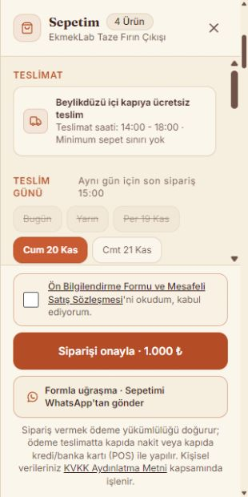
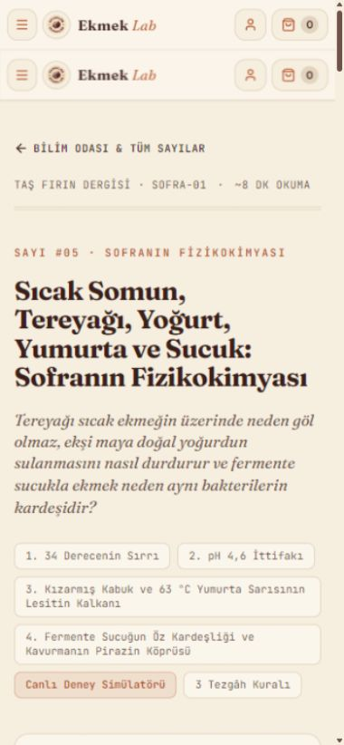
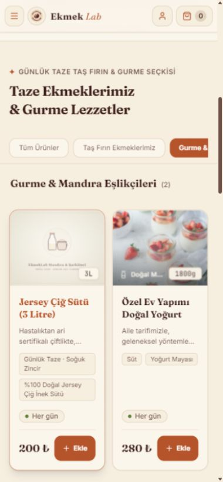

# EkmekLab kullanıcı arayüzü ve müşteri akışı inceleme raporu

**İnceleme tarihi:** 17 Kasım 2026  
**Belge durumu:** Tespit ve öneri raporu  
**Kapsam:** Müşteri vitrini ve sipariş yolculuğu  
**Hazırlayan:** Codex  
**Muhatap:** Tahsin ve EkmekLab geliştirme ekibi

## 1 Yönetici özeti

Öncelik, miktar ve fiyatın işlemle uyuşmasını ve teslim gününün bütün ekranlarda aynı biçimde anlaşılmasını sağlamaktır. Görsel kimlik güçlü bir temel sunarken, satın alma kararını etkileyen bazı davranışlar belirsizlik yaratmaktadır. Mobil sepetin sabit alt bölümü form alanını daraltmakta; kategori dönüşü, pencere odağı ve dergi sayfasındaki ortak arayüz tekrarları gezinmeyi zorlaştırmaktadır.

Toplam **22 bulgu** vardır: **10 yüksek**, **12 orta** öncelikli. Kanıt türleri **15 canlı gözlem**, **5 görsel değerlendirme**, **2 yalnız kod incelemesi** olarak ayrılmıştır. Bu sayılar bir başarı puanı veya birbirinden bağımsız kullanıcı testi sayısı değildir.

İlk müdahale, sepete yeniden ürün ekleyen inceleme düğmesi ve miktardan bağımsız sabit fiyat olmalıdır. Bunu teslim günü tutarlılığı ve değişiklik bildirimi, mobil form yerleşimi, kategori dönüşü, pencere odağı ve çift menü sorunu izlemelidir. Öncelikler uzman değerlendirmesidir; dönüşüm kaybı ölçülmemiştir.

## 2 Yöntem ve inceleme sınırları

Rapor, bu sohbet kapsamında 17 Kasım 2026 tarihinde yapılan canlı tarayıcı gözlemleri ve yerel kaynak kodu incelemesinden hazırlanmıştır. Raporlaştırma sırasında yeni canlı test yapılmamıştır. Muhatap, EkmekLab ürün ve geliştirme kararlarını veren Tahsin ve uygulamayı geliştirecek ekiptir. Hazırlayan Codex'tir.

İncelenen canlı yüzeyler:

- Anasayfa ve kategori filtreleri: https://ekmeklab.tr/
- Siyez ürününün modalı ve doğrudan sayfası: https://ekmeklab.tr/urun/yuzde-100-tas-degirmen-siyez-ekmegi
- Sepet, teslim günü, miktar, ödeme tercihi ve eksik form davranışları.
- Google giriş penceresi ve misafir devamı.
- Sipariş sorgulama ve boş durum: https://ekmeklab.tr/siparislerim
- Dergiden alışverişe geçiş: https://ekmeklab.tr/bilim/sayi/05

İnceleme sınırları:

- Gerçek sipariş oluşturulmadı; ödeme, Google girişi ve WhatsApp gönderimi tamamlanmadı. Boş sipariş formundaki deneme istemci doğrulamasında durdu.
- Başarı ekranı ve geçmiş siparişten tekrar sipariş bulguları yalnız kod incelemesine dayanır. Gerçek sipariş takibi, hesap içi adresler ve kurye adımları denenmedi.
- 1440 x 900 masaüstü ile 390 x 844 mobil görünümlerden örnekler incelendi. 320 x 640 kısa mobil görünüm özellikle sepet formu için kontrol edildi. Açık ve koyu tema örnekleri görüldü; bütün ekran ve tema birleşimleri taranmadı.
- Gerçek telefon, sanal klavye, ekran okuyucu, çoklu tarayıcı, ağ kesintisi, performans ve dönüşüm analitiği testi yapılmadı. Mobil klavye etkisi bir sonraki doğrulama adımıdır.
- Yerel çalışma ağacı ile canlı dağıtımın aynı revizyonda olduğu doğrulanmadı. Canlı bulgularda ekrandaki gözlem esas alındı. Dosya ve satır referansları yerel inceleme anına aittir.
- Ürün metinlerindeki oran ve içerik çelişkileri yalnız kullanıcıya sunulan bilginin tutarlılığı açısından ele alındı. Gerçek reçete ve bilimsel iddialar doğrulanmadı.
- Bu belge tespit ve öneri raporudur. Uygulama davranışları, canlı ürün ayarları ve veritabanı değiştirilmedi. Deneme sepeti temizlendi ve geçici görünüm ayarları geri alındı.

**Kanıt etiketleri:** Canlıda doğrulandı bir etkileşimin veya görünür durumun gözlendiğini; Görsel değerlendirme tasarım yorumunu; Yalnız kod incelemesi canlıda çalıştırılmadan kaynak kodundan çıkarılan davranışı belirtir. Yüksek öncelik yanlış sipariş, temel gezinme veya erişilebilirlik riski; orta öncelik bilgi hiyerarşisi ve akış açıklığı gereksinimi anlamındadır.

## 3 Önerilen müşteri akışı

1. **Ürün seçimi:** Gerçek ürün fotoğrafı, kısa ad, gramaj, fiyat ve sıradaki uygun teslim günü birlikte görünür. Sepete ekleme sonrasında kullanıcı katalogda kalır.

2. **Sepet ve teslim günü:** Tam ürün adı, doğru ölçü birimi, miktar ve ortak teslim tarihi gösterilir. Sepetteki değişiklik teslim gününü etkilerse neden ve yeni tarih açıkça bildirilir.

3. **Teslimat ve onay:** Misafir devamı, ad soyad, telefon, mahalle ve açık adres; teslimatta ödeme, sözleşme ve tek ana onay eylemi. Son özette gün, saat aralığı ve toplam birlikte görünür.

4. **Takip ve tekrar sipariş:** Başarıda sipariş numarası ve teslim bilgisi sunulur. Ana işlem Siparişi Takip Et olur. Tekrar siparişte mevcut sepetin korunması veya değiştirilmesi açık bir tercihtir.

Bu sıra dört ayrı sayfa zorunluluğu değildir. Kısa form tek ekranda da çalışabilir; amaç tek doğal kaydırma alanı ve her aşamada açık bir ana eylemdir.

## 4 Öncelikli çalışma paketleri

### Önce işlem ve bilgi doğruluğu

UX-01, UX-02, UX-03, UX-04, UX-06, UX-09, UX-11.

Miktar, tutar, tarih, kategori ve ürün birimi tutarlılığı sağlanır. UX-22 için dolu sepetli tekrar sipariş senaryosu önce güvenli test verisiyle doğrulanır.

### Ardından temel arayüz davranışı

UX-05, UX-07, UX-08, UX-10, UX-13, UX-18, UX-20.

Mobil formun alan paylaşımı, ortak sayfa kabuğu, klavye odağı, ürün modalı ve katalog ritmi ele alınır.

### Sonra içerik ve sipariş sonrası deneyim

UX-12, UX-14, UX-15, UX-16, UX-17, UX-19, UX-21, UX-22.

Kartlar ve tanıtım sadeleşir, fotoğraflar tamamlanır, bilim ve alışveriş katmanları belirginleşir; takip ve tekrar sipariş davranışları netleştirilir.

Bu paketler uygulama onayı, iş emri veya süre taahhüdü değildir. İşler planlanırken kapsam ve doğrulama adımları ayrıca belirlenmelidir.

## 5 Bulguların ayrıntıları

### UX-01 Sepeti inceleme düğmesi yeniden ürün ekliyor

**Aşama:** Ürün inceleme  
**Öncelik:** Yüksek  
**Kanıt:** Canlıda doğrulandı

**Gözlem:** Boş sepette Siyez ürününün miktarını 2 yaptım ve Sepete Ekle ile 2 adet ekledim. Ardından Hemen Sipariş Ver & Sepeti İncele düğmesine bastım. Sepet 4 adede, toplam 1.000 ₺'ye çıktı.

**Kullanıcıya etkisi:** Sepetini kontrol etmeyi amaçlayan müşteri fazladan ürün ekleyebilir. İki ayrı niyet aynı düğme etiketinde birleşiyor.

**Önerilen düzeltme:** Sepete Ekle ve Sepeti Gör işlemlerini ayır. Sepeti Gör yalnız paneli açsın; miktarı değiştirmesin. Hemen Al korunacaksa etiketi ürün ekleyeceğini açıkça anlatsın.

**Düzeltme sonrası kontrol:** 2 adet ekledikten sonra Sepeti Gör'e basıldığında miktar 2 ve toplam 500 ₺ kalır.

**Kod referansı:** `src/components/storefront/ProductDetailClientActions.tsx:44`

### UX-02 Sabit sipariş düğmesinin fiyatı seçili miktarla eşleşmiyor

**Aşama:** Ürün inceleme  
**Öncelik:** Yüksek  
**Kanıt:** Canlıda doğrulandı

**Gözlem:** Miktar 2 olduğunda ana düğme Sepete Ekle (500 TL) gösterdi. Alttaki sabit Evine getirelim düğmesi 250 ₺ göstermeye devam etti. Bu düğme seçili miktarı ekleyen aynı işlemi çalıştırıyor.

**Kullanıcıya etkisi:** Kullanıcı düğmenin fiyatının birim fiyat mı, işlem toplamı mı olduğunu ayırt edemiyor.

**Önerilen düzeltme:** Sabit düğmede 2 adet · 500 ₺ göster. Birim fiyat ayrı ve açık bir etiketle sunulsun.

**Düzeltme sonrası kontrol:** Miktar değiştiğinde ana ve sabit düğmelerin işlem tutarları aynı anda güncellenir.

**Kod referansı:** `src/components/storefront/ProductDetailClientActions.tsx:59`

### UX-03 Kartın üretim günü ile sepetteki uygun gün farklı

**Aşama:** Teslimat  
**Öncelik:** Yüksek  
**Kanıt:** Canlıda doğrulandı

**Gözlem:** 17 Kasım 2026 incelemesinde Siyez kartı ve modalı Her Cumartesi · sıradaki 21 Kas diyordu. Aynı ürünün sepetinde Cum 20 Kas uygun ve seçiliydi; açıklama 20, 21 ve 27 Kasım tarihlerini sayıyordu. Doğrudan ürün sayfası ise Günlük Taş Fırın Üretimi ve Taze Üretimde / Mevcut ifadelerini gösteriyordu.

**Kullanıcıya etkisi:** Müşteri siparişin bugün mü, Cuma mı, Cumartesi mi teslim edileceğini farklı ekranlarda farklı yorumlayabilir.

**Önerilen düzeltme:** Kart, modal, ürün sayfası ve sepet aynı uygunluk kaynağından okunur tarih üretsin. Haftalık üretim ritmi ile belirli tarihlerdeki istisnalar ayrı ve anlaşılır gösterilsin.

**Düzeltme sonrası kontrol:** Bir üründe sıradaki uygun teslim tarihi bütün ekranlarda aynı görünür; sipariş verilebilir olması bugün stokta olduğu anlamına gelecek biçimde yazılmaz.

**Kod referansı:** `src/lib/ordering/saleDates.ts:103`

### UX-04 Sepet değişince teslim günü sessizce değişiyor

**Aşama:** Teslimat  
**Öncelik:** Yüksek  
**Kanıt:** Canlıda doğrulandı

**Gözlem:** Köy ekmeğiyle Bugün seçiliydi. Siyez ekledikten sonra uygunluk yanıtı tamamlanınca seçim 20 Kasım Cuma'ya geçti. Gün değiştiğine ilişkin ayrı bir bildirim görünmedi. Kod da seçili gün uygun değilse ilk uygun günü atıyor.

**Kullanıcıya etkisi:** Müşteri ilk seçtiği tarihin hâlâ geçerli olduğunu düşünebilir; günlük ekmek de özel ürünle ileri tarihe taşınır.

**Önerilen düzeltme:** Bu ürün nedeniyle teslimatınız 20 Kasım Cuma olarak güncellendi şeklinde kalıcı ve görünür bir açıklama sun. Son onayda tarih, saat aralığı ve tutarı birlikte göster.

**Düzeltme sonrası kontrol:** Sepet değişimi tarihi etkilediğinde değişiklik hem görünür metinle hem erişilebilir durum bildirimiyle anlaşılır.

**Kod referansı:** `src/components/cart/CartDrawer.tsx:99`

### UX-05 Mobil sabit alt bölüm formun alanını aşırı daraltıyor

**Aşama:** Sepet ve form  
**Öncelik:** Yüksek  
**Kanıt:** Canlıda doğrulandı

**Gözlem:** 390×844 ve özellikle 320×640 görünümünde sözleşme, onay düğmesi, WhatsApp düğmesi ve uzun bilgilendirme metni aynı sabit alt bölümde. Kısa ekranda bu bölüm ekranın yaklaşık yarısını kaplıyor. Hata metinleri çıkınca alan daha da büyüyor.

**Kullanıcıya etkisi:** Adres formunu küçük bir kaydırma penceresinde doldurmak gerekiyor. İçerik ile düğme bağlamı birbirinden uzaklaşıyor.

**Önerilen düzeltme:** Alt sabit alanda toplam ve tek ana işlem kalsın. Sözleşme ile bilgilendirme metinlerini formun doğal akışına taşı; metinleri gizleme veya kaldırma. Mobilde tam ekran, tek kaydırmalı sipariş görünümünü değerlendir.

**Düzeltme sonrası kontrol:** 320×640 ekranda adres alanları rahatça görülebilir; hata mesajları yazma alanını dar bir şeride indirmez. Gerçek mobil klavyeyle ayrıca doğrulanır.

**Kod referansı:** `src/components/cart/CartDrawer.tsx:827`

### UX-06 Menüde Ekmekler seçmek eşlikçi filtresini temizlemiyor

**Aşama:** Keşif ve katalog  
**Öncelik:** Yüksek  
**Kanıt:** Canlıda doğrulandı

**Gözlem:** Gurme & Mandıra Eşlikçileri filtresini seçtim. Ardından Atölye Menüsü içinden Ekmekler'e bastım. Adres #ekmekler oldu; ekranda seçili eşlikçi filtresi ve süt/yoğurt kartları kaldı.

**Kullanıcıya etkisi:** Gezinme komutu beklenen ürün grubunu göstermiyor; müşteri ekmekleri yeniden bulmak zorunda kalıyor.

**Önerilen düzeltme:** Ekmekler bağlantısı hem doğru filtreyi seçsin hem doğru yere kaydırsın. Kategori seçimi URL ve geri dönüş davranışıyla uyumlu olsun.

**Düzeltme sonrası kontrol:** Herhangi bir filtreden menüde Ekmekler seçildiğinde ekmekler görünür. Eşlikçiler bağlantısı için de karşılıklı kontrol yapılır.

**Kod referansı:** `src/components/storefront/ProductCatalog.tsx:180`

### UX-07 Dergi sayfasında üst menü ve alt bilgi iki kez görünüyor

**Aşama:** İçerikten alışverişe  
**Öncelik:** Yüksek  
**Kanıt:** Canlıda doğrulandı

**Gözlem:** /bilim/sayi/05 üzerinde mobilde iki üst menü üst üste göründü. Erişilebilirlik ağacında iki alt bilgi bölümü de vardı. Bilim layout'u ve sayı sayfası Navbar ile Footer'ı ayrı ayrı çiziyor.

**Kullanıcıya etkisi:** İlk ekranda alan kaybı, tekrarlanan gezinme durakları ve bitmemiş arayüz hissi oluşuyor.

**Önerilen düzeltme:** Ortak kabuğu tek yerde tut. Sayı sayfası yalnız yazı içeriğini çizsin; menü, alt bilgi ve alışveriş katmanı layout'tan gelsin.

**Düzeltme sonrası kontrol:** Sayı #05'te bir üst menü, bir ana içerik alanı ve bir alt bilgi bulunur; diğer dergi sayılarında da aynı kontrol yapılır.

**Kod referansı:** `src/app/bilim/sayi/[kod]/page.tsx:63`

### UX-08 Giriş penceresi açıkken klavye odağı arkadaki sayfaya geçiyor

**Aşama:** Hesap ve erişilebilirlik  
**Öncelik:** Yüksek  
**Kanıt:** Canlıda doğrulandı

**Gözlem:** Ürün sayfasında Giriş Yap penceresini açtım. Odak açan düğmede kaldı; Tab'a basınca modal içindeki Google düğmesi yerine arka plandaki sepet düğmesine geçti.

**Kullanıcıya etkisi:** Klavye kullanan kişi görünür pencerenin dışındaki kontrolleri dolaşıyor. Görünen ekran ile etkileşilen ekran ayrılıyor.

**Önerilen düzeltme:** Açılışta odağı pencereye taşı, dış içeriği etkisizleştir, kapatınca odağı açan düğmeye döndür. Aynı davranışı ürün, sepet ve menü pencerelerinde de ortak biçimde sağla.

**Düzeltme sonrası kontrol:** Giriş penceresinde Tab ve Shift+Tab yalnız pencere içini dolaşır; Escape kapatır ve odak başlangıç noktasına döner.

**Kod referansı:** `src/components/auth/AuthModal.tsx:170`

### UX-09 Ürün adı, açıklama ve içerik künyesi birbirini doğrulamıyor

**Aşama:** Ürün inceleme  
**Öncelik:** Yüksek  
**Kanıt:** Canlıda doğrulandı

**Gözlem:** Siyez ürününün adı %100 Taş Değirmen Siyez Ekmeği. Açıklama %20 çavdar ve %80 siyez diyor. Ayrıntılı içerik künyesinde yalnız Siyez Unu yazıyor.

**Kullanıcıya etkisi:** Müşteri ne aldığını anlamak için üç metinden hangisine güveneceğine karar vermek zorunda kalıyor. Buradaki bulgu ürün tanıtımındaki tutarlılıkla sınırlı; reçete doğrulaması yapılmadı.

**Önerilen düzeltme:** Gerçek reçete esas alınarak ad, kısa açıklama ve içindekiler tek ürün kaydından tutarlı sunulsun. Tasarım bütünlüğünden önce ürün kimliği netleşsin.

**Düzeltme sonrası kontrol:** Ürün oranları ve un listesi kart, modal, ürün sayfası ve künye boyunca birbiriyle çelişmez.

**Kod referansı:** `src/app/urun/[slug]/page.tsx:1`

### UX-10 Mobil ürün modalında büyük görsel dar bir metin alanı bırakıyor

**Aşama:** Ürün inceleme  
**Öncelik:** Orta  
**Kanıt:** Canlıda doğrulandı

**Gözlem:** 390×844 görünümünde Siyez görseli modalın üst bölümünün büyük kısmını kapladı; başlık, fiyat ve metin alttaki ayrı kaydırma alanında kaldı. Sepete Ekle'ye ulaşmak için bu küçük alanı kaydırdım. Aynı üretim günü görselde, rozetlerde ve bilgi kutusunda tekrarlandı. Mobil modalda gramaj özeti görünmedi.

**Kullanıcıya etkisi:** Ürün miktarı, teslim günü ve ekleme işlemi bir arada değerlendirilemiyor; kaydırma davranışı alışıldık sayfa akışından ayrılıyor.

**Önerilen düzeltme:** Mobilde tek kaydırma alanı kullan; görseli kısalt; ad, gramaj, fiyat ve uygun günü birlikte göster. Miktar ile ekleme kontrolünü kolay erişilir tut. Üretim gününü bir kez açıkça anlat.

**Düzeltme sonrası kontrol:** İlk modal ekranında ürün adı, gramaj ve fiyat bulunur; CTA'ya tek doğal kaydırmayla erişilir.

**Kod referansı:** `src/components/storefront/ProductModal.tsx:160`

### UX-11 Sütün birimi sepette gram olarak değişiyor

**Aşama:** Sepet ve form  
**Öncelik:** Orta  
**Kanıt:** Canlıda doğrulandı

**Gözlem:** Jersey Çiğ Sütü kartında 3L yazarken sepet satırında 3000 gr · 200 ₺ göründü. Sepet her ürüne gr ekliyor.

**Kullanıcıya etkisi:** Ürün miktarı ve ölçü birimi tutarsızlaşıyor. Kullanıcı başka paket seçtiğini düşünebilir.

**Önerilen düzeltme:** Ürünün ölçü birimini sepet verisinde koru; 3 L, 1.000 g ve adet gösterimlerini ortak biçimlendir.

**Düzeltme sonrası kontrol:** 3 L süt bütün alışveriş ekranlarında 3 L olarak görünür; gram ve adet ürünleri de kendi birimini korur.

**Kod referansı:** `src/components/cart/CartDrawer.tsx:453`

### UX-12 Mobil açılışta ürün görmeden uzun bir tanıtım geçiliyor

**Aşama:** Keşif ve katalog  
**Öncelik:** Orta  
**Kanıt:** Görsel değerlendirme

**Gözlem:** İlk mobil ekran atölye fotoğrafı, uzun tanıtım, iki CTA ve teslimat şeridiyle doluyor. Ürün kartı ilk ekranın altında kalıyor.

**Kullanıcıya etkisi:** Sipariş için gelen ziyaretçinin ürün ve fiyat görmesi gecikiyor. Bu bir kullanılabilirlik değerlendirmesidir; dönüşüm kaybı ölçülmedi.

**Önerilen düzeltme:** Tanıtımı kısalt; ücretsiz teslimat ve minimum sepet bilgisini tek satırda ana eyleme yaklaştır. Ekmeği gösteren bir ana görsel ya da ilk ürünün başlangıcını daha erken sun.

**Düzeltme sonrası kontrol:** 390×844'te ziyaretçi ilk ekranda ne satıldığını ve siparişe nasıl geçeceğini hızla anlayabilir; ürün seçimine tek açık eylemle ulaşır.

**Kod referansı:** `src/components/atelier/AtelierThresholdHero.tsx:39`

### UX-13 Kategori seçince katalog düzeni tamamen değişiyor

**Aşama:** Keşif ve katalog  
**Öncelik:** Orta  
**Kanıt:** Canlıda doğrulandı

**Gözlem:** Tüm Ürünler yatay büyük raflar kullanıyor. Bir kategori seçince mobilde iki dar sütuna geçiliyor. Aynı ürünlerin fotoğrafı ve metin alanı belirgin biçimde küçülüyor; kategori şeridinin tamamı aynı anda görünmüyor.

**Kullanıcıya etkisi:** Kullanıcı filtreleme sonrasında aynı ürünleri yeniden tanımak ve yerlerini yeniden öğrenmek zorunda kalıyor.

**Önerilen düzeltme:** Bütün kategorilerde tutarlı bir mobil kart ailesi kullan. Güncel kısa katalogda tüm seçeneklerin dikey görülebileceği kompakt bir düzeni değerlendir. Yatay raf korunursa tüm grubu görme eylemini açık sun.

**Düzeltme sonrası kontrol:** Kategori değişimi ürünlerin etkileşim biçimini ve temel bilgi ölçeğini değiştirmez; kategoriye geri dönüş görünürdür.

**Kod referansı:** `src/components/storefront/ProductCatalog.tsx:319`

### UX-14 Kartlarda karar bilgileri ile teknik ayrıntılar yarışıyor

**Aşama:** Keşif ve katalog  
**Öncelik:** Orta  
**Kanıt:** Görsel değerlendirme

**Gözlem:** Hidrasyon, un etiketleri, gramaj, kesilen açıklama ve tekrar eden üretim günleri kartta birlikte bulunuyor. Metinlerin önemli kısmı 11-12 px sınıflarında. Ekmek kartları, iki ürünlü eşlikçi satırından farklı büyüklükte.

**Kullanıcıya etkisi:** Ürünleri taramak ve fiyat/gramaj/gün karşılaştırmak güçleşiyor; ayrıntı yoğunluğu temel karar bilgisini bastırıyor.

**Önerilen düzeltme:** Kartta fotoğraf, kısa ürün adı, gramaj, fiyat, uygun gün ve ekleme düğmesini öne al. Teknik bilgiyi detayda sun; ana metni daha rahat okunur ölçüye çıkar.

**Düzeltme sonrası kontrol:** Kart başına ürün kimliği, miktar, fiyat ve gün tek bakışta seçilir; aynı bilgi iki kez tekrarlanmaz.

**Kod referansı:** `src/components/storefront/ProductCard.tsx:354`

### UX-15 Ürün fotoğraflarının temsil ve çekim dili eşit değil

**Aşama:** Keşif ve katalog  
**Öncelik:** Orta  
**Kanıt:** Görsel değerlendirme

**Gözlem:** Sütte yer tutucu çizim, yoğurtta çilekli servis fotoğrafı, ekmeklerde farklı sunum fotoğrafları var. Fotoğrafların gerçek ürünle birebir eşleştiği doğrulanmadı.

**Kullanıcıya etkisi:** Vitrinin tamamlanmışlık hissi zayıflıyor; özellikle sade yoğurt teslim ediliyorsa meyveli fotoğraf farklı beklenti yaratabilir.

**Önerilen düzeltme:** Gerçekte teslim edilen ürün ve ambalajı aynı ışık, fon ve ölçekle çek. Servis önerisini asıl ürün fotoğrafından ayır.

**Düzeltme sonrası kontrol:** Her kart teslim edilen ürünü doğru temsil eden ana fotoğraf taşır; servis sunumu yanıltıcı beklenti oluşturmaz.

**Kod referansı:** `src/components/storefront/SafeProductImage.tsx:1`

### UX-16 Alışveriş kararı ile derin bilim okuması aynı uzun akışta

**Aşama:** Ürün inceleme  
**Öncelik:** Orta  
**Kanıt:** Görsel değerlendirme

**Gözlem:** Doğrudan ürün sayfasında reçete künyesi, çok sayıda bilim bağlantısı ve geniş simülatör alanı; ardından anlatı ve eşlikçi önerileri var. Eşlikçiler basit ekleme yerine ayrı İncele bağlantılarıyla açılıyor.

**Kullanıcıya etkisi:** Bilimsel derinlik değer katıyor; fakat kısa sürede ürün seçen müşteri için temel karar ile merak amaçlı okuma birbirine karışıyor. Tamamlayıcı ürün keşfi çok aşağıda kalıyor.

**Önerilen düzeltme:** Üstte alışveriş özeti ve en fazla birkaç ilgili eşlikçi; ardından isteyenin açabileceği üretim ve bilim ayrıntıları sun. Bilim içeriğini koruyup okuma niyetine göre katmanlandır.

**Düzeltme sonrası kontrol:** Müşteri bilim bölümünü dolaşmadan miktar, teslim günü ve ilgili eşlikçiyi değerlendirebilir; derin içerik ayrı bir açık eylemle erişilebilir kalır.

**Kod referansı:** `src/app/urun/[slug]/page.tsx:1`

### UX-17 WhatsApp alternatifi ana sipariş akışıyla rekabet ediyor

**Aşama:** Sepet ve form  
**Öncelik:** Orta  
**Kanıt:** Görsel değerlendirme

**Gözlem:** Onay düğmesinin hemen altında Formla uğraşma · Sepetimi WhatsApp'tan gönder yazıyor. Bu ifade ana formun zahmetli olduğunu vurguluyor. Bağlantı mesaj hazırlama yoluna götürüyor; WhatsApp'ta gönderim yapılmadı.

**Kullanıcıya etkisi:** Kullanıcı siparişin sitede mi, WhatsApp'ta mı kesinleşeceğini ayırt etmekte zorlanabilir. Mesaj hazırlamak otomatik sipariş kaydıyla eşdeğer görünmemeli.

**Önerilen düzeltme:** WhatsApp ile sipariş desteği gibi tarafsız bir ikincil etiket kullan. WhatsApp yolunda onayın nasıl alınacağını açık anlat; ana formun tek belirgin tamamla eylemi olsun.

**Düzeltme sonrası kontrol:** Web siparişi ve WhatsApp desteğinin sonuçları birbirinden açıkça anlaşılır; iki farklı eylem aynı kesinleşme beklentisini oluşturmaz.

**Kod referansı:** `src/components/cart/CheckoutActions.tsx:267`

### UX-18 Misafir devamı bilgi olarak var, eylem olarak yok

**Aşama:** Hesap ve erişilebilirlik  
**Öncelik:** Orta  
**Kanıt:** Canlıda doğrulandı

**Gözlem:** Giriş penceresinde Google ile Devam Et düğmesi ve hesap açmadan da sipariş verilebileceğini belirten metin var. Misafir Olarak Devam Et düğmesi yok; kullanıcı pencereyi X ile kapatmalı.

**Kullanıcıya etkisi:** Google hesabı kullanmak istemeyen kişi çıkış yolunu kendisi çözmek zorunda kalıyor; hesap açmanın zorunlu olduğunu düşünebilir.

**Önerilen düzeltme:** Misafir Olarak Devam Et düğmesi pencereyi kapatıp kullanıcının önceki alışveriş adımına dönsün. Giriş işleminin avantajını adres kaydetme ve tekrar siparişle sade anlat.

**Düzeltme sonrası kontrol:** Google'a gitmeden görünür bir misafir devam eylemiyle aynı sepet ve form bağlamına dönülür.

**Kod referansı:** `src/components/auth/AuthModal.tsx:170`

### UX-19 Sipariş takibine erişim ve düğme adları tutarlı değil

**Aşama:** Sipariş sonrası  
**Öncelik:** Orta  
**Kanıt:** Canlıda doğrulandı

**Gözlem:** Misafir için Sipariş Sorgula bağlantısı alt bilgide bulundu. Açılan sayfanın başlığı Siparişlerim; takip kodunu açan düğme Fişi Aç. Menüde misafire doğrudan sipariş takip bağlantısı görünmedi. Geçersiz kodda açıklayıcı hata ve ürünlere dönüş vardı.

**Kullanıcıya etkisi:** Takip, geçmiş sipariş ve fiş farklı işler gibi algılanıyor; geri dönen misafir aradığı işlemi geç bulabilir.

**Önerilen düzeltme:** Menüde Siparişimi Takip Et'i misafire de göster. Kod alanının düğmesini Siparişi Bul veya Takibi Aç yap; fiş indirmeyi takip içindeki ayrı işlem olarak adlandır.

**Düzeltme sonrası kontrol:** Misafir menüden tek açık eylemle takip alanına ulaşır; düğme adı gideceği ekranı doğru tarif eder.

**Kod referansı:** `src/app/siparislerim/page.tsx:302`

### UX-20 Masaüstünde her ekleme alışverişi ödeme paneline taşıyor

**Aşama:** Sepet ve form  
**Öncelik:** Orta  
**Kanıt:** Canlıda doğrulandı

**Gözlem:** Masaüstünde katalogdan ürün ekleyince sepet/teslimat/adres paneli açıldı. Kod bu otomatik açılışı 768 px ve üzeri için yapıyor. Mobilde panel açılmıyor; alttaki sepet özeti güncelleniyor.

**Kullanıcıya etkisi:** Masaüstünde çok ürün seçerken her eklemeden sonra paneli kapatmak gerekiyor; eşlikçi seçme ritmi kesilebiliyor.

**Önerilen düzeltme:** Masaüstünde de kısa Eklendi bildirimi ve güncellenen sepet özetiyle alışverişi sürdür. Paneli kullanıcının Sepeti Gör eylemi açsın. Alternatif olarak panelde belirgin Alışverişe Devam Et sun.

**Düzeltme sonrası kontrol:** Arka arkaya ekmek, süt ve yoğurt eklemek için her ürün arasında panel kapatmak gerekmez.

**Kod referansı:** `src/lib/store/useCartStore.ts:84`

### UX-21 Başarı ekranında takip yerine destek öne çıkıyor

**Aşama:** Sipariş sonrası  
**Öncelik:** Orta  
**Kanıt:** Yalnız kod incelemesi

**Gözlem:** Başarı modalının kodunda Siparişiniz alındı, tarih, ödeme ve toplam mevcut. İlk büyük eylem WhatsApp'tan Yazın; Siparişi Takip Et aşağıdaki ikincil sırada. Gerçek sipariş oluşturulmadığı için bu ekran canlıda açılmadı.

**Kullanıcıya etkisi:** Siparişi tamamlayan müşteri sıradaki işin destek mesajı göndermek olduğunu düşünebilir.

**Önerilen düzeltme:** Ana eylemi Siparişi Takip Et yap. WhatsApp'ı Sorun varsa bize yazın gibi ikincil destek konumunda tut; yeniden onay gerektiği izlenimi verme.

**Düzeltme sonrası kontrol:** Başarı ekranı siparişin kaydedildiğini, ne zaman geleceğini ve nasıl izleneceğini ilk bakışta anlatır.

**Kod referansı:** `src/components/cart/OrderSuccessModal.tsx:80`

### UX-22 Tekrar sipariş mevcut sepetin yerine geçiyor

**Aşama:** Sipariş sonrası  
**Öncelik:** Yüksek  
**Kanıt:** Yalnız kod incelemesi

**Gözlem:** applyReorder mevcut ürünlerle birleştirmeden items alanını geçmiş siparişin ürünleriyle değiştiriyor. Siparişlerim ve hızlı tekrar sipariş çağrılarında öncesinde bir tercih veya geri al adımı görünmüyor. Sipariş geçmişi olmayan test oturumunda bu yol canlıda denenmedi.

**Kullanıcıya etkisi:** Geri dönen müşteri daha önce seçtiği yeni ürünleri kaybedebilir; Tekrar Sipariş Ver'in sepete ekleme mi yoksa değiştirme mi yaptığı açık değil.

**Önerilen düzeltme:** Sepet doluyken Mevcut sepete ekle / Sepeti bu siparişle değiştir seçeneklerini sun veya açık bir değiştirme bildirimi ve geri al eylemi sağla.

**Düzeltme sonrası kontrol:** Dolu sepetle tekrar sipariş başlatıldığında eski seçimler habersiz kaybolmaz; boş sepette hızlı yol korunur.

**Kod referansı:** `src/lib/store/useCartStore.ts:193`

## 6 Korunması gereken güçlü yanlar

- Serif başlıklar, sıcak renkler, ekmek görselleri ve ekmek ile eşlikçi ayrımı marka kimliğini taşıyor.
- Mobil ana vitrindeki sepet çubuğu toplamı ve teslimat bilgisini görünür tutuyor; ürün eklemede kullanıcı mobil katalogda kalabiliyor.
- Misafir siparişi mümkün. Form etiketleri, telefon klavyesi ve otomatik doldurma ipuçları var. Eksik formda alan hataları çıkıyor ve odak ilk eksik alana taşınıyor.
- Teslimatta nakit ve kart seçenekleri, genel toplam ve ücretsiz teslimat bilgisi açık. Boş sepetten ürünlere dönüş sağlanıyor.
- Sipariş sorgulamada kod veya takip bağlantısı kabul ediliyor; yanlış biçimde açıklayıcı hata sunuluyor. Bilim yazısından eşlikçi kataloğuna bağlantı çalışıyor.

## 7 Düzeltme sonrası kabul kontrolü

- [ ] 2 adet ürün eklenip Sepeti Gör seçildiğinde miktar 2 ve toplam aynı kalır.
- [ ] Seçili miktar değişince ana ve sabit sipariş düğmelerinin işlem toplamları birlikte güncellenir.
- [ ] Kart, ürün modalı, ürün sayfası ve sepette sıradaki uygun teslim tarihi uyuşur; tarih değişikliği ayrıca açıklanır.
- [ ] Eşlikçi filtresinden menüde Ekmekler seçildiğinde ekmekler görünür; ters yönde de doğru grup seçilir.
- [ ] 320 x 640 görünümünde ve gerçek mobil klavye açıkken adres alanı ile hata mesajları rahatça görülebilir.
- [ ] Giriş penceresinde Tab ve Shift Tab dış sayfaya çıkmaz; kapatınca odak açan kontrole döner.
- [ ] Dergi sayfalarında yalnız bir üst menü ve bir alt bilgi bulunur.
- [ ] 3 L süt sepet ve ürün ekranlarında aynı birimle görünür; ürün adı ile içerik künyesi çelişmez.
- [ ] Dolu sepetle tekrar sipariş başlatıldığında mevcut ürünler habersiz kaybolmaz.

Bu maddeler henüz tamamlanmış testler değildir. Düzeltmeler uygulandıktan sonra çalıştırılacak doğrulama senaryolarıdır.

## 8 Ekran görüntüsü kanıtları

### Kısa mobil ekranda sepet

320 x 640 görünümünde sabit sözleşme, onay, WhatsApp ve bilgilendirme bölümü form alanını daraltıyor. İlgili bulgu UX-05.

### Dergi sayfasında iki üst menü

390 x 844 görünümünde Sayı 05 sayfasının üstünde iki gezinme çubuğu görünüyor. İlgili bulgu UX-07.

### Kategori seçilince küçülen kartlar

390 x 844 görünümünde eşlikçi kategorisi iki dar sütunda açılıyor; tüm ürünlerdeki yatay raftan farklı bir düzen kullanılıyor. İlgili bulgu UX-13.

## 9 Başvurulan arayüz rehberleri

Rehberler normatif ve tasarımsal çerçeve sağlar; canlı gözlemin yerine geçmez. Modern Web Guidance kapsamında forms ve validate-input-after-interaction rehberleri incelenmiştir.

- [W3C WAI Modal Dialog Pattern](https://www.w3.org/WAI/ARIA/apg/patterns/dialog-modal/)
- [Vercel Web Interface Guidelines](https://raw.githubusercontent.com/vercel-labs/web-interface-guidelines/main/command.md)
- [Modern Web Guidance](https://github.com/GoogleChrome/modern-web-guidance)

## 10 Önceki değerlendirmeye ilişkin düzeltme

İlk yorumdaki ürün adının kesin olarak ayrı sayfaya götürdüğü ifadesi canlı davranış olarak geri alınmıştır. Ayrıntılı incelemede ürün adına dokunmak da modal açmıştır. Doğrudan ürün adresiyle erişilen ayrı bir detay sayfası da vardır. Bu iki yüzeyin varlığı doğrulanmış, yerel kod ile canlı revizyon eşliği doğrulanmamıştır.
